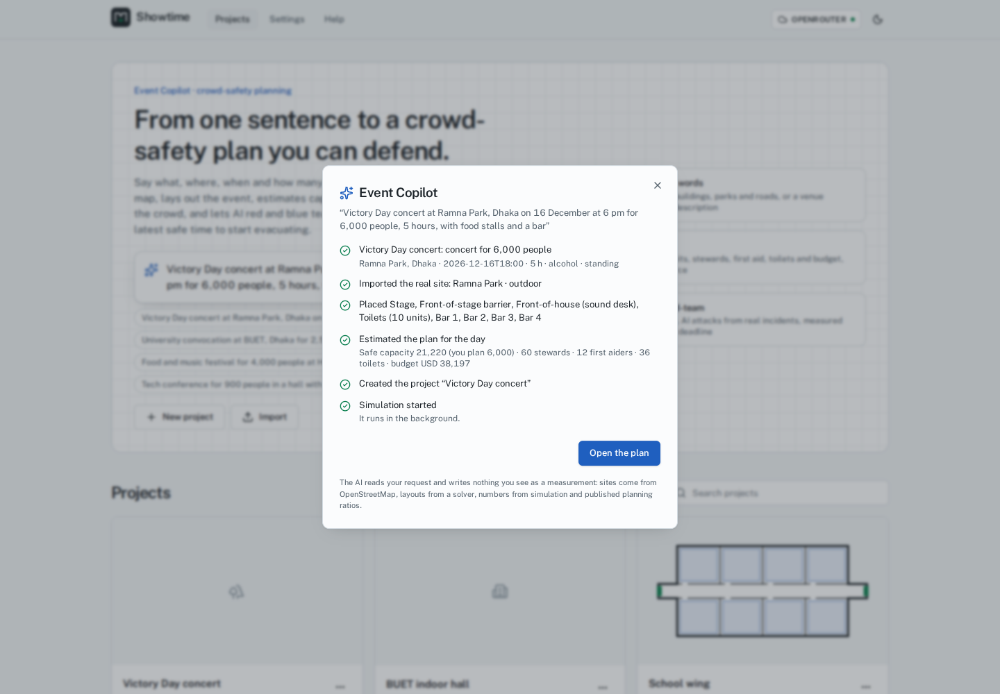

# Showtime: Red Team Night

**Will everyone get out safely? Test your event before the gates open.**

Showtime is a crowd-safety planning studio for event organizers who can't afford a consultant.
Pick your venue on a map, and AI red-team agents (NVIDIA Nemotron) write new crowd-disaster
scenarios as code. Each runs in its own sealed sandbox against a real crowd simulator (JuPedSim).
AI fixes are simulated again, the worst moment can be rewound to test responses from the same
second, and you get a tested plan, a report and a handover checklist. Every number comes from the
simulator, never from the AI. **[Read the pitch, the evidence and the limits](nebius/docs/PITCH.md)**
· [Demo script](nebius/docs/DEMO.md) · [Simulator validation](nebius/docs/VALIDATION.md)

**Engineering novelty, with the papers behind it and numbers measured here:** a red team that
fills a *failure map* by quality-diversity search, judged by physics, not by a language model
(after Rainbow Teaming, NeurIPS 2024); crowd-pressure turbulence warnings (Helbing et al. 2007);
whole multi-storey buildings from one sentence; and a simulated people mix (older people,
children, wheelchair users, patients in beds). See
[Engineering novelty](nebius/README.md#engineering-novelty-and-the-papers-behind-it).

## The problem

Planning a safe event is slow, expensive and specialist work. Someone draws the site and works
out capacity, exits, stewards and toilets from planning guides. For the few events that can
afford it, a consultant builds a crowd model in simulation software and runs a handful of
scenarios. Most organizers skip the simulation, and on the night they manage the crowd by instinct.
Itaewon (2022): 159 deaths in a 3.2 m alley. Indiana State Fair (2011): a stage roof fell in a
59 mph gust.

## Our answer: let AI do the work, with simulators that already exist

Showtime automates event safety planning. AI agents running on **NVIDIA Nemotron** take one sentence and do the
following. Today they run on your GPU. The **Nebius Token Factory** adapter is built, and the
live test is pending.

1. **Build the venue**: the real site from OpenStreetMap, or a layout designed from a description.
2. **Plan for the day**: safe capacity, exits, stewards, first aid, toilets, fencing and budget
   from published planning guides, every ratio cited.
3. **Simulate**: the agents drive existing, proven simulation software instead of guessing.
   [JuPedSim](https://www.jupedsim.org) (Forschungszentrum Jülich) simulates the crowd,
   [PedPy](https://pedpy.readthedocs.io) measures it, [Pynite](https://github.com/JWock82/Pynite)
   checks the stage frame and [Open-Meteo](https://open-meteo.com) supplies the wind forecast.
4. **Break it and fix it (Red Team Night)**: AI attackers try scenarios grounded in 388 real
   crowd incidents, and AI defenders propose fixes. Each fix is re-simulated, and only measured
   improvements are kept.
5. **Hand over**: a report with **the latest safe time to start evacuating**, an evacuation map
   and a data bundle.

**Cost efficient by design.** A small model handles drafting and a larger one handles edits and
fixes. The largest model is used only for the final judgement. Millisecond instant estimates
screen scenarios before any simulation runs. Results are cached by content, and every session
has token, run and time budgets. A live cost meter shows what each step costs.

> Planning aid, not a safety certification.

**Status and roadmap.** Everything above works locally today (see [HANDOFF](nebius/docs/HANDOFF.md)).
The plan to the hackathon deadline is in [plan.md](plan.md). It covers running live on Nebius,
a one-click Autopilot, a simpler three-screen UI, measured cost per plan and a public demo.



The full product description, screenshots and how NVIDIA Nemotron, Nebius Token Factory and
Nebius Sandboxes are used are in [nebius/README.md](nebius/README.md).

## Repository layout

```
.
├── README.md             # this file
├── requirements.txt      # Python API dependencies for a plain pip install
└── nebius/               # the application
    ├── api/              # FastAPI backend: agents, orchestrator, adapters, core, SQLite (uv project)
    ├── sim/              # simulation sandbox image: JuPedSim + PedPy
    ├── web/              # Vite + React + React Three Fiber frontend
    ├── plugins/          # built-in feature plugins (hazards, exporters, importers, rules, ...)
    ├── scripts/          # setup, model download, probes, smoke tests, demo precompute
    ├── config/           # plugin feature flags
    ├── docs/             # architecture, assumptions, user and testing guides, ADRs
    ├── Makefile          # all common tasks (`make help`)
    ├── docker-compose.yml
    └── .env.example      # configuration template
```

## Requirements

| Requirement | Version / notes |
| --- | --- |
| OS | Linux (x86_64) |
| Python | 3.12 (installed for you by `make setup` via uv) |
| Node.js | 20 or 22 LTS (frontend) |
| Docker | with Docker Compose v2; runs the app stack and the simulation sandbox |
| NVIDIA GPU | ~7 GB free VRAM for the local Nemotron Nano 9B v2 model (not needed with `LLM_PROVIDER=nebius`) |
| RAM | 16 GB recommended |
| Optional keys | `NEBIUS_API_KEY` (Token Factory / Sandboxes), `TAVILY_API_KEY` (live web evidence) |

Python packages are listed in [requirements.txt](requirements.txt) (mirrors
[nebius/api/pyproject.toml](nebius/api/pyproject.toml)); simulator packages are pinned in
[nebius/sim/requirements.txt](nebius/sim/requirements.txt) and installed into the sim image.
Frontend packages are in [nebius/web/package.json](nebius/web/package.json).

## Quickstart

```bash
cd nebius
cp .env.example .env
make setup        # uv, Python 3.12, API + web deps, sim image, llama.cpp, Nemotron GGUF, data
make llm-up       # local Nemotron Nano 9B v2 on the GPU
make up           # Docker Compose → http://localhost:5173  (API docs: http://127.0.0.1:8000/api/docs)
```

Three sample projects (an Itaewon-style alley, a two-floor hall and a festival field in a storm)
install automatically with finished red-team sessions, so you can explore right away.

Without Docker for the app: `make dev` runs the API and the Vite dev server natively.

### Plain pip instead of uv

```bash
python3.12 -m venv .venv && source .venv/bin/activate
pip install -r requirements.txt
cd nebius
export PYTHONPATH="$PWD"
(cd api && python -c "from api.db.session import migrate; migrate()")
(cd api && uvicorn api.app.main:app --host 127.0.0.1 --port 8000)
```

Simulations still need the sandbox image: `make build-sim` (from `nebius/`).

### Switch to Nebius

Set `LLM_PROVIDER=nebius`, `SANDBOX_PROVIDER=nebius`, `NEBIUS_API_KEY` and the `MODEL_*` ids in
`nebius/.env`, then run `make smoke-nebius`. Details: [nebius/docs/NEBIUS_SWITCH.md](nebius/docs/NEBIUS_SWITCH.md).

## Common tasks

Run from `nebius/`:

| Command | What it does |
| --- | --- |
| `make help` | List all targets |
| `make check` | Lint, typecheck and fast unit tests |
| `make test` | Full Python tests, including simulation tests (needs Docker) |
| `make test-web` | Frontend unit tests |
| `make smoke` | End-to-end smoke test against the running API |
| `make down` / `make llm-down` | Stop the stack / the local model |

## Documentation

[User guide](nebius/docs/USER_GUIDE.md) · [Testing guide](nebius/docs/TESTING_GUIDE.md) ·
[Architecture](nebius/docs/ARCHITECTURE.md) · [Extending](nebius/docs/EXTENDING.md) ·
[Assumptions](nebius/docs/ASSUMPTIONS.md) · [Security](nebius/SECURITY.md) ·
[Contributing](nebius/CONTRIBUTING.md) · [Licences](nebius/docs/LICENSES.md)

## License

Apache-2.0, see [nebius/LICENSE](nebius/LICENSE).
