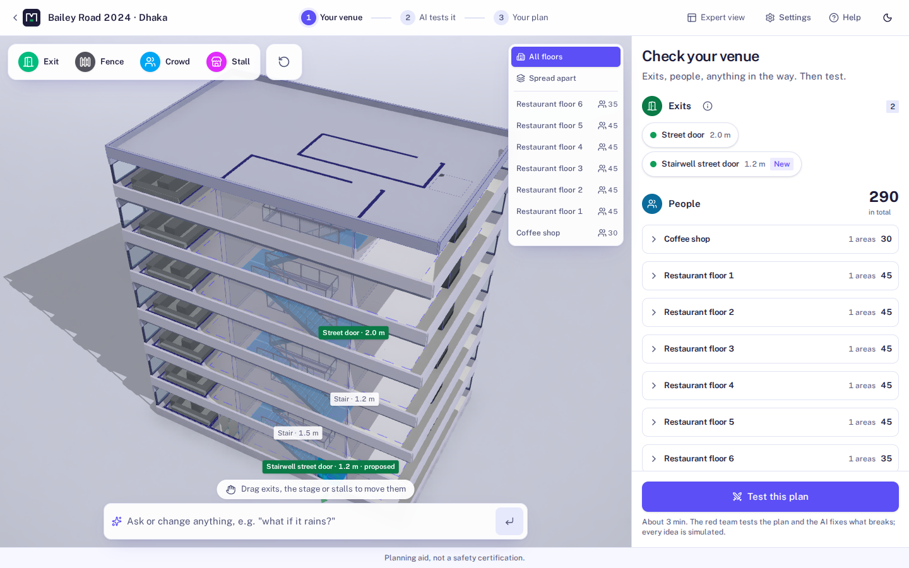
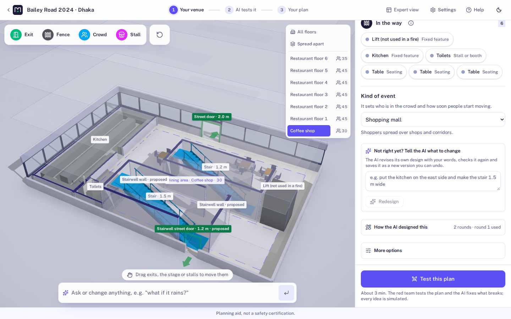
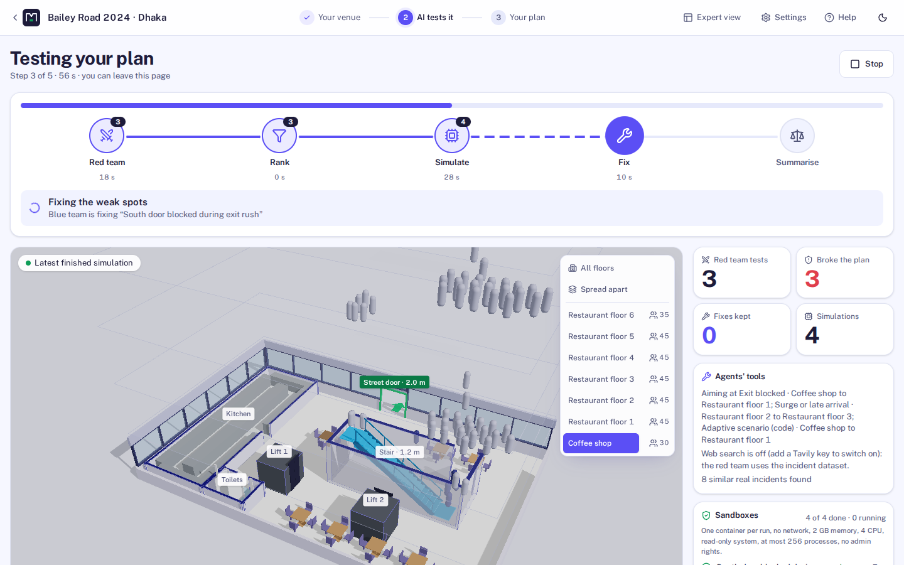
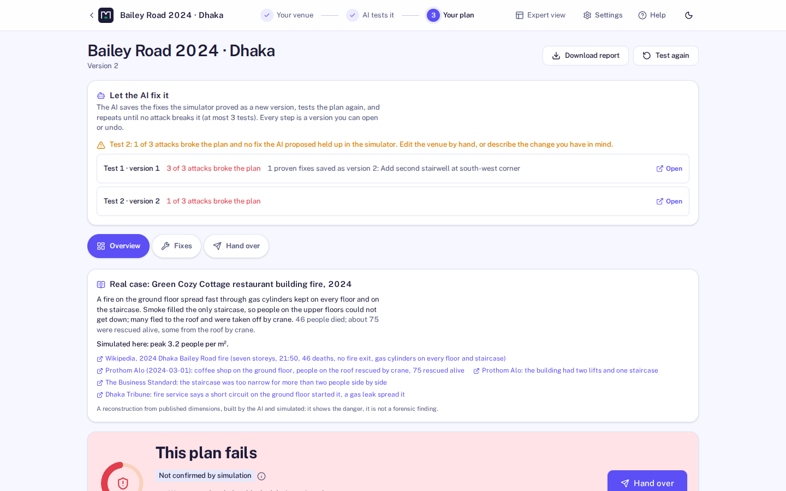
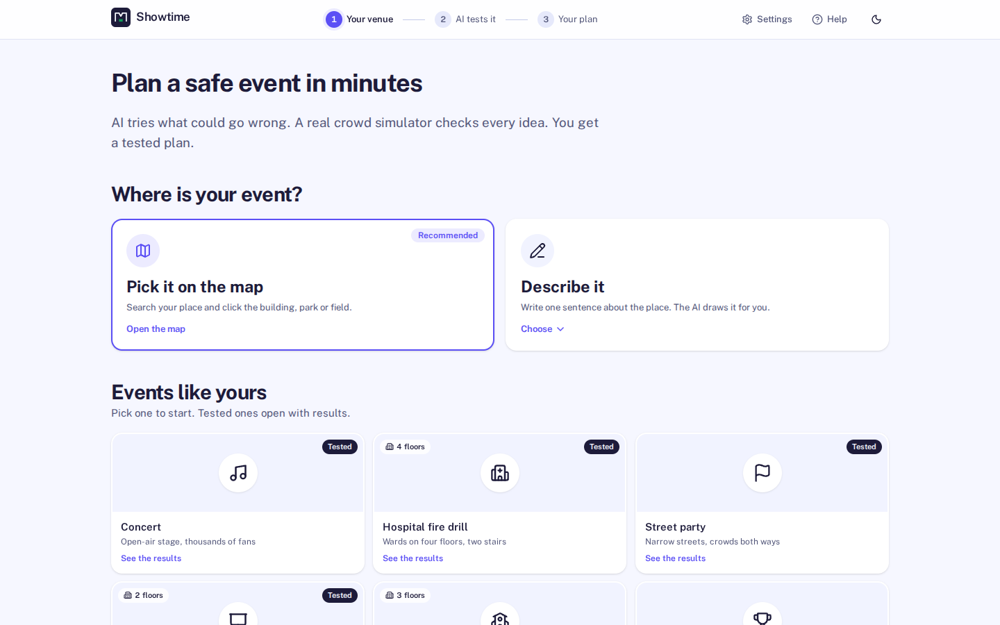
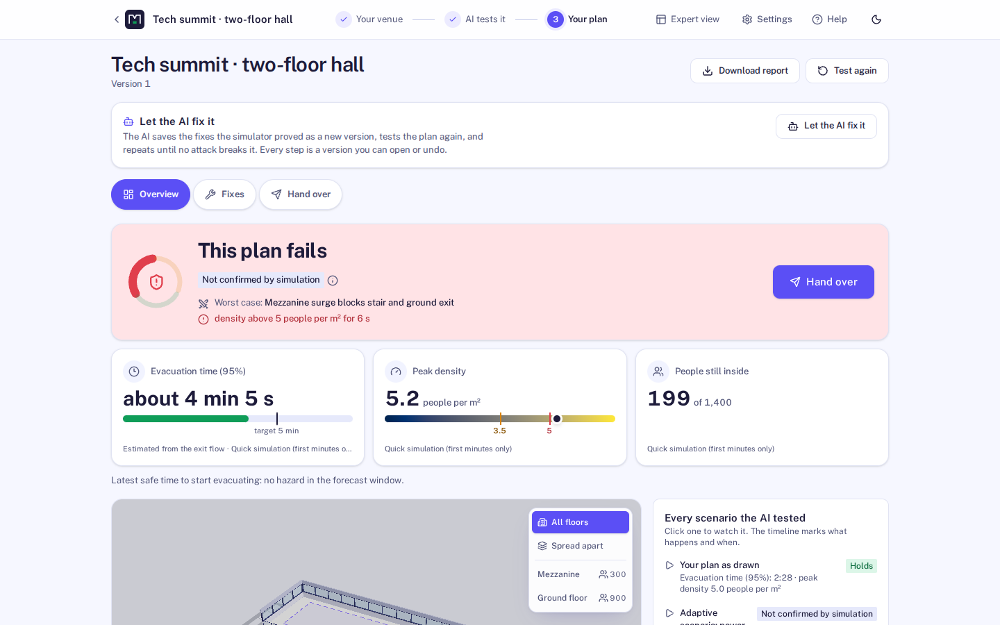
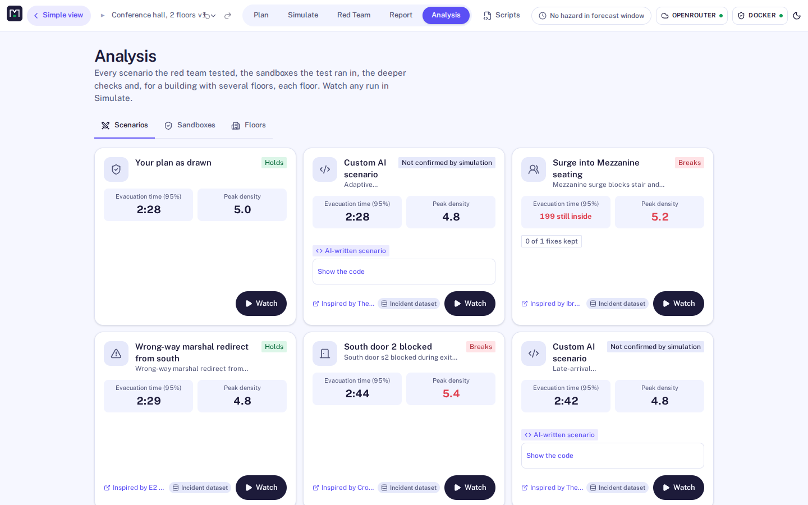
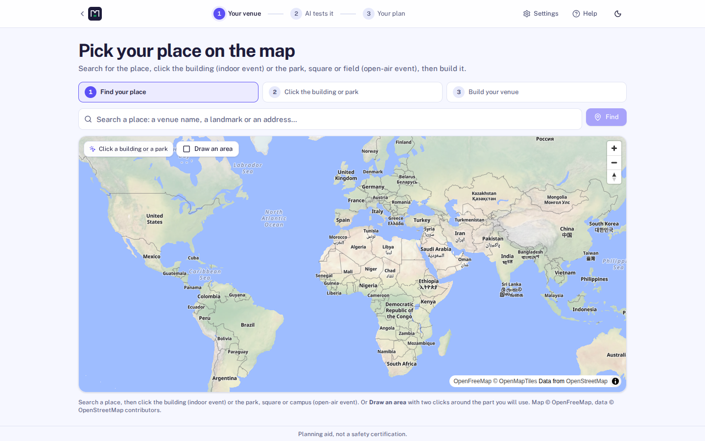
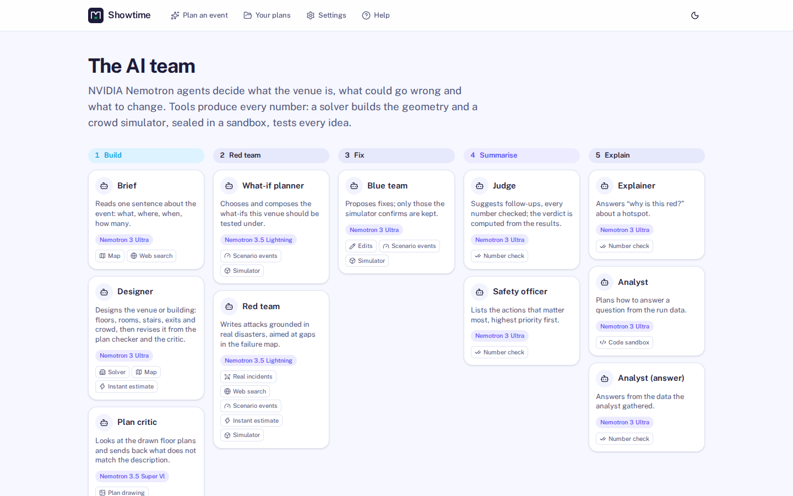
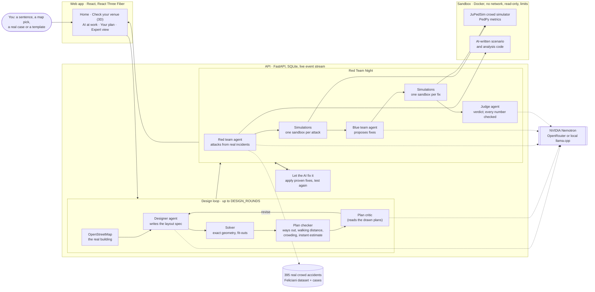

# Showtime: Red Team Night

[](LICENSE)

**Describe a venue in plain words. AI agents build it in 3D, try to break it, and fix it. A crowd
simulator running in a sealed sandbox decides what really breaks and which fixes really work.**

Showtime is a crowd-safety planning studio for events and buildings. You can type a sentence,
pick a building on the map, or rebuild a real disaster from published reports. NVIDIA Nemotron
agents do the planning work, and every number you see comes from a simulation, a formula or cited
data, never from the AI's imagination.



> Planning aid, not a safety certification.

## Contents

[What it does](#what-it-does) · [Example: Bailey Road, built from scratch](#example-bailey-road-built-from-scratch) ·
[Quickstart](#quickstart) · [How to use it](#how-to-use-it) · [How it works](#how-it-works) ·
[Configuration](#configuration) · [Development](#development) · [Repository layout](#repository-layout) ·
[Documentation](#documentation)

## What it does

| Step | What happens | Who does it |
| --- | --- | --- |
| **1. Describe** | "A seven-storey restaurant building with one narrow staircase and 290 people", a building on the map, a template, or a real case | You |
| **2. Design** | The AI writes the layout; a solver builds exact geometry; a plan checker measures it; an image-reading model looks at the drawn plans; the AI revises (up to 3 rounds). The real building is looked up on OpenStreetMap | Designer + plan critic agents, solver, map |
| **3. Correct it in words** | **Not right yet?** Tell the AI what to change ("put the kitchen on the east side, make it eight storeys") and the designer revises its own design in the same rounds, saved as a new version. Small edits ("add a 2 m exit on the west side") go through the editor, and you can drag doors and stalls in 3D | You + designer / editor agents |
| **4. Test** | The red team attacks the plan with scenarios grounded in real crowd accidents (blocked exits, smoke in a stair, surges), and may write one as code. Every attack is simulated with JuPedSim in its own sandbox, several at once (`SANDBOX_MAX_PARALLEL`) | Red team agent, simulator |
| **5. Fix** | The blue team proposes changes (a second stairwell, wider doors, staggered release). Each fix is simulated; only fixes the simulator proves are kept | Blue team agent, simulator |
| **6. Let the AI fix it** | One button: the proven fixes become a new version, the plan is tested again, and this repeats until no attack breaks it | Improve loop |
| **7. Hand over** | Report (PDF), evacuation map, 3D model (.glb), data bundle, a checklist for the day | Exporters |

Each step is visible. "AI at work" shows every agent call and every sandbox run live, and the
verdict says which numbers are simulated and which are estimates.

## Example: Bailey Road, built from scratch

On 29 February 2024, 46 people died in the Green Cozy Cottage fire on Bailey Road, Dhaka. The
building had seven storeys of restaurants, one narrow staircase and no fire exit. Nothing about
it is in the code. It was entered through the app's **Add a real case** form, from the published
facts ([the case file](nebius/docs/examples/bailey-road-case.json)), and everything else was done
by the app:

1. **Design.** The designer drew it in two rounds: 22 × 14 m, seven storeys, one 1.2 m stair, one
   street door, 290 people, each restaurant floor with a kitchen, toilets, a lift and tables. The
   map had no outline for the building, so the described size was kept (the notes say so).
2. **Test.** All 3 red-team attacks broke the plan. The worst, the street door blocked during
   the rush, left 152 of 290 people inside when the run ended.
3. **Let the AI fix it.** The blue team proposed a second, enclosed stairwell in the south-west
   corner with its own street door; the simulator proved it, it became version 2, and the plan was
   tested again: 1 of 3 attacks still broke it (smoke filling the original stair; 38 people
   still inside, down from 152). None of the next fixes the AI proposed held up in the simulator,
   so the loop stopped and said so instead of claiming a safe plan.
4. In an earlier run of the same case, the second round of fixes widened both stairwells to 2.0 m,
   and the third test held: no attack broke the plan. The AI's proposals differ from run to run;
   what is kept is always what the simulator measured.

Run it yourself with `make live-case CASE=docs/examples/bailey-road-case.json` (the record of the
last run is in [bailey-road-case.run.json](nebius/docs/examples/bailey-road-case.run.json)).

| | |
| --- | --- |
|  |  |
| **Check your venue:** the ground floor after the fix (kitchen, toilets, lift, tables, the old stair and the new enclosed stairwell with its own street door), "Not right yet? Tell the AI what to change", and how the AI designed it | **AI tests it:** the red team's attacks, each simulated in a sealed sandbox, live, with the crowd on every floor |
|  |  |
| **Your plan:** "Let the AI fix it", test by test: what broke, the fix the simulator proved, and where it stopped | **One floor at a time,** in the dark theme |

## Quickstart

You need **Docker** (with Compose v2) and `make`, on Linux. A free key from
[openrouter.ai](https://openrouter.ai) gives the AI (NVIDIA Nemotron, free models).

```bash
git clone https://github.com/Morningstaaar36/Showtime.git
cd Showtime/nebius
cp .env.example .env        # then put your key in .env: OPENAI_COMPAT_API_KEY=sk-or-...
make up                     # builds and starts everything in Docker (first time: a few minutes)
```

Open **http://localhost:5173**. Three sample projects with finished tests are installed
automatically, so you can look around before spending any AI calls.

- **No key?** Everything except the AI still works. Choose **Offline** above *Test this plan*:
  rule-based attacks and standard fixes, still simulated.
- **A local model instead** (needs an NVIDIA GPU with about 7 GB): set `LLM_PROVIDER=local`, then
  `make setup` downloads llama.cpp and Nemotron Nano 9B v2, and `make llm-up` starts it.
- **Stop it:** `make down`. **Host it on a server** with HTTPS and a password:
  [nebius/docs/HOSTING.md](nebius/docs/HOSTING.md).

## How to use it



1. **Start on Home.** Type what you are planning ("A school sports day for 600 children on a
   field with two gates") and press Enter. The AI reads it, designs the venue, tests it and writes
   the plan (Autopilot). Or choose one of these:
   - **Learn from real cases:** open a documented disaster (Itaewon 2022, Love Parade 2010, …) or
     **Add a real case** from published reports. The AI rebuilds and tests it.
   - **Pick it on the map:** click a building or draw an area. Storeys and use come from
     OpenStreetMap.
   - **Templates:** a conference hall, a school wing, a festival field, a narrow alley.
2. **Check your venue.** The 3D view shows walls, floors, stairs, exits and people. Drag exits and
   stalls, or type a change ("make the south door 3 m wide") in *Ask or change anything*. A
   checklist lists anything that would stop a test. *How the AI designed this* shows each design
   round.
3. **Press "Test this plan".** *AI tests it* shows the red team's attacks as they run, each in its
   own sandbox, with the agent calls and the code it wrote.
4. **Read "Your plan".** You get a verdict (safe, at risk or fails), the worst scenario, a
   before/after replay with a density heatmap, and the fixes that held up in the simulator.
   - Accept the fixes yourself, or press **Let the AI fix it** to repeat test and fix until the
     plan holds.
   - *Ask or change anything* answers questions ("why is the east stair red?") with numbers from
     the runs.
5. **Hand over:** download the report, the evacuation map, the 3D model and a checklist for the
   day of the event.

Every change is a version, so nothing is lost. Undo works everywhere, and *Expert view* opens the
full studio: failure map, branch tree, sandboxes, scenario matrix and the stress test at scale.

| | |
| --- | --- |
|  |  |
|  |  |

## How it works

Showtime is a multi-agent system. The agents decide *what* to build, test and change, and tools
measure the results. No agent ever produces a number shown as a measurement.



- **The agents** run on NVIDIA Nemotron. Each has one job, one prompt file and one validated JSON
  output; none of them knows any particular venue. The live team, with each agent's model and
  tools, is on the *AI team* page (`/team`).

  | Team | Agent | Its one job | Checked by |
  | --- | --- | --- | --- |
  | Intake | Brief | Reads one sentence: what, where, when, how many | the designer's checks |
  | Design | Designer | Writes the venue as a layout spec; revises it from the checker, the critic or your words | solver + plan checker |
  | Design | Plan critic | Reads the drawn floor plans (an image) and sends back what doesn't match the description | may only raise what the description states |
  | Design | Editor, router | Turn a typed change into validated edits; send a question to the right agent | edit validation, undo |
  | Test | What-if planner | Chooses the everyday what-ifs to simulate | the simulator |
  | Test | Red team | Attacks grounded in real crowd accidents, at most one written as code | source required; code checked, sandboxed |
  | Fix | Blue team | Proposes fixes, from more stewards to a whole new stairwell | each fix re-simulated; kept only if it helps |
  | Review | Judge, safety officer | Follow-ups and prioritised actions; the verdict itself is computed | every number matched to results |
  | Explain | Explainer, analyst | Answer questions; the analyst writes code that runs in the sandbox | numbers matched to the code's output |

  The tools around them are code, not models: the map lookup (OpenStreetMap), the layout solver,
  the plan checker, the instant estimate, the crowd simulator and "Let the AI fix it", which
  applies proven fixes as a new version and tests again until no attack breaks the plan.
- **The tools** produce the numbers:
  - a layout solver;
  - an instant estimate (a network-flow model, in milliseconds);
  - the JuPedSim crowd simulator with PedPy metrics (density, flow, evacuation time, crowd
    pressure);
  - a stage wind check (Pynite) and a weather forecast (Open-Meteo).
- **The sandbox:** every simulation and every piece of AI-written code runs in a throwaway Docker
  container with no network, a read-only system, memory, CPU and process limits, and no keys.
  Several simulations run side by side (`SANDBOX_MAX_PARALLEL`, 2 by default; 3 fit a 16 GB
  machine), and a quick run lasts as long as the building needs to empty (its instant estimate
  times `TIER2_HORIZON_FACTOR`), so a tall building is never judged on a cut-off run.
  [14 attacks on it, and what stopped each one](nebius/docs/SANDBOX_PROOF.md).
- **Honesty checks:**
  - Attacks must cite a real incident.
  - Every number in AI text is matched against computed results.
  - The plan critic may only raise what the description states (it must quote it).
  - A fix is kept only if the simulator shows it helps without making anything else worse.
- **Plugins:** every feature plugs into one of 12 extension points (edit operations, scenario
  events, hazards, rules, incident sources, exporters, importers, engines, agents, tools, providers
  and hooks), so a new feature is a new folder ([EXTENDING.md](nebius/docs/EXTENDING.md)).

More detail: [ARCHITECTURE.md](nebius/docs/ARCHITECTURE.md) · design decisions in
[docs/adr/](nebius/docs/adr/) · every default value with its source in
[ASSUMPTIONS.md](nebius/docs/ASSUMPTIONS.md) · simulator vs a real bottleneck experiment in
[VALIDATION.md](nebius/docs/VALIDATION.md).

## Configuration

Everything is set in `nebius/.env`, with no code changes. `.env.example` is the short version, and
every setting with its default is in `.env.reference`.

| Setting | What it does | Default |
| --- | --- | --- |
| `LLM_PROVIDER` | `openai` (OpenRouter or any OpenAI-compatible API), `local` (llama.cpp) | `openai` |
| `OPENAI_COMPAT_API_KEY` | your OpenRouter key | — |
| `OPENAI_COMPAT_API_KEY_FALLBACK` | spare keys, comma-separated, used in turn when one runs out or expires | — |
| `MODEL_FAST` / `MODEL_MAIN` / `MODEL_JUDGE` | the Nemotron model for each kind of agent | OpenRouter's free Nemotron models |
| `MODEL_VISION` | a model that reads images, for the plan critic (empty turns it off) | `nvidia/nemotron-3.5-super-vl:free` |
| `DESIGN_ROUNDS` | design, check, critique, revise: at most this many rounds | `3` |
| `IMPROVE_ROUNDS` | "Let the AI fix it": at most this many tests | `3` |
| `SANDBOX_PROVIDER` | where simulations run | `docker` |
| `TAVILY_API_KEY` | optional live web search for the red team's evidence | — |
| `DENSITY_DANGER_PPM2`, `TARGET_EVAC_INDOOR_S`, … | thresholds and targets (sources in ASSUMPTIONS.md) | cited values |

Keys stay on the server and never reach the browser. `.env` is gitignored. Switching
provider is one command (`make use-openrouter`, `make use-local`, `make use-list`). See
[PROVIDERS.md](nebius/docs/PROVIDERS.md).

## Development

Run from `nebius/`:

| Command | What it does |
| --- | --- |
| `make help` | every target |
| `make setup` | install uv, Python 3.12, the web dependencies, the sandbox image and the incident data, all inside the folder |
| `make dev` | API and Vite dev server natively, with hot reload |
| `make check` | lint (ruff, eslint), types (mypy strict, tsc), import boundaries, fast API tests |
| `make test` | all Python tests, including real simulations in the sandbox |
| `make test-web` | frontend unit tests (vitest) |
| `make e2e` | Playwright browser journeys against the running app |
| `make smoke` | end-to-end smoke test against the running API |
| `make verify-live` | one real call to every outside service; writes [LIVE_STATUS.md](nebius/docs/LIVE_STATUS.md) |

CI runs the same checks (`.github/workflows/ci.yml`). Plain `pip` instead of uv:
`pip install -r requirements.txt` (it mirrors `nebius/api/pyproject.toml`).

## Repository layout

```
.
├── README.md            this file
├── requirements.txt     Python API dependencies for a plain pip install
├── archive/             early planning documents
└── nebius/              the application
    ├── api/             FastAPI backend: agents (+ prompts), orchestrator, core, adapters, tests
    ├── sim/             the sandbox image: JuPedSim + PedPy, network off
    ├── web/             React + React Three Fiber frontend, Playwright journeys
    ├── plugins/         built-in features as plugins (edit ops, hazards, exporters, importers, …)
    ├── scripts/         setup, probes, smoke tests, demo precompute
    ├── docs/            guides, architecture, assumptions, ADRs, screenshots
    ├── Makefile         every common task (make help)
    ├── docker-compose.yml
    └── .env.example     configuration template
```

## Documentation

[User guide](nebius/docs/USER_GUIDE.md) · [Try it in 5 minutes](nebius/docs/JUDGE_GUIDE.md) ·
[Architecture](nebius/docs/ARCHITECTURE.md) · [Providers and keys](nebius/docs/PROVIDERS.md) ·
[Real cases](nebius/docs/REAL_CASES.md) · [Assumptions](nebius/docs/ASSUMPTIONS.md) ·
[Validation](nebius/docs/VALIDATION.md) · [Failure map](nebius/docs/RAINBOW.md) ·
[Sandbox proof](nebius/docs/SANDBOX_PROOF.md) · [Testing guide](nebius/docs/TESTING_GUIDE.md) ·
[Extending](nebius/docs/EXTENDING.md) · [Hosting](nebius/docs/HOSTING.md) ·
[Security](nebius/SECURITY.md) · [Changelog](nebius/CHANGELOG.md) · [Licences](nebius/docs/LICENSES.md)

## License

Apache-2.0, see [LICENSE](LICENSE). Third-party licences: [LICENSES.md](nebius/docs/LICENSES.md).
