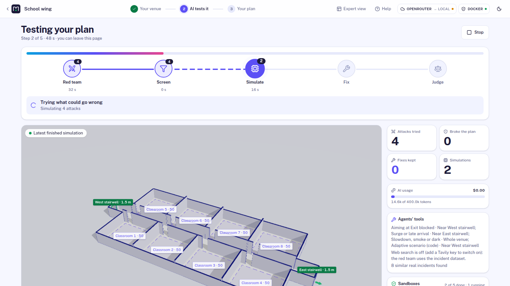

# Showtime: Red Team Night

[](LICENSE)

> **Judges: start here → [nebius/docs/JUDGE_GUIDE.md](nebius/docs/JUDGE_GUIDE.md)** (demo link, a
> 5-minute path, what runs live, and how to run it yourself in three commands).

**AI agents try to break your event plan. The red team can write attacks as code, and that code
only ever runs in a sealed sandbox. A physics simulator, not the AI, decides what breaks. Then the
AI proposes fixes, and only the fixes the simulator confirms are kept.**

- **Agents that act:** eleven NVIDIA Nemotron agents. They build the venue from one sentence,
  attack it (menu attacks, plus at most one scenario written as code per round), look up real
  incidents, propose fixes and write their own analysis code.
- **Sandboxes at the core:** every simulation and every AI-written script runs in a throwaway
  container. It has no network, a read-only system, memory, CPU and process limits, and no keys.
  [14 attacks on it, and what stopped each](nebius/docs/SANDBOX_PROOF.md).
- **Evidence:** attacks cite real crowd accidents (395: the Feliciani dataset's 388 plus 7
  well-known ones). Numbers come from the simulator, formulas and cited data, and every number in
  AI text is checked against the computed results. Calibrated on a real bottleneck experiment, the
  simulator's flow is within about 6 % of it at every width; calibration and check come from that
  same experiment ([validation](nebius/docs/VALIDATION.md)).



**Run it:** [quickstart](#quickstart) · **Status:** it runs now on local Docker sandboxes and on
NVIDIA Nemotron through OpenRouter. Nebius Token Factory, Nebius Sandboxes and Tavily web search
are built as plug-ins, but **not run live** (no keys yet: [live status](nebius/docs/LIVE_STATUS.md)).

> Planning aid, not a safety certification.

[Judge's guide](nebius/docs/JUDGE_GUIDE.md) · [Pitch, evidence and limits](nebius/docs/PITCH.md) ·
[3-minute demo](nebius/docs/DEMO.md) · [Hard questions](nebius/docs/QA.md) ·
[Real cases](nebius/docs/REAL_CASES.md) · the full product description is in
[nebius/README.md](nebius/README.md).

## Why

Crowd crushes happen at bottlenecks nobody tested. Itaewon (2022): 159 deaths in a 3.2 m alley.
Indiana State Fair (2011): a stage roof fell in a 59 mph gust. Professional crowd modelling takes
specialists and money, so most events are never stress-tested. Showtime makes "what breaks this
plan?" a few-minute question, answered by a simulator.

## Repository layout

```
.
├── README.md             # this file
├── requirements.txt      # Python API dependencies for a plain pip install
├── archive/              # early planning documents (proposals, plans, task allocation)
└── nebius/               # the application
    ├── api/              # FastAPI backend: agents, orchestrator, adapters, core, SQLite (uv project)
    ├── sim/              # simulation sandbox image: JuPedSim + PedPy
    ├── web/              # Vite + React + React Three Fiber frontend
    ├── plugins/          # built-in feature plugins (hazards, exporters, importers, rules, ...)
    ├── scripts/          # setup, model download, probes, smoke tests, demo precompute
    ├── config/           # plugin feature flags
    ├── docs/             # judge's guide, architecture, assumptions, guides, ADRs (history in docs/archive/)
    ├── Makefile          # all common tasks (`make help`)
    ├── docker-compose.yml
    └── .env.example      # configuration template
```

## Requirements

| Requirement | Version / notes |
| --- | --- |
| OS | Linux (x86_64) |
| Docker | with Docker Compose v2; runs the app stack and the simulation sandbox. The only requirement for the quickstart |
| Python | 3.12, developer setup only (installed for you by `make setup` via uv) |
| Node.js | 20 or 22 LTS, developer setup only |
| NVIDIA GPU | only for the local model (~7 GB VRAM); not needed with a hosted model (OpenRouter or Nebius) |
| RAM | 16 GB recommended |
| Keys | `OPENAI_COMPAT_API_KEY` (OpenRouter, free tier); optional `NEBIUS_API_KEY` (Token Factory / Sandboxes), `TAVILY_API_KEY` (web evidence) |

Python packages are listed in [requirements.txt](requirements.txt) (mirrors
[nebius/api/pyproject.toml](nebius/api/pyproject.toml)); simulator packages are pinned in
[nebius/sim/requirements.txt](nebius/sim/requirements.txt) and installed into the sim image.
Frontend packages are in [nebius/web/package.json](nebius/web/package.json).

## Quickstart

Needs only Docker (with Compose v2) and `make`. A free key from openrouter.ai gives the AI
(NVIDIA Nemotron); without one, choose **Offline** above *Test this plan*.

```bash
cd nebius && cp .env.example .env    # then set OPENAI_COMPAT_API_KEY=<your OpenRouter key> in .env
make up                              # builds and starts everything in Docker
# open http://localhost:5173  (API docs: http://127.0.0.1:8000/api/docs)
```

Sample projects install automatically with finished red-team sessions. Hosting on a server:
[nebius/docs/HOSTING.md](nebius/docs/HOSTING.md).

### Developer setup

`make setup` (from `nebius/`) installs uv, Python 3.12, the web dependencies, the sandbox image
and the incident dataset inside the folder; `make dev` then runs the API and the Vite dev server
natively. The local model instead of OpenRouter: set `LLM_PROVIDER=local`; `make setup` then also
fetches llama.cpp and Nemotron Nano 9B v2 (≈ 6 GB), started with `make llm-up`.

### Plain pip instead of uv

```bash
python3.12 -m venv .venv && source .venv/bin/activate
pip install -r requirements.txt
cd nebius
export PYTHONPATH="$PWD"
(cd api && python -c "from api.db.session import migrate; migrate()")
(cd api && uvicorn api.app.main:app --host 127.0.0.1 --port 8000)
```

Simulations still need the sandbox image: `make build-sim` (from `nebius/`).

### Switch to Nebius or add Tavily

Only `nebius/.env` changes:
- **Nebius Token Factory:** `LLM_PROVIDER=nebius` and `NEBIUS_API_KEY`. Leftover model ids from
  another provider switch to the Nebius preset on their own.
- **Nebius Sandboxes:** also `SANDBOX_PROVIDER=nebius` and `NEBIUS_PROJECT_ID`.
- **Tavily:** `TAVILY_API_KEY`.

Then `make verify-nebius-llm`, `make verify-nebius-sandbox` or `make verify-tavily` gives a pass
or the exact reason, and `make up` restarts the app. None of the three has run live yet (no keys).
Details: [nebius/docs/NEBIUS_SWITCH.md](nebius/docs/NEBIUS_SWITCH.md).

## Common tasks

Run from `nebius/`:

| Command | What it does |
| --- | --- |
| `make help` | List all targets |
| `make check` | Lint, typecheck and fast unit tests (CI: `.github/workflows/ci.yml`) |
| `make test` | Full Python tests, including simulation tests (needs Docker) |
| `make test-web` | Frontend unit tests |
| `make e2e` | Playwright browser journeys (needs the app running) |
| `make smoke` | End-to-end smoke test against the running API |
| `make down` / `make llm-down` | Stop the stack / the local model |

## Documentation

[Judge's guide](nebius/docs/JUDGE_GUIDE.md) · [User guide](nebius/docs/USER_GUIDE.md) · [Testing guide](nebius/docs/TESTING_GUIDE.md) ·
[Architecture](nebius/docs/ARCHITECTURE.md) · [Extending](nebius/docs/EXTENDING.md) ·
[Assumptions](nebius/docs/ASSUMPTIONS.md) · [Hosting](nebius/docs/HOSTING.md) · [Security](nebius/SECURITY.md) ·
[Contributing](nebius/CONTRIBUTING.md) · [Licences](nebius/docs/LICENSES.md)

## License

Apache-2.0, see [LICENSE](LICENSE).
