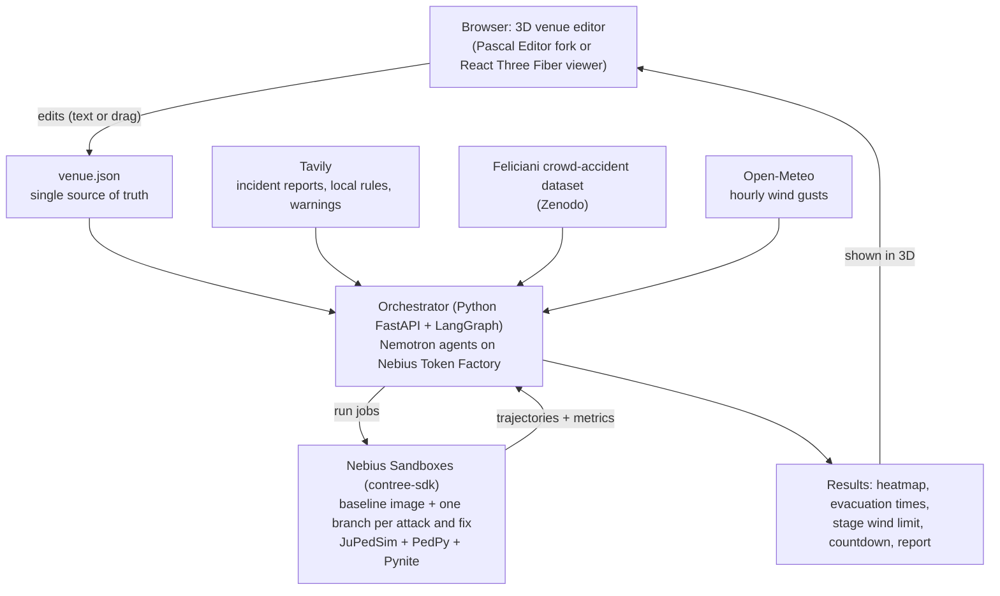

# Showtime: Red Team Night — End-to-End Project Explanation

**Hackathon:** Nebius x NVIDIA Global AI Hackathon (Devpost)
**Track:** Best Apps & Agents (also eligible for Best Use of Tavily, $3,000)
**Submission deadline:** Oct 30, 2026, 10:00 AM PT (11:00 PM GMT+6)
**Team:** 4 people
**Last updated:** Oct 7, 2026

---

## 1. The idea in one paragraph

Showtime lets an event organizer load a venue (a city square, a festival field, a stadium bowl, or a narrow alley), see it in 3D, and change it by typing or dragging. Then an AI **red team** attacks the plan with scenarios taken from real crowd disasters ("an exit gets blocked", "a surge at stage left", "a wind gust hits the stage roof"). Each attack runs as a real crowd simulation inside its own Nebius Sandbox branch. An AI **blue team** proposes fixes (open a gate, add a barrier, one-way flow, earlier evacuation call), and each fix is simulated again. The result is an evacuation plan, a crowd-density heatmap, and one headline number: **the latest safe time to start evacuating**, based on the weather forecast and the stage's wind limit.

**One-line pitch:** "Before the gates open, Showtime runs the disaster so it never happens."

**Key principle:** we do not invent crowd physics, structural engineering or 3D tools. We connect proven open-source components with Nemotron agents, and the agents are never allowed to make up a number; every number comes from a simulator, a formula, or a sourced dataset.

---

## 2. The real-world problem

Crowd disasters keep happening, and most of them come down to a lack of planning that nobody stress-tested beforehand.

| Incident | What happened | What a stress test would have flagged |
| --- | --- | --- |
| Itaewon, Seoul (Oct 2022) | 159 deaths and 196 injuries in a Halloween crowd crush in a narrow, sloped T-shaped alley | Crowd density above about 5 people/m², the level where crush risk rises sharply |
| Indiana State Fair (Aug 2011) | A wind gust collapsed a temporary stage roof onto the crowd: 7 deaths, 58 injuries | The ballast held only 25–43 mph of wind, against a 68 mph code requirement; the gust was about 59 mph |

The bigger picture:

- Feliciani et al. (*Safety Science*, 2023) found that crowd accidents happen worldwide **on average about once a month**, and more than **4,500 people died in them between 2010 and 2019**.
- Professional crowd simulation software is expensive and needs a specialist, so usually only the largest events use it, and only for a few worst-case runs (Iventis).
- At Indiana there was no engineering review after the stage went up and no formal protocol to delay the show, and the weather warning did not reach the decision makers.
- An ASU engineering project brief (2025) asks for exactly this kind of tool: upload a floor plan, enter attendance and exits, and find bottlenecks before the event.

**The gap:** small and medium event organizers, venue managers, and permit offices have no cheap, fast way to ask "what happens if…?" and get an answer backed by real physics.

---

## 3. Who uses it and why they would adopt it

| User | Their problem | What Showtime gives them |
| --- | --- | --- |
| Festival and concert organizers | No budget for specialist crowd modelling | Minutes per scenario instead of a consultant engagement |
| Venue managers (stadiums, halls, plazas) | Need to re-check plans for every new event layout | Reusable venue templates and fast re-runs |
| University and school facilities teams | Drills and large gatherings with no modelling | Evacuation times and bottlenecks for their buildings |
| City permit offices and fire marshals | Must approve event plans quickly | A report with assumptions, numbers and sources |

**Important framing:** Showtime is a **planning aid, not a safety certification**. It supports decisions; licensed engineers, stage manufacturers and local authorities still sign off.

---

## 4. What the user experiences (end-to-end walk-through)

Example: a festival organizer planning an open-air concert for 6,000 people.

1. **Pick a venue.** Choose a template ("festival field with stage") or upload a DXF drawing. The 3D venue appears: ground, stage, barriers, gates, standing zones.
2. **Describe changes in plain English.** Type: "Move the stage 10 m back and add a 4 m gate on the east fence." Nemotron turns that into a small edit to the venue file. Dragging objects in 3D edits the same file, so typing and dragging never disagree.
3. **Load the weather.** Showtime pulls the hourly wind gust forecast for the event date and location from Open-Meteo.
4. **Check the stage.** A simple structural check (Pynite plus a standard wind-pressure formula) finds the gust speed at which the stage roof's ballast is no longer enough. That becomes the stage's wind limit.
5. **Press "Red Team Night".** The red team (Nemotron + Tavily + a real accident dataset) builds 3–5 attack cards, each linked to a real incident. Example: "Counterflow in the north alley, similar to Itaewon 2022 [source]."
6. **Watch the attacks run.** Each attack runs as a crowd simulation in its own sandbox branch. The 3D view shows moving people and a density heatmap; dangerous areas turn red.
7. **Watch the defense.** The blue team proposes fixes. Each fix is simulated again in its own branch. Only fixes that measurably reduce peak density or evacuation time are kept.
8. **Get the countdown.** The screen shows: "Start evacuating by 20:31 if gusts exceed 52 km/h."
9. **Export the report.** A printable plan with the 3D views, numbers, attacks, fixes, assumptions and every source link.

---

## 5. How it works under the hood

### 5.1 Architecture



### 5.2 The components we reuse (nothing reinvented)

| Pipeline stage | Component | License | What it does for us |
| --- | --- | --- | --- |
| Venue input | Hand-built templates + DXF layers in the JuPedSim format | MIT (examples) | Reliable venue geometry without image recognition |
| 3D view and editing | **Pascal Editor** (fork) or a small React Three Fiber viewer | MIT | Browser 3D editor; Pascal also ships an MCP server so an agent can edit the scene |
| Crowd simulation | **JuPedSim** | LGPLv3+ | Moves every simulated person; writes trajectories |
| Crowd metrics | **PedPy** | MIT | Density, flow, speed and evacuation-time maps from trajectories |
| Stage check | **Pynite** (PyniteFEA) + ASCE-style wind-pressure formula | MIT | Wind force on the roof vs ballast resistance |
| Weather | **Open-Meteo** | Free non-commercial tier, data CC BY 4.0 | Hourly gust forecast, archive back to 1940 |
| Real incidents | **Feliciani crowd-accident list 1900–2024** + **Tavily** | Verify Zenodo licence | Attack cards grounded in real events, with sources |
| Validation | Jülich Pedestrian Dynamics Data Archive, Wuppertal bottleneck, Itaewon data | Check each | Prove the simulator matches real experiments |
| AI models | **Nemotron** on Nebius Token Factory | NVIDIA open model licence | All reasoning, planning and writing |
| Isolation and branching | **Nebius Sandboxes** via `contree-sdk` | Apache 2.0 | Run each attack and fix in its own branch |
| Agent pattern reference | `llm-evacuation-sim` (JuPedSim + LLM agents) | Verify before forking | Proof that LLM agents + JuPedSim work together |

### 5.3 Venue input: why templates instead of "text to 3D"

Free-form text-to-3D and photo-to-3D are the riskiest parts of the original idea. Floor-plan recognition models are trained mostly on Nordic houses and fail on festival or stadium plans, and Nemotron's vision model (Nano Omni) is dedicated-only on Token Factory. So:

- We ship **4 templates**: city square, stadium bowl, festival field with stage, and an Itaewon-style T-alley.
- Users can **upload a DXF** using the JuPedSim layer names (`jps-walkablearea`, `jps-obstacles`, `jps-exits`, and so on).
- **Text edits** change template parameters (stage position, gate width, barrier lines), which Nemotron does reliably with a JSON schema.
- Loading a real square from OpenStreetMap is a stretch goal.

---

## 6. The data contracts (how the pieces talk)

Everything flows through three small JSON files. Keeping them simple is what makes the project buildable by four people.

### 6.1 `venue.json` — what the venue looks like

Plain English: a list of shapes in metres. The walkable ground, the things you cannot walk through, the exits, where people start, and the stage.

```json
{
  "venue_id": "festival-field-01",
  "units": "m",
  "walkable_area": [[0,0],[80,0],[80,50],[0,50]],
  "obstacles": [{"id": "stage", "polygon": [[30,42],[50,42],[50,50],[30,50]]}],
  "exits": [
    {"id": "gate_a", "polygon": [[10,0],[14,0],[14,0.5],[10,0.5]]},
    {"id": "gate_b", "polygon": [[60,0],[64,0],[64,0.5],[60,0.5]]}
  ],
  "zones": [{"id": "front_of_stage", "polygon": [[20,25],[60,25],[60,40],[20,40]], "people": 4000}],
  "stage": {"width_m": 20, "depth_m": 8, "roof_height_m": 12, "ballast_kg_per_leg": 2000, "legs": 6},
  "location": {"lat": 23.81, "lon": 90.41, "event_start": "2026-11-20T18:00:00"}
}
```

### 6.2 `attack.json` — one red-team scenario

Plain English: what goes wrong, where, when, how badly, and which real incident inspired it.

```json
{
  "attack_id": "A3",
  "title": "Counterflow in the north alley",
  "changes": [{"type": "close_exit", "exit_id": "gate_b", "at_s": 120},
              {"type": "surge", "zone_id": "front_of_stage", "extra_people": 1200}],
  "inspired_by": {"incident": "Itaewon crowd crush, 2022", "source_url": "https://..."}
}
```

### 6.3 `result.json` — what the simulator measured

Plain English: the numbers that matter, all computed by JuPedSim and PedPy, never by the LLM.

```json
{
  "run_id": "branch-A3-fix2",
  "tier": 3,
  "evacuation_time_p95_s": 412,
  "peak_density_p_per_m2": 3.1,
  "hotspots": [{"x": 62, "y": 3, "density": 3.1}],
  "agents_not_evacuated": 0
}
```

---

## 7. The AI agents

Each agent has one job, uses the smallest model that can do it, and returns strict JSON that code validates.

| Agent | Model on Token Factory | Price per 1M tokens (in / out) | Job |
| --- | --- | --- | --- |
| Venue agent | Nemotron 3 Super 120B-A12B | $0.30 / $0.90 | Turn text edits into `venue.json` patches; check geometry with Shapely |
| Red team | Nemotron 3.5 Lightning or Nemotron 3 Nano 30B-A3B | $0.06 / $0.24 | Build attack cards from the incident dataset and Tavily results |
| Blue team | Nemotron 3 Super | $0.30 / $0.90 | Propose fixes as `venue.json` patches |
| Judge and report writer | Nemotron 3 Ultra 550B-A55B | $1.00 / $3.00 | Rank fixes using measured results; write the plan and explanations |

Prices are from the Token Factory model catalog; confirm the exact model IDs in your console before Phase 2.

**Guardrails:**

- Agents choose *what* to test and *what* to change. Simulators and formulas produce *every* number.
- Every agent output must pass a JSON schema check and a geometry validity check (`shapely.make_valid`) before it is used.
- Every attack card must carry a source link; cards without a source are discarded.
- Fixed random seeds, so the same scenario gives the same result twice.

---

## 8. Simulation strategy (why it is not a bottleneck)

A full crowd simulation of thousands of people takes minutes. If every edit and every attack needed one, the app would crawl. So we use **three tiers**, and each number in the UI shows which tier produced it.

| Tier | Method | Target time per run | Runs per session | Used for |
| --- | --- | --- | --- | --- |
| 1. Instant | SFPE hydraulic model (closed-form formulas) + exit network flow in NetworkX | Under 50 ms | Hundreds | Screening every edit and every attack combination |
| 2. Coarse | JuPedSim with capped people, larger time steps, short horizon | Under 30 s | About 10 | Ranking the worst attacks and the best fixes |
| 3. Full | JuPedSim full crowd + PedPy density and evacuation-time maps | 1–3 min | At most 3 | Final numbers and the 3D replay in the demo |

**Tier 1 formula (hydraulic model, simplest form):**

```
time to exit ≈ walking distance / walking speed + people using the exit / (specific flow × effective exit width)
```

Take the walking speed and specific flow values from the SFPE Handbook tables, never from the LLM.

**Risk reducers:**

- Precompute and cache every demo template; replay stored trajectories in the browser.
- Hard caps on people, simulated time and number of branches; on timeout, fall back to Tier 1 with a visible warning.
- If JuPedSim ever blocks the team, Tiers 1 and 2 still carry the demo; Tier 3 is the bonus.
- The stage check is tiny: a Pynite frame solves in seconds, and wind limits per stage template are precomputed.

### 8.1 Stage wind check (screening only)

1. Wind pressure from the ASCE 7 velocity-pressure formula: `q = 0.613 × Kz × Kzt × Kd × V²` (N/m², V in m/s).
2. Force on the roof or banner area = pressure × area × force coefficient.
3. Compare the overturning and uplift with the ballast resistance (Pynite gives member forces and reactions).
4. Output: the gust speed at which the stage stops being safe. This is the **stage wind limit**.

Label it "screening estimate"; the stage manufacturer's wind-management plan remains the authority.

### 8.2 The countdown: latest safe time to start evacuating

```
T_latest = T_hazard − (T_pre_movement + RSET_sim × safety_factor)
```

| Term | Meaning | Where it comes from |
| --- | --- | --- |
| T_hazard | First forecast hour when gusts exceed the stage wind limit (or a storm threshold) | Open-Meteo + stage check |
| T_pre_movement | Time before people actually start moving | Organizer setting (shown on screen) |
| RSET_sim | Required safe egress time: 95th–100th percentile exit time | JuPedSim + PedPy |
| safety_factor | Extra margin, e.g. 1.5 | Organizer setting |

The UI shows `T_latest − now` as a live countdown.

---

## 9. The red-team / blue-team loop, step by step

1. **Baseline.** Build `venue.json`, start one sandbox from the `showtime-sim` image, load the venue, run a baseline simulation, and save that state as the branch point.
2. **Build the attack deck.** The red team filters the Feliciani dataset by event type (concert, sports, religious, street) and uses Tavily to fetch incident reports, inquiry findings and local warnings. It writes 3–5 attack cards, each with a source link.
3. **Screen.** Tier 1 scores many combinations of attacks in milliseconds; the worst ones move on.
4. **Attack.** Each surviving attack runs in its own sandbox branch (Tier 2, then Tier 3 for the finalists). The heatmap turns red where density crosses the danger threshold.
5. **Defend.** The blue team proposes fixes as venue patches: open gate C, add a barrier line, one-way flow, staggered entry, earlier evacuation call.
6. **Verify.** Each fix runs in its own branch against the same attack. A fix is kept only if it lowers peak density or evacuation time.
7. **Repeat** until the red team cannot find a new break within the budget. The scoreboard shows breaks per round, for example 5, then 2, then 0.
8. **Report.** Ultra writes the plan: exit assignments, fixes, countdown, assumptions, and the source behind every attack.

---

## 10. Exactly how Nebius, NVIDIA and Tavily are used

| Product | How Showtime uses it | Why it matters to judges |
| --- | --- | --- |
| **NVIDIA Nemotron** (Lightning/Nano, Super, Ultra) | Every agent: venue edits, attack cards, fixes, judging, report | Tiered model use: cheap models for volume, Ultra only for hard reasoning |
| **Nebius Token Factory** | OpenAI-compatible API at `https://api.tokenfactory.nebius.com/v1`, JSON-schema outputs | Required runtime inference on Nebius |
| **Nebius Sandboxes** (`contree-sdk`) | One image with JuPedSim + PedPy + Pynite; one branch per attack and per fix; runs in parallel | The branch tree (baseline → attack → fix) is a Nebius-native visual nobody else has |
| **Tavily** | Fetches incident reports, inquiry findings, local occupancy rules and live warnings; every card shows its sources | Tavily is the evidence engine, not a side feature (Best Use of Tavily prize) |

### 10.1 Sandbox usage sketch

```python
# pip install contree-sdk
from contree_sdk import ContreeSync

client = ContreeSync()                          # API key and base URL from your config
image = client.images.use("showtime-sim")       # imported image with JuPedSim, PedPy, Pynite
result = image.run(shell="python run_crowd.py venue.json attack_A3.json --tier 2").wait()
print(result.exit_code, result.stdout)
```

Check the exact client set-up, image import and branching calls against the SDK docs before Phase 2; this sketch follows the published examples.

---

## 11. Build in two phases: local first, then Nebius

### Phase 1 — your PC (16 GB GPU)

- **LLM:** Nemotron Nano 9B v2 in GGUF format via Ollama or llama.cpp. At Q4_K_M it needs about 5 GB of VRAM. Both expose an OpenAI-compatible API, so the code is the same as in Phase 2.
- **Sandbox stand-in:** a local Docker container built from the same `showtime-sim` image.
- **Tavily and Open-Meteo:** the same free APIs in both phases.
- **Record and replay:** save every real model response during development and replay them in tests to protect your credits.

### Phase 2 — switch to Nebius

Build two small adapters on day one so the switch is configuration, not a rewrite:

1. **LLM adapter:** one client with a base URL and a role-to-model map (`venue → Super`, `red → Lightning`, `blue → Super`, `judge → Ultra`).
2. **Sandbox adapter:** one function, `run(job, files) → result`, that calls Docker locally and `contree-sdk` on Nebius.

**Swap checklist:**

- [ ] Base URL, API keys and model names only in environment variables
- [ ] Re-run the prompt test set against real Nemotron (behaviour differs between serving backends)
- [ ] Import the Docker image into Nebius Sandboxes and confirm a Tier 3 run finishes in under 3 minutes
- [ ] Confirm branching works: one baseline, three attack branches, two fix branches

---

## 12. Suggested repository layout

```
showtime/
├── web/                  # Pascal Editor fork or R3F viewer, heatmap, countdown, report page
├── api/                  # FastAPI orchestrator, LangGraph agent graph
│   ├── agents/           # venue, red_team, blue_team, judge (prompts + JSON schemas)
│   ├── adapters/         # llm_client.py, sandbox_runner.py (Docker | contree)
│   └── data/             # template venues, cached Tavily results, incident CSV
├── sim/                  # runs inside the sandbox image
│   ├── run_crowd.py      # venue.json + attack.json → JuPedSim → PedPy → result.json
│   ├── run_stage.py      # stage params + wind → Pynite → wind limit
│   └── tier1.py          # hydraulic model + NetworkX exit flow
├── validation/           # Jülich / Wuppertal comparison notebooks
├── docker/               # showtime-sim Dockerfile
├── README.md             # setup, how Nemotron/Token Factory/Sandboxes/Tavily are used
└── LICENSE               # MIT or Apache 2.0 (required by the hackathon)
```

---

## 13. Team of 4: roles and timeline

| Role | Owns | Done when |
| --- | --- | --- |
| A — 3D and UI | Editor or viewer, templates in 3D, heatmap, trajectory replay, countdown, report page | A judge can load, edit and stress-test a venue without help |
| B — Agents and Nemotron | Venue, red, blue and judge agents; JSON schemas; Tavily integration; Phase 2 model swap | 9 of 10 test edits produce valid venue patches; every attack card has a source |
| C — Simulation | `run_crowd.py`, `run_stage.py`, `tier1.py`, validation against real data | Validation targets in section 14 pass |
| D — Platform | Sandbox adapter, Docker image, Nebius Sandboxes, caching, deployment, video, README | Public demo URL live; repo passes the submission checklist |

| Dates | Milestone |
| --- | --- |
| Oct 7–8 | Request Sandboxes access, claim credits, Tavily key, repo with licence; local LLM running |
| Oct 8–12 | Templates, `venue.json` schema, 3D viewer, Tier 1, Docker image with JuPedSim + PedPy + Pynite |
| **Oct 12** | **Walking skeleton:** template → 3D → Tier 1 result, all local |
| Oct 13–17 | Text and drag edits, stage wind check, Open-Meteo countdown, validation runs |
| Oct 15–20 | Red-team / blue-team loop with Docker branches; attack deck from Feliciani data + Tavily |
| Oct 20–24 | Port to Token Factory and Nebius Sandboxes; branch tree view in the UI |
| **Oct 24** | **Running fully on Nebius** |
| Oct 25–27 | Judge path, cached demos, report page, README, tool-feedback notes |
| Oct 27–28 | Record and edit the video |
| **Oct 29** | **Submit (one day early)** |

**Effort estimate:** about 22–28 person-days of work against roughly 60 available (4 people × 3 weeks), which leaves buffer for surprises.

---

## 14. Validation plan

| Check | Data | Target |
| --- | --- | --- |
| Flow through a door matches real experiments | Jülich archive + Wuppertal 2018 bottleneck series (loaded with PedPy) | Simulated flow within about 15% of measured flow |
| Dangerous density reproduced in a known disaster geometry | Itaewon T-alley template built from published dimensions; Itaewon field data | Simulator reaches danger-level density under the reported crowd |
| Stage wind check is sensible | Indiana figures (ballast 25–43 mph) | A friction-only ballast model fails in that range |
| Agents produce valid output | 10 team-written edit requests | At least 9 of 10 produce valid geometry |

One clear validation chart in the video ("our simulator vs a real Jülich experiment") does more for credibility than any claim.

---

## 15. Demo: what judges see

### 15.1 Three-minute video script

1. **0:00–0:20, hook.** Two headlines: Itaewon 2022 and the Indiana stage collapse. "Both had warning signs. Neither had a stress test."
2. **0:20–0:50, load and edit.** Pick the festival template; it appears in 3D. Type "move the stage 10 m back, add an east gate." The scene updates.
3. **0:50–1:10, weather and stage.** Forecast gusts load; the stage turns amber at its wind limit.
4. **1:10–1:50, Red Team Night.** Attack cards fly in, each citing a real incident via Tavily. Sandbox branches run; the heatmap turns red at gate B.
5. **1:50–2:25, defense.** The blue team's fixes run in their own branches; the scoreboard drops from 5 breaks to 0; the countdown reads "Start evacuating by 20:31."
6. **2:25–2:50, trust and tech.** Validation chart against Jülich data; one architecture slide naming Nemotron (Lightning, Super, Ultra), Token Factory, Nebius Sandboxes and Tavily, said out loud.
7. **2:50–3:00, close.** "Run the disaster before the gates open." On screen: "Planning aid, not a safety certification."

### 15.2 How a judge tests it in under 2 minutes

- Open the public URL; no login.
- Pick a template, or type one edit from a "Try these" list.
- Press "Red Team Night": cached runs replay instantly; a new branch finishes in under a minute at Tier 2.

---

## 16. Why this can win

| Judging criterion | How Showtime answers it |
| --- | --- |
| Technological Implementation | Tiered Nemotron agents on Token Factory; peer-reviewed simulators run in Nebius Sandboxes; every attack and fix is a sandbox branch; validated against real experiments |
| Design | One screen: 3D venue, attack and fix cards, scoreboard, countdown; text and mouse edit the same scene |
| Potential Impact | Named disasters, named users, and one actionable number: when to start evacuating |
| Quality of the Idea | Adversarial safety planning with attacks grounded in real incidents, and fixes proven by simulation instead of asserted by an LLM |
| Best Use of Tavily | Tavily is the red team's evidence engine; every card shows its sources |

**Framing reuse as a strength:** "We didn't invent new crowd physics. We made validated physics usable by an AI agent, and we made the agent prove every fix."

**Crowding check:** public repos for this hackathon found so far are mostly coding agents, research agents, personal assistants and compliance checkers; none on crowd safety. Re-check the Devpost gallery once it is published.

---

## 17. Risks and fallbacks

| Risk | Fallback |
| --- | --- |
| Sandboxes beta access arrives late | Same adapter runs Docker locally; show at least one real Nebius branch in the demo |
| Pascal Editor fork is too heavy (WebGPU, monorepo) | A 1–2 day React Three Fiber viewer with drag handles |
| JuPedSim fails silently on bad geometry | `shapely.make_valid`, watchdog timeouts, agent-count checks, cached results |
| Agent proposes a fix that makes things worse | Every fix is re-simulated; only measured improvements are kept |
| Simulations too slow | Three tiers, caps, precomputed templates |
| Liability perception | "Planning aid, not certification" on every screen and in the report |
| Rule compliance | Nemotron on every agent; any non-NVIDIA model is a helper only |

---

## 18. Cost and compute budget (estimates to confirm in week 1)

- **Tokens per full Red Team Night session:** roughly 200K cheap-model tokens, 150K Super tokens and 25K Ultra tokens, about $0.10–0.15 per session at catalog prices. The $25 promo credit plus Builders Program credit covers a few hundred sessions.
- **Sandbox runs per session:** about 10 Tier 2 runs and up to 3 Tier 3 runs, CPU only.
- **Tavily:** cache results per incident and per city so repeat demos cost no searches.
- **Open-Meteo:** free non-commercial tier (under 10,000 calls per day); cache responses.

---

## 19. Verify before you build

- [ ] Request Nebius Sandboxes beta access today
- [ ] Copy exact Nemotron model IDs and prices from your Token Factory console
- [ ] Check licences: `llm-evacuation-sim`, Feliciani Zenodo files, Itaewon Dryad data, any floor-plan model you add
- [ ] Confirm hackathon rules on Devpost: demo URL uptime through judging, required Nemotron usage, licence placement
- [ ] Confirm Open-Meteo terms fit a non-commercial hackathon demo

---

## 20. Glossary (plain English)

| Term | Meaning |
| --- | --- |
| Crowd crush | People packed so tightly that they cannot move or breathe; danger rises sharply above about 5 people per m² |
| JuPedSim | Open-source software that simulates how each person in a crowd walks |
| PedPy | Tool that measures density, speed and flow from simulation or experiment recordings |
| RSET | Required safe egress time: how long it takes everyone to get out |
| Hydraulic model | Simple formulas that treat a crowd like water flowing through pipes (doors and corridors) |
| Pynite | Open-source library that calculates forces in frames like a stage roof |
| Ballast | Heavy weights that stop a temporary structure from tipping or lifting in wind |
| Sandbox branch | A copy of a running environment you can change without touching the original |
| Red team / blue team | Attackers who try to break a plan, and defenders who fix it |
| Token Factory | Nebius's service for calling AI models like Nemotron over an API |

---

## 21. References

**Problem and evidence**
- Itaewon crowd-crush simulation study (Springer, 2024): https://link.springer.com/article/10.1007/s42452-024-06451-7
- Indiana State Fair stage collapse (summary of investigation reports): https://en.wikipedia.org/wiki/Indiana_State_Fair_stage_collapse
- Feliciani et al., trends in crowd accidents (*Safety Science*, 2023): https://www.sciencedirect.com/science/article/pii/S0925753523001169
- Iventis on crowd analysis cost and use: https://www.iventis.com/blog/crowd-analysis-and-visualisation-in-iventis/
- ASU EPICS crowd-flow project brief: https://epics.engineering.asu.edu/2025/09/predictive-crowd-flow-crush-analytics/

**Components**
- JuPedSim: https://github.com/PedestrianDynamics/jupedsim · docs: https://www.jupedsim.org
- JuPedSim Web community (DXF templates): https://github.com/PedestrianDynamics/jupedsim-web-community
- PedPy: https://github.com/PedestrianDynamics/PedPy · user guide: https://pedpy.readthedocs.io/stable/user_guide.html
- Pynite: https://github.com/JWock82/Pynite
- Pascal Editor: https://github.com/pascalorg/editor
- llm-evacuation-sim (reference pattern): https://github.com/MJones235/llm-evacuation-sim
- Open-Meteo terms: https://open-meteo.com/en/terms
- ASCE 7-16 wind load walkthrough: https://www.littlepeng.com/single-post/wind-load-calculation-as-per-asce-7-16
- SFPE hydraulic model background: https://link.springer.com/article/10.1007/s10694-022-01244-z · https://files.thunderheadeng.com/femtc/2018_d1-03-campbell-paper.pdf

**Data**
- Feliciani crowd-accident list 1900–2024: https://zenodo.org/records/19483010
- Itaewon field data: https://datadryad.org/dataset/doi:10.5061/dryad.kprr4xhb9 · https://zenodo.org/records/10074509
- Jülich Pedestrian Dynamics Data Archive: https://ped.fz-juelich.de/da/doku.php
- Wuppertal 2018 bottleneck series: https://doi.org/10.34735/ped.2018.1
- CROMA bottleneck data: https://zenodo.org/records/19448415

**Nebius, NVIDIA, Tavily**
- Token Factory model catalog: https://tokenfactory.nebius.com/model-catalog.md
- Nemotron on Token Factory: https://nebius.com/services/token-factory/models/nvidia-nemotron-models-inference
- Sandboxes overview: https://docs.tokenfactory.nebius.com/sandboxes/overview
- contree-sdk: https://github.com/nebius/contree-sdk · SDK docs: https://docs.tokenfactory.nebius.com/sandboxes/sdk
- Sandbox branching: https://docs.tokenfactory.nebius.com/sandboxes/sdk/python_sdk/branching
- Sandboxes + LangChain: https://docs.tokenfactory.nebius.com/sandboxes/sdk/integrations/langchain
- Nemotron Nano 9B v2 GGUF (local): https://huggingface.co/dominguesm/NVIDIA-Nemotron-Nano-9B-v2-GGUF
- Tavily docs: https://docs.tavily.com
- Hackathon page: https://nebiusglobalaihackathon.devpost.com/
- Hackathon starter (Token Factory + Tavily wiring): https://github.com/fruteroclub/nebius-nvidia-ai-hackathon-starter
- Sandbox usage example (CodeGuard): https://github.com/kuker24/nebius-codeguard
