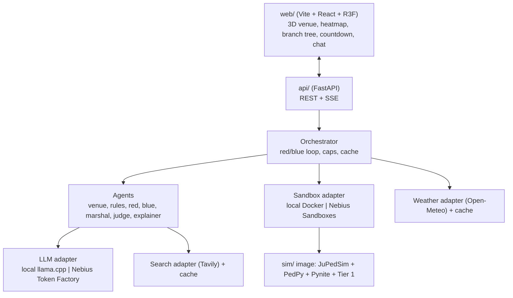

# CLAUDE.md — Autonomous Build Brief for "Showtime: Red Team Night"

> **Who this file is for:** an autonomous coding agent (Claude Code) working in a Linux project folder with Docker and a local GPU.
> **What you must deliver:** a complete, tested, locally runnable app that the human can start with one command, test in a browser, and later switch to Nebius Token Factory (Nemotron) and Nebius Sandboxes by changing environment variables only.
> **Where to put this file:** save it as `CLAUDE.md` in the project root so it is loaded as project memory (see the Claude Code docs: https://docs.claude.com/en/docs/claude-code/overview). Keep it updated if decisions change.

---

## 0. Read this first: how to work

1. **Work milestone by milestone** (section 16). Do not start a milestone until the previous one passes its "done when" checks.
2. **After every meaningful change run `make check`** (lint, typecheck, unit tests). After every milestone run `make smoke`.
3. **Keep a log.** Append to `docs/PROGRESS.md` after each milestone: what you built, commands run, test results, open issues. Record blockers in `docs/BLOCKERS.md` with what you tried.
4. **Verify before you trust.** Several API details in this brief are marked **[VERIFY]**. Read the linked docs, write a 10-line probe script, and only then build on it. If the real API differs, follow the real API and note the difference in `docs/PROGRESS.md`.
5. **Prefer existing components.** Never write your own crowd physics, structural solver, 3D engine or search engine. Glue existing ones together (section 5).
6. **If something blocks you for more than 3 attempts,** use the fallback listed for it (section 18), log it, and move on. The product must ship end to end even if a stretch feature is cut.
7. **Stay inside the project folder.** Do not modify system files, other projects, or global configs, except for the documented install steps in section 7. Never run destructive commands outside the repo (no `rm -rf` outside it, no `docker system prune -a`, no deleting images or volumes you did not create).
8. **Never commit secrets.** Keys live in `.env` (gitignored). Commit `.env.example` only.
9. **Do not push to any remote** unless the human asks. Commit locally with clear messages at each milestone.

---

## 1. Mission and definition of done

**Mission:** build Showtime, a web app where an event or venue organizer loads a venue (indoor building or open-air site), sees it in 3D, edits it by typing or dragging, and runs **Red Team Night**: AI attackers create scenarios grounded in real crowd incidents, each scenario runs as a real crowd simulation, AI defenders propose fixes, each fix is re-simulated, and the app outputs an evacuation plan, a density heatmap and **the latest safe time to start evacuating**.

**The project is done when all of these are true:**

- [ ] `make up` starts the whole stack with Docker Compose on Linux, and the app opens at `http://localhost:5173`.
- [ ] The human can, without help: pick a template, edit it by text and by drag, run a stress test, run Red Team Night, see the 3D crowd replay with heatmap, see the branch tree, see the countdown, ask "why is this red?", and export the report and evacuation map.
- [ ] `make test` passes (unit + integration). `make smoke` passes (end-to-end on a small crowd).
- [ ] Switching to Nebius needs **only** `.env` changes: `LLM_PROVIDER=nebius`, `SANDBOX_PROVIDER=nebius`, keys and model IDs. `make smoke-nebius` exists and runs once keys are present.
- [ ] Three demo scenarios are precomputed and replay instantly (section 15).
- [ ] `README.md`, `docs/HANDOFF.md`, `docs/PROGRESS.md`, `LICENSE` (Apache-2.0 or MIT) exist and are accurate.
- [ ] Memory budget respected throughout (section 3); the human's VS Code never froze.
- [ ] It feels like a product, not a demo (section 1A): projects persist across restarts, autosave and undo work, first-run onboarding works, every screen has designed loading, empty and error states, and the design system (section 4A) is applied everywhere.
- [ ] Engineering standards met (section 7B): strict typing, lint clean, migrations, CI workflow file, `CHANGELOG.md`, ADRs, user guide, and a `v0.1.0` git tag at handoff.


---

## 1A. Product quality bar

Build this as **version 0.1 of a product a venue-safety team would pay for**, not as a hackathon demo. A hackathon judge should feel they are using shipped software.

1. **One job per screen.** Each screen has one primary action; everything else is secondary.
2. **Every number is traceable.** Clicking any metric shows where it came from: run ID, tier, engine, formula or source link.
3. **Honest by design.** Assumptions, tier labels and the "planning aid" notice are visible, never hidden in a footnote.
4. **Fast feedback, then confirmation.** Instant estimate first (Tier 1), confirmed result after (Tier 2/3), and the UI shows which one you are looking at.
5. **Nothing is lost.** Autosave, undo/redo, venue version history, and project export/import.
6. **Works offline after setup.** Missing services degrade features with a clear banner, never crash.
7. **Calm interface, bold in one place.** The 3D venue and the red-team round are the memorable moments; everything else is quiet and disciplined.

---

## 2. Hard rules (non-negotiable)

1. **No model training or fine-tuning.** Inference only.
2. **Zero paid services.** Free tiers and open-source only: Tavily free tier, Open-Meteo free non-commercial tier, local models, hackathon credits later.
3. **The LLM never produces a number shown to the user as a measurement.** Densities, times, forces, wind limits and costs come from simulators, formulas, APIs or token-usage fields. The LLM chooses *what to test* and *what to change*, and writes explanations that quote computed numbers.
4. **Every LLM output is JSON validated by Pydantic** before use. Invalid output → one repair retry → fall back to a safe default and log it.
5. **Every red-team attack card must carry a `source_url`** from a Tavily result or the incident dataset. When Tavily is off or the dataset row has no web link, cite the dataset's Zenodo DOI plus the row ID (e.g. `https://doi.org/10.5281/zenodo.19483010#row=412`). Cards without any source are discarded.
6. **Determinism:** every simulation takes an explicit `seed`. Same inputs + same seed → same result.
7. **Caps everywhere:** max people per run, max simulated seconds, max wall-clock seconds, max branches per session, max tokens per session, max Tavily calls per session. All configurable in `.env`.
8. **Provider-agnostic code:** application code calls only the adapters in `api/adapters/`. No direct imports of `openai`, `contree_sdk`, `docker` or `tavily` outside adapters.
9. **Safety framing:** every results screen and the report show: "Planning aid, not a safety certification."
10. **Licences:** do not commit downloaded datasets or model weights. Download them via scripts at setup time. Record each licence in `docs/LICENSES.md`.
11. **Everything is a plugin.** Every feature plugs into a registered extension point (section 7A). Core code never imports a concrete feature directly, and built-in features are implemented as plugins too.

---

## 3. Resource budget: 16 GB RAM, 16 GB VRAM (do not crash VS Code)

The human's machine has **16 GB system RAM** and a **16 GB VRAM NVIDIA GPU**, running Linux with VS Code open. System RAM is the tight resource.

### 3.1 Budget

| Process | Limit | How to enforce |
| --- | --- | --- |
| Local LLM server (llama.cpp) | ≤ 7 GB VRAM, ≤ 1.5 GB RAM | Q4_K_M model, full GPU offload, context 8192 (raise to 16384 only if VRAM allows) |
| Simulation container | ≤ 4 GB RAM, ≤ 4 CPUs | `mem_limit: 4g`, `cpus: 4` in Compose; `docker run --memory=4g --cpus=4` in the Docker sandbox adapter |
| API (FastAPI) | ≤ 1.5 GB RAM | `mem_limit: 1536m` |
| Frontend dev server (Vite) | ≤ 1.5 GB RAM | `NODE_OPTIONS=--max-old-space-size=1536` |
| Browser tab (3D) | ~1–2 GB | Instanced meshes, downsampled trajectories (section 13) |
| Headroom for OS + VS Code | ≥ 4 GB | Never run more than **one** simulation at a time locally |

### 3.2 Rules that keep VS Code alive

- Create `.vscode/settings.json` at M0 with heavy folders excluded from watching and search:

```json
{
  "files.watcherExclude": {
    "**/node_modules/**": true, "**/.venv/**": true, "**/data/**": true,
    "**/runs/**": true, "**/models/**": true, "**/cache/**": true, "**/dist/**": true
  },
  "search.exclude": {
    "**/node_modules": true, "**/.venv": true, "**/data": true,
    "**/runs": true, "**/models": true, "**/cache": true, "**/dist": true
  },
  "files.exclude": { "**/runs/**/*.sqlite": true, "**/runs/**/*.h5": true }
}
```

- Store model weights **outside the repo** (default `~/models/showtime/`), referenced by `MODELS_DIR` in `.env`.
- Never `cat` large files. Use `head -n 50`, `tail -n 50`, `wc -l`, `du -sh`. Never open trajectory files in the editor.
- Run long jobs in the background with logs to files (`nohup … > logs/x.log 2>&1 &`), then poll with `tail`. Limit command output with `| head -n 100`.
- Install dependencies with limited parallelism when RAM is tight: `npm ci --maxsockets=4`; `uv pip install` is already light.
- Rotate logs: keep at most 20 MB per log file (Python `RotatingFileHandler`).
- Clean only your own artifacts: `make clean` removes `runs/`, `cache/tmp/` and containers labelled `com.showtime.project=true`.
- Check memory before heavy steps: `free -h` and `nvidia-smi --query-gpu=memory.used,memory.total --format=csv`. If free RAM < 3 GB, stop the frontend dev server before running a Tier 3 simulation.

---

## 4. Product specification

### 4.1 Users and core flow

Users: festival/concert organizers, venue managers, school/university facilities teams, permit offices.

1. **Pick a venue:** a template (section 4.3), or upload a DXF using JuPedSim layer names.
2. **See it in 3D:** walls, floors, stage, barriers, exits, zones with headcounts.
3. **Edit:** type ("move the stage 10 m back, add a 4 m door on the east wall") or drag/resize objects. Both produce patches to the same `venue.json`.
4. **Validate:** geometry checks (closed rooms, connected doors, every zone reaches an exit) and rule checks (exit width per person, max travel distance), with violations highlighted in 3D.
5. **Hazard clock:**
   - Open-air: Open-Meteo gust forecast + stage wind limit (Pynite + wind-pressure formula).
   - Indoor: scenario clock ("exit B unusable after T seconds", "power cut at T").
6. **Stress test:** run the baseline crowd simulation.
7. **Red Team Night:** attack cards (grounded in incidents) → simulated in parallel branches → blue-team fixes → re-simulated → keep measured improvements → repeat until no new break or budget used.
8. **Results:** 3D crowd replay, density heatmap and "danger terrain", branch tree, scoreboard, countdown, cost meter, marshal speech bubbles, "Ask the venue".
9. **Export:** printable report (HTML → PDF via browser print) and evacuation map (SVG with exit-assignment arrows).

### 4.2 Feature priorities

| Priority | Features |
| --- | --- |
| **P0 (must ship)** | Templates; text and drag editing; geometry validation; Tier 1 + Tier 3 simulation; heatmap replay; red/blue loop with branches; countdown; branch tree; report; cost meter; "Break it yourself" (block an exit live); Docker + local LLM; Nebius adapters behind flags |
| **P1 (should ship)** | Tier 2 coarse sim; danger terrain; time-travel branch (intervention at time t); split-screen compare; marshal agents with speech bubbles; "Ask the venue"; evacuation map export; rules agent with Tavily-sourced rules; open-air wind check; 2-floor building |
| **P2 (stretch)** | DXF upload; validation view vs Jülich experiment; narrated walkthrough (browser speech synthesis); IFC import; floor-plan image as backdrop for tracing |

### 4.3 Templates to ship (author them as JSON in `api/data/templates/`)

| ID | Type | Description |
| --- | --- | --- |
| `conference_hall_2f` | Indoor, 2 floors | 40×25 m hall with stage on north wall, 2 doors south, mezzanine reached by one stairwell in the NE corner, 1,200 people |
| `school_wing` | Indoor, 1 floor | Corridor with 8 classrooms, 2 stairwell exits, 400 people |
| `festival_field` | Open-air | 80×50 m field, stage north (20 m wide, 12 m roof), 2 gates south, fences, 6,000 people |
| `t_alley` | Open-air street | Narrow sloped T-shaped alley inspired by published Itaewon dimensions (≈3.2–4 m wide, ≈45–50 m long; sources differ, so cite which you used), 1,500–2,500 people |


---

## 4A. Product experience and design system

### 4A.1 Positioning

- **Product:** Showtime, a crowd-safety planning studio for events and venues.
- **Promise:** "Run the disaster before the gates open."
- **Primary users:** event safety leads and organizers (plan and approve an event), venue managers (re-check layouts per event), facilities teams (buildings and drills). **Secondary:** permit officers who read the exported report.
- **Core job:** "Show me where this plan fails, how to fix it, and when I must start evacuating, with evidence I can defend."

### 4A.2 Information architecture

```
Project (an event or a building)
 └── Venue (versioned: every save is a version; diff and restore)
      ├── Checks (geometry + rules)
      ├── Stress tests (single runs: tier, seed, scenario)
      └── Red Team sessions (rounds → attacks → fixes → final plan)
            └── Reports (HTML/PDF, evacuation map, JSON bundle)
```

Persist all of it in SQLite (section 7B). Artifacts live on disk under `runs/` and are referenced by ID.

### 4A.3 Screens and primary actions

| Screen | Purpose | Primary action |
| --- | --- | --- |
| **First run** | Checklist: local model running, Docker ready, optional keys (Tavily), sample projects installed | "Open sample project" |
| **Projects** | List, search, create, duplicate, import/export (`.showtime.zip`) | "New project" |
| **Workspace › Plan** | 3D venue, edit by text or drag, object inspector, live checks | "Run stress test" |
| **Workspace › Simulate** | Replay, heatmap, timeline, compare, block-an-exit ("Break it yourself") | "Confirm with simulation" |
| **Workspace › Red Team** | Attack and fix cards, branch tree, scoreboard, countdown, agent activity | "Start red team" |
| **Workspace › Report** | Preview, assumptions, sources, export | "Export report" |
| **Settings** | Providers (local/Nebius), keys, budgets, units (metric/imperial), plugins, theme | "Save settings" |
| **Help** | Glossary, how the numbers are computed, limits of the tool | — |

Ship **three sample projects** (the demo scenarios in section 15) so a first-time user sees value in under a minute.

### 4A.4 States and copy (every screen)

Each screen and panel must define loading, empty, error, partial (budget or timeout) and offline states. Examples:

| State | Example copy |
| --- | --- |
| Empty project list | "No projects yet. Start from a sample or create your own." + buttons |
| Run in progress | "Simulating 1,200 people… 42 s elapsed" with cancel |
| Tier label | "Instant estimate (formula)" vs "Confirmed by simulation (run r_8f2c)" |
| Partial | "Stopped at 180 s of simulated time. Results show the first 3 minutes." |
| Error | "The simulation couldn't start: exit 'door_e1' is outside the floor. Move it inside the wall line and run again." |
| Offline search | "Live search is off. Attack cards use the incident dataset." |

**Copy rules:** sentence case; plain verbs; an action keeps its name through the flow (button "Run stress test" → toast "Stress test finished"); errors say what happened and how to fix it, without apologising; no jargon without a glossary link. All UI strings live in one locale file (`web/src/i18n/en.json`) so translation is possible later.

**Vocabulary (use exactly these terms):** "people per m²", "evacuation time (95%)", "peak density", "exit", "blocked exit", "stress test", "red team", "fix", "instant estimate", "confirmed by simulation", "latest safe time to start evacuating".

### 4A.5 Visual direction

Ground the look in the subject: **architectural plan drawings and safety wayfinding signage**. The venue reads like a drawing; colour is reserved for safety meaning.

**Palette (light theme; derive dark theme tokens from it):**

| Token | Hex | Use |
| --- | --- | --- |
| `plan` | `#EEF2F4` | canvas and page background (cool drawing-paper grey) |
| `ink` | `#1C2329` | text, primary lines |
| `line` | `#8E9BA5` | walls, borders, secondary text |
| `signal` | `#1F5FBF` | interactive elements, selection, focus |
| `egress` | `#0A7F4F` | exits, safe states (safety-sign green) |
| `caution` | `#B97F00` | warning density, cautions |
| `danger` | `#C62828` | danger threshold, blocked exits, breaks |

- **Safety colours carry meaning only.** Never use egress/caution/danger as decoration.
- **Density heatmap:** use a perceptually uniform, colour-blind-safe colormap (e.g. cividis or inferno) for the continuous scale. Show the danger threshold as an outlined contour with a label, so colour is never the only signal.
- **Typography:** one family, **Public Sans** (open licence, designed for public-service interfaces: https://public-sans.digital.gov), self-hosted. Use tabular figures for all numbers. Type scale based on a 1.25 ratio; body 15–16 px; line length under 80 characters in text panels.
- **Spacing:** 4 px base grid. **Radius by hierarchy:** 0–2 px for drawing elements and data, 6 px for controls, 10 px for floating panels. Minimal elevation: one subtle shadow for floating panels only.
- **3D language:** walls as clean extruded planes with thin ink edges; people as small neutral markers that tint toward the colormap; exits as green gate frames with a direction arrow; blocked exits as red frames with a cross; the stage as a light frame structure.
- **Components:** Tailwind CSS + shadcn/ui (copy-in components built on Radix primitives) for accessible, consistent controls; lucide icons; Recharts for charts; TanStack Query for server state.

**Do not default to these generic looks** (they read as generated or templated): cream background with a terracotta accent; near-black with one acid-green accent; identical rounded cards with the same grey shadow everywhere; gradient washes as decoration; all-caps tracked labels above every heading; monospace for small data labels (use tabular figures instead); arrows appended to button text.

### 4A.6 Workspace layout

```
┌──────────────────────────────────────────────────────────────────────────────┐
│ Project ▸ Venue v12   [Plan] [Simulate] [Red Team] [Report]   ⏱ 20:31  $0.11  LOCAL │
├──────┬───────────────────────────────────────────────────────┬────────────────┤
│ Tools│                                                       │ Inspector      │
│ ─────│                  3D venue (dominant)                  │  selected item │
│ move │                                                       │  checks        │
│ exit │                                                       │  cards / tree  │
│ zone │                                                       │  metrics       │
│ text │                                                       │                │
├──────┴───────────────────────────────────────────────────────┴────────────────┤
│ Timeline ▶ ▮▮ 1× 4× 16×  ──●────────────── 02:14 / 08:20   events ▲ ▲   ▲    │
└──────────────────────────────────────────────────────────────────────────────┘
```

Left-aligned text throughout; the 3D view takes at least 60% of the width on desktop. Minimum supported width 1280 px for the workspace; Projects, Report and Settings must work down to tablet width.

### 4A.7 Motion

- One orchestrated moment: the red-team round (cards dealt in, branch tree growing, scoreboard updating).
- Otherwise motion only answers user actions (panel open, camera fly-to, value change).
- Respect `prefers-reduced-motion`: replace animations with instant state changes.

### 4A.8 Usability and accessibility floor

- Keyboard: every action reachable; visible focus; shortcuts (`Ctrl/Cmd+Z` undo, `Ctrl/Cmd+Shift+Z` redo, `Space` play/pause, `R` run stress test, `/` focus the command box), listed in Help.
- Contrast meets WCAG 2.2 AA for text and controls (https://www.w3.org/TR/WCAG22/).
- Controls have accessible names; charts have text summaries; colour is never the only signal.
- Units: metric by default, imperial toggle in Settings; times shown in the venue's time zone.

### 4A.9 Self-review before handoff

At M9, use Playwright to screenshot every screen (light and dark, empty and filled, error state) into `docs/screenshots/`. Review each against sections 1A and 4A, fix issues, and record the review in `docs/PROGRESS.md`. Use the best screenshots in the README.

---

## 5. Components we reuse (do not reinvent)

| Need | Component | Licence | Link |
| --- | --- | --- | --- |
| Crowd simulation | JuPedSim (Python, C++ core, CPU) | LGPL-3.0-or-later | https://github.com/PedestrianDynamics/jupedsim · docs https://www.jupedsim.org/stable/ |
| Crowd metrics | PedPy | MIT | https://github.com/PedestrianDynamics/PedPy · https://pedpy.readthedocs.io/stable/user_guide.html |
| Geometry | Shapely 2.x | BSD | https://shapely.readthedocs.io |
| Exit network flow (Tier 1) | NetworkX | BSD | https://networkx.org |
| Stage frame check | Pynite (`PyniteFEA` on PyPI) | MIT | https://github.com/JWock82/Pynite |
| Weather | Open-Meteo (free non-commercial, CC BY 4.0 data) | Terms | https://open-meteo.com/en/docs · https://open-meteo.com/en/terms |
| Web evidence | Tavily (free tier) | API terms | https://docs.tavily.com · https://github.com/tavily-ai/tavily-python |
| Incident data | Feliciani crowd-accident list 1900–2024 | **[VERIFY licence]** | https://zenodo.org/records/19483010 |
| Backend | FastAPI + Pydantic v2 | MIT | https://fastapi.tiangolo.com · https://docs.pydantic.dev |
| Python tooling | uv | Apache/MIT | https://docs.astral.sh/uv/ |
| Frontend | Vite + React + TypeScript | MIT | https://vite.dev |
| 3D | three.js + React Three Fiber + drei | MIT | https://threejs.org · https://r3f.docs.pmnd.rs · https://github.com/pmndrs/drei |
| Branch tree | React Flow (xyflow) | MIT | https://reactflow.dev |
| Local LLM server | llama.cpp (`llama-server`, OpenAI-compatible) | MIT | https://github.com/ggml-org/llama.cpp |
| Local model | NVIDIA Nemotron Nano 9B v2 (GGUF) | NVIDIA open model licence | https://huggingface.co/dominguesm/NVIDIA-Nemotron-Nano-9B-v2-GGUF |
| Cloud LLM (Phase 2) | Nemotron on Nebius Token Factory | — | https://tokenfactory.nebius.com/model-catalog.md · https://nebius.com/services/token-factory/models/nvidia-nemotron-models-inference |
| Cloud sandbox (Phase 2) | Nebius Sandboxes via `contree-sdk` | Apache-2.0 | https://github.com/nebius/contree-sdk · https://docs.tokenfactory.nebius.com/sandboxes/overview · https://docs.tokenfactory.nebius.com/sandboxes/sdk |
| Reference only | llm-evacuation-sim (JuPedSim + LLM agents) | **[VERIFY licence]**, do not copy code until verified | https://github.com/MJones235/llm-evacuation-sim |

**Decision already made:** build the 3D UI with React Three Fiber, not a fork of Pascal Editor (too heavy: WebGPU + monorepo). Pascal is MIT and could be revisited later.

---

## 6. Data contracts (single source of truth)

Define these as Pydantic models in `api/models/` and generate TypeScript types for the frontend (`make types`, e.g. with `datamodel-code-generator` or by exporting JSON Schema and using `json-schema-to-typescript`). All units are metres and seconds.

### 6.1 `Venue`

```json
{
  "venue_id": "conference_hall_2f",
  "name": "Conference hall, 2 floors",
  "mode": "indoor",
  "floors": [
    {
      "floor_id": "F0", "elevation_m": 0,
      "walkable": [[0,0],[40,0],[40,25],[0,25]],
      "obstacles": [{"id": "stage", "kind": "stage", "polygon": [[12,20],[28,20],[28,25],[12,25]]}],
      "exits": [{"id": "door_s1", "polygon": [[8,0],[10,0],[10,0.3],[8,0.3]], "width_m": 2.0}],
      "zones": [{"id": "audience", "polygon": [[5,5],[35,5],[35,18],[5,18]], "people": 900}]
    },
    {
      "floor_id": "F1", "elevation_m": 4.5,
      "walkable": [[0,15],[40,15],[40,25],[0,25]],
      "obstacles": [], "exits": [],
      "zones": [{"id": "mezzanine", "polygon": [[2,17],[30,17],[30,24],[2,24]], "people": 300}]
    }
  ],
  "stairs": [{"id": "stair_ne", "from_floor": "F1", "to_floor": "F0",
              "top_polygon": [[36,20],[39,20],[39,24],[36,24]],
              "bottom_polygon": [[36,10],[39,10],[39,14],[36,14]], "width_m": 2.0, "length_m": 9.0}],
  "stage": null,
  "location": {"lat": 23.81, "lon": 90.41, "timezone": "Asia/Dhaka", "event_start": "2026-11-20T18:00:00"},
  "rules_profile": "default"
}
```

For open-air venues, `mode = "outdoor"`, one floor, and `stage` is filled:

```json
{"stage": {"width_m": 20, "depth_m": 8, "roof_height_m": 12, "roof_area_m2": 160,
           "legs": 6, "ballast_kg_per_leg": 2000, "friction_coeff": 0.5, "force_coeff": 1.3}}
```

### 6.2 `VenuePatch` (what editing agents and the UI produce)

A list of operations, applied and validated server-side:

```json
{"ops": [
  {"op": "move", "target": "stage", "dx": 0, "dy": -10},
  {"op": "add_exit", "floor_id": "F0", "id": "door_e1", "wall": "east", "center": 12.5, "width_m": 4.0},
  {"op": "set_people", "zone_id": "audience", "people": 1100}
]}
```

Supported ops: `move`, `resize`, `add_exit`, `remove_exit`, `block_exit`, `add_obstacle`, `remove_obstacle`, `add_barrier_line`, `set_people`, `add_zone`, `set_stage_param`. Unknown ops are rejected.

### 6.3 `Attack` (red team) and `Fix` (blue team)

```json
{"attack_id": "A3", "title": "Stairwell surge during exit",
 "events": [{"type": "block_exit", "exit_id": "door_s1", "at_s": 60},
            {"type": "surge", "zone_id": "mezzanine", "extra_people": 200, "at_s": 0}],
 "inspired_by": {"incident": "…", "year": 2022, "source_url": "https://…", "evidence": "one-sentence paraphrase"},
 "rationale": "why this venue is vulnerable"}
```

```json
{"fix_id": "F2", "for_attack": "A3", "title": "Open east door and stagger mezzanine release",
 "patch": {"ops": [{"op": "add_exit", "floor_id": "F0", "id": "door_e1", "wall": "east", "center": 12.5, "width_m": 2.0}]},
 "operational": [{"type": "staggered_release", "zone_id": "mezzanine", "delay_s": 45}],
 "rationale": "…"}
```

Event types: `block_exit`, `unblock_exit`, `surge`, `slowdown` (speed factor, e.g. power cut), `counterflow` (a group heading inward), `staggered_release`, `marshal_redirect`.

### 6.4 `RunRequest` and `RunResult`

```json
{"run_id": "auto", "venue_id": "…", "venue_hash": "sha256…", "attack_id": null, "fix_id": null,
 "tier": 3, "seed": 42, "max_people": 3000, "max_sim_s": 900, "max_wall_s": 240,
 "intervention_at_s": null}
```

```json
{"run_id": "r_…", "tier": 3, "status": "ok",
 "metrics": {"evac_time_p95_s": 412.0, "evac_time_max_s": 498.0, "peak_density_ppm2": 3.1,
             "time_above_danger_s": 0, "agents_not_evacuated": 0,
             "per_exit": [{"exit_id": "door_s1", "people": 640, "mean_flow_pps": 1.4}]},
 "hotspots": [{"floor_id": "F0", "x": 9.1, "y": 1.2, "peak_density_ppm2": 3.1, "t_s": 140}],
 "artifacts": {"trajectory": "runs/r_…/traj.bin", "density_grid": "runs/r_…/density.bin", "raw": "runs/r_…/traj.sqlite"},
 "runtime_s": 74.2, "provider": "docker", "parent_run_id": "r_baseline"}
```

`danger` threshold for density defaults to **5 people/m²** (`DENSITY_DANGER_PPM2` in `.env`); "warning" defaults to 3.5.

### 6.5 `SessionEvent` (server-sent events to the UI)

`{"type": "agent_call" | "tool_call" | "run_started" | "run_finished" | "attack_card" | "fix_card" | "branch_node" | "score" | "cost" | "countdown" | "log", "ts": "...", "payload": {...}}`

The UI builds the branch tree, scoreboard, agent trace and cost meter from this stream.

---

## 7. Architecture and repository layout



```
showtime/
├── CLAUDE.md                 # this file
├── README.md                 # human-facing setup + usage + sponsor tech explanation
├── LICENSE                   # Apache-2.0 (or MIT)
├── CHANGELOG.md              # Keep a Changelog
├── SECURITY.md · CONTRIBUTING.md
├── .pre-commit-config.yaml
├── .github/workflows/ci.yml  # created, not pushed
├── config/features.yaml      # plugin feature flags
├── Makefile
├── docker-compose.yml        # api, web, (optional) llm
├── .env.example
├── .vscode/settings.json
├── api/
│   ├── pyproject.toml        # managed with uv
│   ├── app/main.py           # FastAPI app, routes, SSE
│   ├── adapters/             # llm.py, sandbox.py, search.py, weather.py (+ fakes for tests)
│   ├── agents/               # venue.py, rules.py, red_team.py, blue_team.py, marshal.py, judge.py, explainer.py
│   │   └── prompts/          # one .md prompt per agent, versioned
│   ├── core/                 # venue_ops.py (patch apply), geometry.py (validate/compile), countdown.py,
│   │                         # stage_check.py, tier1.py, scoring.py, cache.py, budget.py, costs.py
│   ├── orchestrator/         # session.py (red/blue loop), branches.py
│   ├── models/               # Pydantic contracts (section 6)
│   ├── db/                   # SQLModel tables + Alembic migrations (projects, venue versions, runs, sessions, audit log)
│   ├── data/templates/       # template venues (JSON)
│   └── tests/                # unit + integration, recorded LLM fixtures
├── sim/
│   ├── Dockerfile            # the sandbox image (linux/amd64)
│   ├── run_sim.py            # RunRequest (+venue, attack, fix) → RunResult + artifacts
│   ├── jps_build.py          # venue → JuPedSim geometry, exits, journeys, agents
│   ├── metrics.py            # PedPy metrics, density grid, hotspots
│   ├── stage.py              # Pynite stage model + wind limit
│   └── tests/
├── web/
│   ├── package.json
│   └── src/                  # app shell, design/ (tokens, theme), scene/, panels/, plugins/, i18n/, api/, state/, types/ (generated)
├── plugins/                  # built-in and future plugins (Python side), one folder per plugin with plugin.toml
│   ├── engine_jupedsim/      # simulation engine plugin (code runs in sim image)
│   ├── hazard_wind/          # Open-Meteo + stage check → T_hazard
│   ├── hazard_timer/         # indoor scenario clock
│   ├── incidents_feliciani/  # incident data source
│   ├── search_tavily/        # search provider
│   ├── export_html_report/   # exporter
│   ├── export_svg_map/       # exporter
│   └── _template/            # scaffold copied by `make new-plugin`
├── scripts/                  # setup_env.sh, get_model.sh, get_data.sh, probe_*.py, smoke.py, smoke_nebius.py, precompute_demos.py
├── docs/                     # PROGRESS.md, BLOCKERS.md, BACKLOG.md, HANDOFF.md, USER_GUIDE.md, LICENSES.md, ASSUMPTIONS.md, ARCHITECTURE.md, NEBIUS_SWITCH.md, EXTENDING.md, adr/, screenshots/
├── runs/                     # simulation outputs (gitignored)
├── cache/                    # tavily/, weather/, llm/ (record-replay), gitignored except demo fixtures
└── data/                     # downloaded datasets (gitignored)
```

---

## 7A. Extensibility: plugin architecture

The human wants to add many features later. Build Showtime as a **modular monolith with plugins**: a small core that defines extension points, and every feature (including the built-in ones) registered as a plugin. Adding a feature must mean adding a folder, not editing core code.

### 7A.1 Extension points

Define each as a Python `Protocol` (or abstract base class) in `api/core/extensions/`, with an `API_VERSION` constant.

| Extension point | What a plugin provides | Built-in plugins to ship |
| --- | --- | --- |
| `VenueImporter` | Turn a file or source into a `Venue` | JSON templates; DXF (P2) |
| `PatchOp` | A new edit operation (apply, validate, undo, JSON schema for agents) | move, resize, add/remove/block exit, barriers, people |
| `ScenarioEvent` | A new event type: schema, Tier 1 effect, sim-side handler, UI label | block_exit, surge, slowdown, counterflow, staggered_release, marshal_redirect |
| `SimEngine` | Run a `RunRequest` and return `RunResult` + artifacts | `engine_jupedsim` |
| `Metric` | Compute a metric from trajectories (sim side) | RSET, peak density, per-exit flow, hotspots |
| `HazardSource` | Produce `T_hazard` and its explanation | `hazard_wind` (Open-Meteo + stage check), `hazard_timer` |
| `RulesPack` | A set of checkable rules (data file + checker) | `rules_generic` (example values, clearly labelled) |
| `IncidentSource` | Incident records for the red team | `incidents_feliciani` |
| `Agent` | An LLM role with prompt file, input/output schemas, tools it may call | venue, red team, blue team, marshal, judge, explainer, rules |
| `Tool` | A function agents may call (JSON schema + implementation) | edit_venue, run_tier1, run_sim, search_web, get_forecast |
| `Provider` | LLM, sandbox, search or weather backend | local llama.cpp, Nebius Token Factory, Docker, Nebius Sandboxes, Tavily, Open-Meteo |
| `Exporter` | An output format | HTML report, SVG evacuation map, JSON bundle |
| `Hook` subscribers | React to lifecycle events | cost meter, run cache, audit log |

### 7A.2 Mechanism (reuse existing tools)

- **Discovery:** Python entry points (group `showtime.plugins`) via `importlib.metadata`, plus folder discovery of `plugins/*/plugin.toml`. Folder plugins make local experiments easy; entry points allow installing plugins as packages later.
- **Hooks:** use **pluggy** (the plugin system behind pytest, MIT; https://pluggy.readthedocs.io) for lifecycle hooks: `on_venue_changed`, `on_run_started`, `on_run_finished`, `on_session_event`, `on_session_finished`, `register_routes`, `register_tools`.
- **Manifest** (`plugin.toml`):

```toml
[plugin]
id = "hazard_wind"
name = "Wind hazard (Open-Meteo + stage check)"
version = "0.1.0"
api_version = "1"
provides = ["HazardSource"]
requires = ["Provider:weather"]
enabled_by_default = true

[config]          # validated by the plugin's Pydantic config model
storm_gust_ms = 20
```

- **Feature flags:** `config/features.yaml` (plus env overrides like `FEATURE_HAZARD_WIND=false`) turns plugins on or off. `GET /api/v1/features` tells the UI what is enabled.
- **Config:** each plugin has a Pydantic config model; invalid config disables that plugin with a clear log line instead of crashing the app.
- **Isolation:** a failing plugin is caught, logged, marked unhealthy in `/api/v1/health`, and skipped. The core loop keeps running.
- **Import boundaries:** enforce "core never imports plugins" and "plugins import only `api.core.extensions` and `api.models`" with **import-linter** (https://import-linter.readthedocs.io) in `make check`.

### 7A.3 Contracts that can grow

- Every JSON contract has `schema_version` and an `extensions: {}` object for plugin data under namespaced keys (`"extensions": {"hazard_wind": {...}}`).
- Changes to contracts are additive; removing or renaming a field needs a version bump and a migration function.
- `RunRequest` names its engine and metrics (`"engine": "jupedsim", "metrics": ["rset", "peak_density"]`), so new engines and metrics plug in without changing callers.
- Scenario events are dispatched by `type` through the `ScenarioEvent` registry, so a new event (e.g. "flooded corridor") needs only a new plugin.

### 7A.4 API and frontend extension

- Version all routes under `/api/v1/`. Plugins may add routes under `/api/v1/plugins/<plugin_id>/` via the `register_routes` hook.
- **Frontend plugins:** `web/src/plugins/<id>/index.ts` exports a manifest `{ id, panels, sceneLayers, eventRenderers, cardRenderers, settings }`. Register them automatically with Vite's `import.meta.glob` and show only those enabled by `/api/v1/features`. The 3D scene composes plugin `sceneLayers` (heatmap, danger terrain, marshal bubbles are each a layer plugin).
- Built-in UI features (heatmap layer, danger terrain, branch tree panel, cost meter, report export) are frontend plugins too.

### 7A.5 Sim-side extension

- The sim image loads engines and metrics from `sim/plugins/` by name. Adding an engine means adding a module that implements `SimEngine` and rebuilding the image; the API discovers available engines from `sim/plugins/registry.json` baked into the image.

### 7A.6 Developer experience

- `make new-plugin TYPE=HazardSource ID=hazard_flood` copies `plugins/_template/` and fills in the manifest, config model, a test file and a README.
- `make plugins` lists discovered plugins with status (enabled, healthy, version).
- **Conformance tests:** for each extension point, a reusable test suite in `api/tests/conformance/` that any plugin must pass (e.g. a `PatchOp` must apply, validate and undo; a `HazardSource` must return a time or "none" with an explanation). Built-in plugins run it in `make test`.
- `docs/EXTENDING.md`: one short recipe per extension point ("Add a new hazard in 5 steps"), with the template plugin as the example.

### 7A.7 Don't over-engineer

One process, one repo. No microservices, message brokers or dynamic code downloads. Plugins are trusted local code. Keep the core small: registries, contracts, orchestrator, adapters' interfaces.


---

## 7B. Engineering quality standards

| Area | Standard |
| --- | --- |
| **Python** | 3.12; type hints everywhere; `mypy --strict` on `api/core`, `api/adapters`, `api/orchestrator`; `ruff` lint + `ruff format`; public functions have docstrings |
| **TypeScript** | `strict: true`; ESLint + Prettier; no `any` in app code; generated contract types only |
| **Structure** | Small modules with one responsibility; no circular imports (import-linter); no dead code; every `TODO` links to an item in `docs/BACKLOG.md` |
| **Persistence** | SQLite via SQLModel; schema changes only through Alembic migrations; venue versions stored as full JSON snapshots plus patch history; artifacts on disk referenced by ID; project export/import as `.showtime.zip` |
| **Configuration** | One `Settings` object (pydantic-settings) validated at startup with readable errors; no `os.environ` reads elsewhere |
| **API** | Versioned `/api/v1/v1`; consistent error shape `{code, message, hint, details}`; OpenAPI docs served at `/api/docs`; idempotent run creation (same request hash → same run) |
| **Observability** | Structured JSON logs with request ID and session ID; an audit log per session recording agent, model, prompt version, tokens, tool calls and decisions; `/api/v1/health` per provider and plugin |
| **Security (local-first)** | Bind to `127.0.0.1` by default; CORS limited to the web origin; keys stay server-side and are never sent to the browser; upload size and type limits; sim containers run with `--network=none` and non-root; document the Docker-socket trade-off in `SECURITY.md`; `pip-audit` and `npm audit` in CI |
| **Performance budgets** | Non-simulation API p95 < 200 ms; Tier 1 < 50 ms; first page load < 3 s locally; replay ≥ 30 fps with 3,000 people on the human's GPU |
| **Testing** | Section 14, plus Playwright end-to-end tests for the main journeys: open sample → edit → stress test → red team → export |
| **Git and releases** | Conventional Commits; pre-commit hooks (ruff, format, eslint, prettier, secret scan); `CHANGELOG.md` in Keep a Changelog format; semantic versioning; tag `v0.1.0` at handoff |
| **CI** | `.github/workflows/ci.yml`: lint, typecheck, unit tests, build sim image, small-crowd sim test, frontend build. Create it but do not push. |
| **Decisions** | Architecture Decision Records in `docs/adr/` (start with: plugin architecture, R3F over Pascal fork, tiered simulation, SQLite persistence, provider adapters) |
| **Docs** | `README.md` (what it is, screenshots, quickstart, how sponsor tech is used), `docs/USER_GUIDE.md`, `docs/ARCHITECTURE.md`, `docs/EXTENDING.md`, `docs/ASSUMPTIONS.md` (every default value with a source), `SECURITY.md`, `CONTRIBUTING.md` |

**Feature definition of done:** designed states (4A.4), consistent copy, tests, docs updated, logged and visible in the audit log, accessible (4A.8), works with Tavily off, and registered as a plugin.

---

## 8. Environment setup (Linux) — milestone M0

Run each step, check its output, and record versions in `docs/PROGRESS.md`.

### 8.1 Checks

```bash
uname -a; lsb_release -a 2>/dev/null
free -h; nproc; df -h .
nvidia-smi                       # driver + 16 GB GPU visible
docker --version; docker compose version
docker run --rm --gpus all nvidia/cuda:12.4.1-base-ubuntu22.04 nvidia-smi   # GPU inside Docker
```

If the last command fails, the NVIDIA Container Toolkit is missing. Install it following the official guide (https://docs.nvidia.com/datacenter/cloud-native/container-toolkit/latest/install-guide.html). This needs `sudo`: **ask the human before running sudo commands**, or fall back to running `llama-server` natively (section 8.3), which needs no GPU-in-Docker.

### 8.2 Toolchains

- Python: install `uv` (https://docs.astral.sh/uv/getting-started/installation/), then `uv python install 3.12`.
- Node: Node 20 or 22 LTS via `nvm` (https://github.com/nvm-sh/nvm).
- Create `.vscode/settings.json` (section 3.2) and `.gitignore` before downloading anything.

### 8.3 Local LLM: Nemotron Nano 9B v2 on llama.cpp

1. **Download the model outside the repo** (Q4_K_M, about 5–6 GB): **[VERIFY file names]** by listing the repo first.

```bash
mkdir -p ~/models/showtime
uvx --from huggingface_hub hf download dominguesm/NVIDIA-Nemotron-Nano-9B-v2-GGUF \
  --include "*Q4_K_M*" --local-dir ~/models/showtime
# If the `hf` command is not available in your huggingface_hub version, use `huggingface-cli download` with the same arguments.
```

2. **Run `llama-server`** (OpenAI-compatible API on port 8080). Two options:

   - **Native (preferred, lowest RAM):** build llama.cpp with CUDA using limited parallelism to protect RAM:

   ```bash
   git clone --depth 1 https://github.com/ggml-org/llama.cpp ~/src/llama.cpp
   cd ~/src/llama.cpp && cmake -B build -DGGML_CUDA=ON && cmake --build build --config Release -j 4
   ~/src/llama.cpp/build/bin/llama-server -m ~/models/showtime/<file>.gguf \
     -ngl 99 -c 8192 --parallel 1 --host 127.0.0.1 --port 8080 --jinja
   ```

   - **Docker (if GPU-in-Docker works):** the llama.cpp project publishes server images; **[VERIFY image tag]** in the llama.cpp README (e.g. a `server-cuda` tag), and run it with `--gpus all` and the model mounted read-only.

3. **Probe** (`scripts/probe_llm.py`): one plain chat call, one JSON call with a schema, measure tokens/s and VRAM (`nvidia-smi`).
4. **Reasoning mode:** the Nemotron Nano 9B v2 model card describes how to turn reasoning on or off from the system prompt **[VERIFY]** (https://huggingface.co/nvidia/NVIDIA-Nemotron-Nano-9B-v2). Use reasoning **off** for JSON-producing calls; on for explanations if quality improves.
5. **Structured output:** `llama-server` can constrain output with a JSON schema or grammar **[VERIFY parameter name: `response_format` with `json_schema`, or `json_schema`]**. Implement both paths behind `LLM_SUPPORTS_JSON_SCHEMA`.

**Fallback if the model does not load in llama.cpp:** try Ollama (https://ollama.com) with the same GGUF via a Modelfile; if both fail, use any small instruct model *for local plumbing only*, mark it clearly in `docs/BLOCKERS.md`, and keep every prompt tested against real Nemotron in Phase 2. The submitted app must run on Nemotron.

### 8.4 Free API keys (optional locally, required for full features)

- `TAVILY_API_KEY`: free tier (https://docs.tavily.com). Without it, the red team uses the incident dataset plus cached search fixtures and the UI shows "live search off".
- Open-Meteo needs no key (https://open-meteo.com/en/docs). Respect the free tier limits; cache every response.

### 8.5 Data downloads (`scripts/get_data.sh`)

- Feliciani crowd-accident list: https://zenodo.org/records/19483010 → `data/incidents/` **[VERIFY file names and licence]**. Build `data/incidents/incidents.parquet` with normalized columns (year, country, event type, deaths, injuries, cause keywords, description, source).
- Optional validation data (P2): Jülich archive https://ped.fz-juelich.de/da/doku.php, Wuppertal bottleneck series https://doi.org/10.34735/ped.2018.1, CROMA https://zenodo.org/records/19448415.
- Never commit `data/`. Record licences in `docs/LICENSES.md`.

### 8.6 M0 done when

- [ ] `make probe` prints green for: GPU, Docker, llama-server chat, llama-server JSON, JuPedSim minimal run inside the sim image, PedPy import, Pynite import, Open-Meteo call, Tavily call (or "skipped: no key").
- [ ] VRAM used by the LLM ≤ 7 GB; free RAM ≥ 6 GB with llama-server running.

---

## 9. Adapters (the only code that knows about providers)

### 9.1 LLM adapter — `api/adapters/llm.py`

- Uses the `openai` Python SDK against any OpenAI-compatible base URL.
- **Roles → models** (env):

| Role | Used by | Local value | Nebius value |
| --- | --- | --- | --- |
| `fast` | rules extraction, red-team drafting, marshals, classification | local GGUF name | Nemotron 3 Nano 30B-A3B or Nemotron 3.5 Lightning |
| `long` | reading long incident/inquiry text | local GGUF name | Nemotron 3.5 Lightning (1M context) |
| `main` | venue agent, blue team, explainer | local GGUF name | Nemotron 3 Super 120B-A12B |
| `judge` | ranking, final report | local GGUF name | Nemotron 3 Ultra 550B-A55B |

- Copy exact Nebius model IDs from the Token Factory console or catalog (https://tokenfactory.nebius.com/model-catalog.md) into `.env`. Do not hardcode them.
- **Methods:** `chat(role, messages, schema: type[BaseModel] | None, temperature, max_tokens) -> (parsed | text, usage)`.
- **JSON handling:** if `LLM_SUPPORTS_JSON_SCHEMA=true`, pass the schema; else instruct "return only JSON", extract the first JSON object, validate with Pydantic, and on failure make **one** repair call that includes the validation error.
- **Record/replay cache:** key = sha256(provider, model, messages, schema name, temperature). `LLM_CACHE_MODE=off|record|replay|record_replay`. Tests run in `replay`. Store under `cache/llm/`.
- **Usage and cost:** read `usage.prompt_tokens` / `completion_tokens` from responses; cost = tokens × `PRICE_<ROLE>_IN/OUT` (USD per 1M, from `.env`). Emit a `cost` SessionEvent per call. Local provider prices are 0 but tokens are still counted.
- **Budgets:** per-session token caps per role; raise `BudgetExceeded`, which the orchestrator handles by stopping the loop gracefully.
- **Timeouts and retries:** 60 s timeout, 2 retries with backoff for network errors only.

### 9.2 Sandbox adapter — `api/adapters/sandbox.py`

Interface:

```python
class SandboxRunner(Protocol):
    async def prepare_base(self, venue: Venue) -> str: ...          # returns base node id
    async def run(self, req: RunRequest, attack: Attack | None, fix: Fix | None,
                  parent_node: str) -> RunResult: ...                # writes artifacts to runs/<run_id>/
    async def close(self) -> None: ...
```

**`DockerRunner` (local, default):**

- Image `showtime-sim:latest`, built from `sim/Dockerfile` for `linux/amd64`.
- Each run: write `request.json`, `venue.json`, `attack.json`, `fix.json` into `runs/<run_id>/`, then
  `docker run --rm --network=none --memory=4g --cpus=4 --label com.showtime.project=true -v $PWD/runs/<run_id>:/work showtime-sim:latest python /app/run_sim.py /work`.
- Enforce `max_wall_s` by killing the container; return `status: "timeout"`.
- Branching is **logical** locally: `parent_node` is stored on the result to build the tree.
- Concurrency 1 locally (`SANDBOX_MAX_PARALLEL=1`).

**`NebiusRunner` (Phase 2, `SANDBOX_PROVIDER=nebius`):** built against the contree-sdk docs, behind the same interface.

- **[VERIFY all calls]** against https://github.com/nebius/contree-sdk, https://docs.tokenfactory.nebius.com/sandboxes/sdk and https://docs.tokenfactory.nebius.com/sandboxes/sdk/python_sdk/branching. Facts gathered so far (re-check them):
  - Install: `pip install contree-sdk`; async client `ContreeAsyncClient(api_key=..., base_url="https://api.tokenfactory.nebius.com/sandboxes")`.
  - Images: start from a public OCI image (e.g. `images.oci("python:3.12-slim")`).
  - `run(shell=..., disposable=False)` keeps the resulting state as a child image you can branch from.
  - There is a LangChain/deepagents integration and an MCP server (`uvx contree-mcp`); not required.
  - Sandboxes are in beta and need an access request.
- **Plan:**
  1. Base node: start from `python:3.12-slim`, install pinned sim dependencies and copy the `sim/` code (e.g. pip install from a pinned requirements file plus a base64-embedded tarball if the SDK has no file-upload call), with `disposable=False`. Cache this node id in `cache/nebius/base_image.json`.
  2. Venue node: child of base with `venue.json` written in, `disposable=False`. This is the tree root shown in the UI.
  3. Each attack run: child of the venue node; each fix run: child of the attack node. Collect `result.json` and artifacts from stdout or the SDK's file API **[VERIFY]**; large artifacts can be printed as base64 chunks if needed.
  4. Run up to `SANDBOX_MAX_PARALLEL` (start with 4, measure) concurrently with the async client.
- Write `docs/NEBIUS_SWITCH.md` explaining each step and what was verified.
- Contract tests: run the same test suite against a `FakeRunner` and `DockerRunner`; add `NebiusRunner` tests that are skipped unless `NEBIUS_API_KEY` is set.

### 9.3 Search adapter — `api/adapters/search.py`

- `tavily-python` client (https://github.com/tavily-ai/tavily-python). Methods: `search(query, max_results, search_depth)`, `extract(urls)`.
- Disk cache (`cache/tavily/`, key = sha256 of query/params). Per-session cap `TAVILY_MAX_CALLS`. Budget counter shown in the UI.
- Return `SearchHit{title, url, snippet, published}`. Agents only see hits plus their URLs; they must cite URLs from hits.

### 9.4 Weather adapter — `api/adapters/weather.py`

- Open-Meteo forecast endpoint `https://api.open-meteo.com/v1/forecast` with hourly wind speed and gusts **[VERIFY variable names, e.g. `wind_gusts_10m`, and units parameter `wind_speed_unit=ms`]**; archive endpoint for past dates **[VERIFY URL]**.
- Cache by (lat, lon, date, hour range). If the API fails, the UI offers manual gust input.

---

## 10. Simulation engine — `sim/`

Everything here runs inside the sandbox image. No network access at run time.

### 10.1 Image (`sim/Dockerfile`)

- Base `python:3.12-slim`, platform `linux/amd64`.
- Pinned deps: `jupedsim`, `pedpy`, `shapely`, `numpy`, `networkx`, `PyniteFEA` **[VERIFY latest compatible versions; pin them]**.
- Non-root user, workdir `/app`, entrypoint `python /app/run_sim.py`.
- Keep the image small (no build tools in the final stage).

### 10.2 Building the JuPedSim scenario (`jps_build.py`)

**[VERIFY every call]** against https://www.jupedsim.org/stable/ (API reference and notebooks). Expected shape:

1. Geometry: per floor, `walkable` minus `obstacles` with Shapely; `make_valid`; reject if not a single valid polygon or multipolygon JuPedSim accepts.
2. Exits: exit polygons must lie inside the walkable area (clip and nudge inward by a few centimetres if needed).
3. Model: start with the collision-free speed model for speed; make the model configurable.
4. Agents: distribute `people` inside each zone polygon intersected with the walkable area (JuPedSim provides distribution helpers such as `distribute_by_number` with a seed). Desired speeds drawn from a configurable normal distribution (`WALK_SPEED_MEAN`, `WALK_SPEED_SD`; cite the source you choose in `docs/ASSUMPTIONS.md`), with an optional fraction of slow walkers.
5. Exit assignment: use the Tier 1 assignment (section 10.5) to split each zone across exits; create one journey per (zone, exit) group. JuPedSim routes agents through the walkable geometry to their target.
6. Events (from attacks/fixes/marshals) applied during the iteration loop:
   - `block_exit` at t: switch affected agents to their next-best exit **[VERIFY JuPedSim API for switching an agent's journey/stage]**. Fallback: treat the exit as blocked from t=0 and document it.
   - `surge` at t: add agents at t.
   - `slowdown` at t: scale desired speeds **[VERIFY whether parameters can change mid-run]**; fallback: apply from t=0.
   - `counterflow`: a group with a journey toward the stage/interior.
   - `staggered_release`: add a zone's agents at a delay.
   - `marshal_redirect`: switch agents within a radius to another exit.
   - `intervention_at_s` (time travel): events from a fix only start at that time; same seed ensures the run is identical before it.
7. Loop: iterate until no agents remain, or `max_sim_s`, or wall clock exceeded. Write trajectories with JuPedSim's SQLite trajectory writer every Nth frame.

### 10.3 Multi-floor (P1)

Simulate the upper floor first; record each agent's arrival time at the stair-top exit. Stair travel time = `length_m / STAIR_SPEED` (configurable, cite source) plus a queue limited by stair width × `STAIR_FLOW`. Inject those agents into the lower floor at the stair-bottom polygon at the computed times. Document this as an approximation in `docs/ASSUMPTIONS.md`. Limit the demo to 2 floors.

### 10.4 Metrics (`metrics.py`)

- **Visualization density grid:** per floor, 1 m cells, per output frame, count agents per cell (people/m²), light Gaussian smoothing. Save as `density.bin` (Float16/Float32, shape [frames, floors, ny, nx]) + `density_index.json`.
- **Headline metrics via PedPy** **[VERIFY function names in the user guide]**: load the JuPedSim trajectory, compute density in measurement areas in front of each exit, flow across exit lines, and evacuation times per agent; RSET = p95 and max of exit times.
- **Hotspots:** cells exceeding the warning/danger thresholds, merged into clusters with peak density and time.
- **UI trajectories:** downsample to 4 Hz, write `traj.bin` (per frame: count, then [id, x, y, floor] float32) + `traj_index.json` (frame times, floors, bounds).
- Write `result.json` (RunResult). Print a one-line JSON summary to stdout for the adapter.

### 10.5 Tier 1 (`api/core/tier1.py`, runs in the API process, no sandbox)

- Exit capacity = `SPECIFIC_FLOW × effective width` (people/s); stairs use `STAIR_FLOW`. Defaults in `.env` with a comment: replace with SFPE Handbook values and cite them in `docs/ASSUMPTIONS.md` (background: https://link.springer.com/article/10.1007/s10694-022-01244-z, https://files.thunderheadeng.com/femtc/2018_d1-03-campbell-paper.pdf).
- Build a NetworkX graph zone → exits with walking-time costs (straight-line or Shapely shortest path inside the walkable polygon); solve a min-cost flow to assign people to exits respecting capacities.
- Estimate `T_exit ≈ distance / speed + people_at_exit / capacity`. Output the same `metrics` shape as RunResult with `tier: 1`.
- Must run in < 50 ms for templates. Calibrate: store the Tier 1 / Tier 3 ratio per template and show it in the report.

### 10.6 Tier 2

Same simulation as Tier 3 but stop at `TIER2_MAX_SIM_S` (default 180 s) and write fewer frames. Used to rank attacks and fixes. Metrics that need full evacuation are marked "partial".

### 10.7 Stage wind check (`sim/stage.py`, P1, outdoor only)

- Build a simple Pynite 3D frame of the stage roof structure (legs + roof beams) from `stage` parameters.
- Apply a reference lateral wind load from the ASCE 7 velocity pressure form `q = 0.613·Kz·Kzt·Kd·V²` (N/m², V in m/s) times gust factor and force coefficient over the roof/banner area (walkthrough: https://www.littlepeng.com/single-post/wind-load-calculation-as-per-asce-7-16). Defaults in config; cite them.
- Get leg reactions; compare uplift and sliding demand with ballast weight and friction; because the model is linear, scale to find `V_limit` where demand equals capacity.
- Output `{v_limit_ms, governing: "uplift"|"sliding"|"overturning", assumptions: [...]}`. Label "screening estimate".
- Test: more ballast → higher `V_limit` (monotonic); doubling area → lower `V_limit`.

### 10.8 Countdown (`api/core/countdown.py`)

```
T_latest = T_hazard − (T_pre_movement + RSET × SAFETY_FACTOR)
```

- Outdoor: `T_hazard` = first forecast hour where gust ≥ `V_limit` (or user-set storm threshold).
- Indoor: `T_hazard` = scenario time when a route becomes unusable (from the attack), or a user-set hazard time.
- `T_pre_movement`, `SAFETY_FACTOR` are user settings shown on screen. If no hazard in the forecast window, show "No hazard in forecast window".

---

## 11. Agents — `api/agents/`

Each agent: one prompt file in `agents/prompts/<name>.md`, one Pydantic output schema, temperature ≤ 0.3, a token cap, and validators that reject references to IDs that don't exist in the venue.

| Agent | Role/model | Input | Output | Guardrails |
| --- | --- | --- | --- | --- |
| **Venue** | `main` | user text + compact venue summary + allowed ops | `VenuePatch` or `{"questions": [...]}` | only allowed ops; geometry validated after applying; if invalid, return the error to the agent once |
| **Rules** (P1) | `fast` + search | venue location + Tavily hits | `[{rule_id, metric, comparator, value, unit, source_url, note}]` | every rule needs a `source_url` from hits; rules marked "unconfirmed" until the user ticks them; checks run in code |
| **Red team** | `fast` (+ `long` for long reports) | computed venue features (min corridor width, people per metre of exit width, stair count, mode), filtered incident rows, Tavily hits | `[Attack]` (≤ `ATTACKS_PER_ROUND`) | `source_url` must come from hits or dataset; event IDs must exist; no duplicate attacks |
| **Blue team** | `main` | attack + run metrics + hotspots + venue | `[Fix]` (≤ `FIXES_PER_ATTACK`) | patch validated; cost/complexity label; no fix may remove the stage or reduce capacity below the user's headcount |
| **Marshal** (P1) | `fast` | at decision times: densities near exits, queue lengths | `[marshal_redirect]` + one-line speech bubble | max `MARSHALS` (default 5), max 3 decisions per run |
| **Judge** | `judge` | all RunResults (numbers only) + attacks + fixes | ranking + final plan text | **number check:** every number in the text must match a computed value (regex check against results); otherwise regenerate once, then fall back to a template-generated summary |
| **Explainer** ("Ask the venue") | `main` | clicked hotspot context (density over time, nearby exits, flows), optional Tavily hits | answer text + `camera_target` + cited URLs | same number check; must say "I don't know" if data is missing |

Prompt-writing rules:

- Give each prompt the JSON schema, 2 short examples, and the list of valid IDs.
- Keep prompts short enough for the 9B local model; the same prompts must work on Nemotron Super/Ultra later.
- Version prompts (`prompt_version` field in logs and cache keys).

---

## 12. Orchestrator and API

### 12.1 Red Team Night session (`api/orchestrator/session.py`)

```
load venue → validate → baseline run (Tier 3, cached by venue_hash+seed)
for round in 1..MAX_ROUNDS:
    attacks = red_team(venue_features, incidents, tavily_hits)          # LLM
    screened = rank(attacks, key=tier1_score)                           # Tier 1, instant
    results = parallel_runs(screened[:K], tier=2, parent=baseline)      # sandbox branches
    breaks  = [a for a in results if is_break(a)]
    if not breaks: break
    for a in worst(breaks, n=FIX_TARGETS):
        fixes = blue_team(a, results[a], venue)                         # LLM
        fix_results = parallel_runs(fixes, tier=2, parent=a.node)
        accept fixes that improve the primary metric by ≥ FIX_MIN_GAIN and do not break the baseline
    apply accepted fixes to the working venue (new venue node)
final: Tier 3 confirmation for baseline vs best fixed venue under the worst attacks
judge(all results) → report
```

- `is_break`: peak density ≥ danger threshold, or `agents_not_evacuated > 0`, or RSET×safety factor > available time.
- Every step emits SessionEvents (agent calls, tool calls, runs, branch nodes, scores, costs).
- Budgets enforced: rounds, runs, tokens, Tavily calls, wall clock. When a budget runs out, finish gracefully with what exists.

### 12.2 HTTP API (`api/app/main.py`)

| Method | Path | Purpose |
| --- | --- | --- |
| GET | `/api/v1/templates` | list templates |
| POST | `/api/v1/venues` | create venue from template or uploaded JSON/DXF (P2) |
| GET | `/api/v1/venues/{id}` | get venue |
| POST | `/api/v1/venues/{id}/patch` | apply a VenuePatch (from UI drag) |
| POST | `/api/v1/venues/{id}/edit` | text edit via Venue agent → patch or questions |
| POST | `/api/v1/venues/{id}/validate` | geometry + rules checks |
| POST | `/api/v1/venues/{id}/tier1` | instant estimate (used by "Break it yourself") |
| POST | `/api/v1/runs` | start a run (tier, seed, attack/fix, intervention time) |
| GET | `/api/v1/runs/{id}` | RunResult |
| GET | `/api/v1/runs/{id}/trajectory` | binary trajectory (`application/octet-stream`) + index |
| GET | `/api/v1/runs/{id}/density` | binary density grid + index |
| GET | `/api/v1/weather` | forecast for venue location/date |
| POST | `/api/v1/stage-check` | wind limit for the stage |
| POST | `/api/v1/sessions` | start Red Team Night |
| GET | `/api/v1/sessions/{id}/events` | SSE stream of SessionEvents |
| POST | `/api/v1/ask` | Explainer agent for a hotspot |
| GET | `/api/v1/sessions/{id}/report` | HTML report |
| GET | `/api/v1/sessions/{id}/map.svg` | evacuation map |
| GET | `/api/v1/health` | provider status (LLM, sandbox, Tavily, weather) |

Run jobs in a background task queue inside the API process (asyncio + a simple job table in SQLite). No Redis/Celery.

---

## 13. Frontend — `web/`

Stack: Vite + React + TypeScript (strict), Tailwind CSS + shadcn/ui (Radix primitives), lucide icons, React Three Fiber + drei, React Flow, Recharts, TanStack Query (server state), Zustand (UI state), Public Sans (self-hosted). Generated types from the Pydantic contracts. Follow the design system in section 4A.

### 13.1 Layout

Use the workspace layout, screens and modes in section 4A (Plan, Simulate, Red Team, Report), with the top bar showing project and venue version, mode switcher, countdown, cost meter, provider badge (`LOCAL` / `NEBIUS`) and the "Planning aid, not a safety certification" notice in the Report and results views.

### 13.2 3D scene

- Floors as flat planes; walls extruded 3 m from walkable boundaries and obstacles; stage as a box with a roof frame; exits as glowing gates (green open, red blocked); stairs as ramps.
- **Exploded view toggle** for multi-floor venues (floors separated vertically, stairs highlighted).
- **Agents:** one `InstancedMesh` (small capsules or cylinders), positions interpolated between 4 Hz frames, neutral by default and tinted with the density colormap (section 4A.5). Cap rendered agents at 5,000.
- **Heatmap:** density grid as a `DataTexture` on each floor plane, updated per frame, using a perceptually uniform colour-blind-safe colormap; the danger threshold is drawn as a labelled contour line.
- **Danger terrain (P1):** a plane displaced by density (height = density × scale), same colormap, with the danger threshold as a translucent plane at its height.
- **Edit mode:** drei `TransformControls` on stage, obstacles, barriers and exits; on release, send a `VenuePatch`.
- **"Break it yourself" (P0):** in Results mode, clicking an exit toggles "blocked"; call `/tier1` immediately (update hotspot markers and countdown), then offer "Confirm with simulation" (Tier 2).
- **Marshal bubbles (P1):** drei `Html` labels above marshal positions at decision times.
- **Camera:** orbit controls; "fly to hotspot" animation used by "Ask the venue".

### 13.3 Panels

- **Attack cards:** title, events, "inspired by" with a link to the source, result badges (peak density, RSET, break yes/no).
- **Fix cards:** title, patch summary, before/after numbers, accepted/rejected.
- **Branch tree (React Flow):** nodes = baseline, attacks, fixes, final; colour = break/ok; click a node to load that run in the viewport.
- **Split-screen compare (P1):** two canvases sharing one clock (baseline vs fixed, or attack vs fix).
- **Time travel (P1):** drag the scrubber, click "Apply fix from here" → run with `intervention_at_s`; new branch node appears.
- **Ask the venue (P1):** click a hotspot, type a question, get the answer with cited sources and camera fly-to.
- **Report:** printable HTML (browser print to PDF) with 3D snapshots, metrics, attacks, fixes, assumptions, sources and the countdown. **Evacuation map:** SVG per floor with exit-assignment arrows.

### 13.4 Performance rules

- Fetch trajectories and density as binary `ArrayBuffer`s; never as large JSON.
- Use one `InstancedMesh`; update `instanceMatrix` per frame; avoid React re-render per frame (use `useFrame` and refs).
- Dispose geometries/textures when switching runs.
- Dev server memory cap (`NODE_OPTIONS=--max-old-space-size=1536`).

---

## 14. Testing — "build, break, fix"

Run with `make test` (Python) and `make test-web` (frontend). Coverage target ≥ 70% for `api/core` and `sim/`.

### 14.1 Unit tests

- Venue patch ops: each op applies and validates; invalid ops rejected; patches are reversible (undo).
- Geometry: closed rooms, exits inside walkable area, every zone reaches an exit, `make_valid` repairs.
- Tier 1: hand-computed cases (one room, one exit; two exits with different widths) match expected numbers.
- Countdown: formula cases including "no hazard" and negative (already too late) results.
- Stage check: monotonic behaviour (more ballast → higher `V_limit`; more area → lower).
- Contracts: JSON round-trips; generated TS types compile.
- Adapters: `FakeLLM`, `FakeRunner`, cached search and weather.

### 14.2 Simulation tests (inside the sim image; small crowds)

- 50 agents, one room, one exit → all evacuate; RSET > 0.
- Blocking the only nearby exit increases RSET.
- Same seed → identical metrics; different seed → small variation.
- `intervention_at_s`: trajectories identical before t.
- Multi-floor chaining conserves agent count.

### 14.3 Agent tests (replay mode)

- Recorded real responses for each agent from the local model.
- Adversarial outputs: invalid JSON, unknown IDs, missing `source_url`, numbers in text that don't match results → each must be rejected or repaired as specified.

### 14.4 Chaos tests ("break it")

- Sandbox run times out → status `timeout`, session continues.
- Sandbox crashes mid-run → run marked failed, retried once.
- Tavily unavailable → cached/dataset-only mode, UI banner.
- Open-Meteo unavailable → manual gust input.
- LLM server down → clear UI error, API health shows red, nothing crashes.
- Budget exceeded mid-session → graceful finish with partial results.

### 14.5 End-to-end smoke (`scripts/smoke.py`, `make smoke`)

1. `GET /api/v1/health` all green (Tavily may be "off").
2. Create `school_wing` venue; text edit "add a 2 m exit on the east side"; validate.
3. Tier 1 estimate; Tier 3 baseline with `max_people=300`.
4. Start a session with `MAX_ROUNDS=1`, `ATTACKS_PER_ROUND=2`, `FIXES_PER_ATTACK=1`; wait for completion via SSE.
5. Fetch report and map; assert files are non-empty and contain the disclaimer.
6. Print total runtime, tokens, peak RAM (`/proc/meminfo` sample) and peak VRAM.

Optional: a Playwright smoke that opens the UI and takes screenshots (run it alone; headless Chromium uses RAM).

---

## 15. Demo scenarios (precompute with `make demo-precompute`)

Store under `cache/demos/` (committed, small) so the app replays them instantly even offline:

1. **Itaewon-style T-alley:** baseline reaches danger density; fixed version (one-way flow + staggered release) stays below it. Side-by-side.
2. **Conference hall, 2 floors:** stairwell surge + blocked south door; blue team opens the east door and staggers the mezzanine; scoreboard 3 → 1 → 0.
3. **Festival field (outdoor):** stage wind limit from the stage check, forecast gusts from a cached Open-Meteo response, countdown "Start evacuating by HH:MM".

Each demo includes cached LLM responses, Tavily results and run artifacts.

---

## 16. Milestones (do them in order)

| # | Milestone | Done when |
| --- | --- | --- |
| M0 | Environment and probes (section 8) | `make probe` green; VRAM ≤ 7 GB; free RAM ≥ 6 GB with LLM running |
| M1 | Plugin core (registries, manifests, hooks, feature flags), contracts, templates, patch ops, geometry validation | unit tests and plugin conformance tests pass; 4 templates validate; `make plugins` lists built-ins |
| M2 | Sim image + Tier 3 runner + metrics + DockerRunner | single-floor templates run; determinism test passes; artifacts written |
| M3 | Tier 1, countdown, weather adapter, stage check | tests pass; Tier 1 < 50 ms; stage check monotonic |
| M4 | **Walking skeleton inside the real app**: app shell, design tokens and components (section 4A), SQLite persistence and migrations, Projects screen, Workspace › Plan and Simulate; template → 3D → drag edit → baseline run → replay with heatmap | a human can do it in the browser; projects and venue versions survive a restart; undo works |
| M5 | LLM adapter + Venue agent (text edits) + record/replay + cost meter | 9 of 10 scripted edit requests produce valid patches |
| M6 | Red/blue orchestrator, search adapter, incident data, SSE, branch tree, scoreboard, "Break it yourself" | `make smoke` passes end to end |
| M7 | P1 features: Tier 2, time travel, split compare, danger terrain, marshals, multi-floor, rules agent, Ask the venue, report, evacuation map | each feature has a test or scripted check; smoke still passes |
| M8 | Nebius adapters (LLM + Sandbox) behind flags, `smoke_nebius.py`, `docs/NEBIUS_SWITCH.md` | mocks pass; real run passes if keys present, else clearly marked "untested: no keys" |
| M9 | Sample projects and demo precompute, first-run onboarding, Settings, Help, all empty/error states, Playwright journeys, screenshot self-review (4A.9), README with screenshots, USER_GUIDE, ADRs, CHANGELOG, CI workflow, `v0.1.0` tag | docs complete; demos replay offline; review recorded; all journeys pass |
| M10 | Fresh-clone verification | in a new folder: `make setup && make up && make smoke` passes |

After each milestone: `make check`, `make smoke` (from M6), commit, update `docs/PROGRESS.md`.

---

## 17. Files to create

### 17.1 `Makefile` targets

```
setup            # uv sync, npm ci, build sim image, create .env from .env.example if missing
probe            # scripts/probe_*.py (section 8.6)
llm-up / llm-down# start/stop native llama-server in background with logs/llm.log
up / down        # docker compose up -d / down (api + web); prints URLs
dev              # api with reload + vite dev (memory-capped)
build-sim        # docker build --platform linux/amd64 -t showtime-sim:latest sim/
types            # export JSON Schema from Pydantic → generate TS types
check            # ruff, mypy (api/core, adapters), pytest -q -m "not slow", tsc --noEmit
test             # full pytest including sim tests
test-web         # vitest
smoke            # scripts/smoke.py
smoke-nebius     # scripts/smoke_nebius.py (skips without keys)
demo-precompute  # scripts/precompute_demos.py
clean            # remove runs/, cache/tmp/, containers labelled com.showtime.project=true
mem              # free -h; nvidia-smi summary; docker stats --no-stream
plugins          # list discovered plugins with status
new-plugin       # scaffold: make new-plugin TYPE=<ExtensionPoint> ID=<plugin_id>
```

### 17.2 `docker-compose.yml` (sketch)

```yaml
services:
  api:
    build: ./api
    env_file: .env
    ports: ["8000:8000"]
    volumes:
      - ./runs:/app/runs
      - ./cache:/app/cache
      - ./data:/app/data:ro
      - /var/run/docker.sock:/var/run/docker.sock   # DockerRunner launches sim containers
    mem_limit: 1536m
    extra_hosts: ["host.docker.internal:host-gateway"]  # reach native llama-server on the host
  web:
    build: ./web
    ports: ["5173:5173"]
    environment: ["NODE_OPTIONS=--max-old-space-size=1536"]
    mem_limit: 1536m
  # Optional: llama.cpp server in Docker (profile "llm") if GPU-in-Docker works
  # llm:
  #   image: <llama.cpp server-cuda image [VERIFY tag]>
  #   profiles: ["llm"]
  #   volumes: ["${MODELS_DIR}:/models:ro"]
  #   command: ["-m", "/models/<file>.gguf", "-ngl", "99", "-c", "8192", "--host", "0.0.0.0", "--port", "8080", "--jinja"]
  #   deploy: { resources: { reservations: { devices: [ { driver: nvidia, count: 1, capabilities: [gpu] } ] } } }
```

Note: mounting the Docker socket gives the API control over Docker. That is acceptable for local development only; document it in the README. When `SANDBOX_PROVIDER=nebius`, the socket is not needed. Bind-mount paths for sim containers must be host paths, so pass `HOST_RUNS_DIR` (absolute host path) to the API.

### 17.3 `.env.example`

```dotenv
# --- Providers ---
LLM_PROVIDER=local                 # local | nebius
SANDBOX_PROVIDER=docker            # docker | nebius

# --- Local LLM (llama-server) ---
LOCAL_LLM_BASE_URL=http://host.docker.internal:8080/v1
LOCAL_LLM_MODEL=nemotron-nano-9b-v2-q4_k_m
LLM_SUPPORTS_JSON_SCHEMA=true
MODELS_DIR=/home/USER/models/showtime

# --- Nebius Token Factory (Phase 2) ---
NEBIUS_API_KEY=
NEBIUS_BASE_URL=https://api.tokenfactory.nebius.com/v1
MODEL_FAST=      # copy from console, e.g. Nemotron 3 Nano 30B-A3B or Nemotron 3.5 Lightning
MODEL_LONG=      # Nemotron 3.5 Lightning
MODEL_MAIN=      # Nemotron 3 Super 120B-A12B
MODEL_JUDGE=     # Nemotron 3 Ultra 550B-A55B
# Prices in USD per 1M tokens, for the cost meter (confirm in console)
PRICE_FAST_IN=0.06
PRICE_FAST_OUT=0.24
PRICE_LONG_IN=0.06
PRICE_LONG_OUT=0.24
PRICE_MAIN_IN=0.30
PRICE_MAIN_OUT=0.90
PRICE_JUDGE_IN=1.00
PRICE_JUDGE_OUT=3.00

# --- Nebius Sandboxes (Phase 2) ---
NEBIUS_SANDBOX_BASE_URL=https://api.tokenfactory.nebius.com/sandboxes
SANDBOX_MAX_PARALLEL=1             # local 1; try 4 on Nebius

# --- Search and weather ---
TAVILY_API_KEY=
TAVILY_MAX_CALLS=20

# --- Caches ---
LLM_CACHE_MODE=record_replay       # off | record | replay | record_replay

# --- Simulation defaults (cite sources in docs/ASSUMPTIONS.md) ---
HOST_RUNS_DIR=/home/USER/showtime/runs
MAX_PEOPLE=3000
MAX_SIM_S=900
MAX_WALL_S=240
TIER2_MAX_SIM_S=180
WALK_SPEED_MEAN=1.3
WALK_SPEED_SD=0.25
SPECIFIC_FLOW=1.3
STAIR_SPEED=0.6
STAIR_FLOW=1.0
DENSITY_WARN_PPM2=3.5
DENSITY_DANGER_PPM2=5.0
SAFETY_FACTOR=1.5
PRE_MOVEMENT_S=60

# --- Session budgets ---
MAX_ROUNDS=3
ATTACKS_PER_ROUND=5
FIXES_PER_ATTACK=2
FIX_MIN_GAIN=0.10
MARSHALS=5
SESSION_MAX_TOKENS=400000
```

The numeric simulation defaults above are placeholders for development. Replace them with cited values and record each source in `docs/ASSUMPTIONS.md`.

---

## 18. Fallbacks (use them instead of getting stuck)

| Problem | Fallback |
| --- | --- |
| Nemotron 9B GGUF won't load in llama.cpp | Ollama with the same GGUF; else a small instruct model for plumbing only (logged), prompts re-tested on Nemotron in Phase 2 |
| GPU not available inside Docker | Run `llama-server` natively; API reaches it via `host.docker.internal` |
| JSON-schema decoding unsupported | Prompted JSON + extraction + Pydantic validation + one repair call |
| JuPedSim can't switch journeys mid-run | Apply blocks/redirects from t=0 and document the approximation |
| JuPedSim run fails or hangs on a geometry | `make_valid`, simplify polygons, nudge exits inward; watchdog timeout; fall back to Tier 1 for that scenario with a UI warning |
| Multi-floor too hard | Ship single-floor templates; keep 2-floor as P1 stretch |
| Pynite model issues | Closed-form overturning/sliding check only (same formula), labelled screening |
| Tavily key missing or quota used | Incident dataset + cached search fixtures; UI shows "live search off" |
| Open-Meteo unavailable | Manual gust input |
| RAM pressure | Stop the dev server, use `make up` (built frontend), reduce `MAX_PEOPLE`, run one sim at a time |
| Nebius Sandboxes access not granted | Keep DockerRunner; NebiusRunner built against docs with mocked tests; mark "untested: no access" in HANDOFF |
| Branch/checkpoint API differs from this brief | Follow the real API; keep logical branching via `parent_node` so the UI tree still works |

---

## 19. Handoff — `docs/HANDOFF.md` (fill this in at the end)

```markdown
# Showtime — Handoff

## Start it
1. `cp .env.example .env` and fill keys (optional locally).
2. `make setup`
3. `make llm-up` (or `docker compose --profile llm up -d llm`)
4. `make up` → open http://localhost:5173

## Try these (5 minutes)
- Load "Conference hall, 2 floors" → type "add a 2 m exit on the east wall" → Validate → Stress test.
- Press "Red Team Night" → watch attack cards, branch tree and scoreboard.
- Click a red hotspot → "Ask the venue".
- Results → click an exit to block it ("Break it yourself").
- Report → Export PDF / Evacuation map.

## Switch to Nebius
- Set LLM_PROVIDER=nebius, SANDBOX_PROVIDER=nebius, NEBIUS_API_KEY, MODEL_* IDs.
- Run `make smoke-nebius`. See docs/NEBIUS_SWITCH.md for what was verified.

## Status
| Feature | Status | Notes |
|---|---|---|

## Test results
- make check: …   make test: …   make smoke: …   peak RAM/VRAM: …

## Known issues and approximations
- …

## Unverified items (need human check)
- Nemotron model IDs and prices; Sandboxes branching calls; dataset licences; …
```

---

## 20. Hackathon submission checklist (for the human, prepared by you)

From the hackathon page (https://nebiusglobalaihackathon.devpost.com/):

- [ ] Runs on Nebius Token Factory (or AI Cloud) and uses at least one NVIDIA open model (Nemotron) at runtime.
- [ ] Public repo with an open-source licence visible at the top of the repo page.
- [ ] README with setup steps, and a clear section on how Nemotron, Token Factory, Nebius Sandboxes and Tavily are used.
- [ ] Working demo URL (the human deploys; keep keys server-side).
- [ ] Demo video ≤ 3 minutes on YouTube (public), naming Nebius and NVIDIA out loud.
- [ ] Feedback on Token Factory, Sandboxes and Nemotron: keep notes in `docs/FEEDBACK.md` as you hit real issues (onboarding, docs gaps, errors, what worked).
- [ ] API keys never committed; `.env` gitignored; repo scanned before publishing.

---

## 21. Reference links

**Hackathon and sponsors**
- Hackathon: https://nebiusglobalaihackathon.devpost.com/
- Token Factory model catalog: https://tokenfactory.nebius.com/model-catalog.md
- Nemotron on Token Factory: https://nebius.com/services/token-factory/models/nvidia-nemotron-models-inference
- Nebius Sandboxes overview: https://docs.tokenfactory.nebius.com/sandboxes/overview
- Sandboxes Python SDK: https://docs.tokenfactory.nebius.com/sandboxes/sdk
- Sandboxes branching: https://docs.tokenfactory.nebius.com/sandboxes/sdk/python_sdk/branching
- Sandboxes + LangChain/deepagents: https://docs.tokenfactory.nebius.com/sandboxes/sdk/integrations/langchain
- contree-sdk: https://github.com/nebius/contree-sdk
- Tavily docs: https://docs.tavily.com · Python SDK: https://github.com/tavily-ai/tavily-python
- Starter showing Token Factory + Tavily wiring: https://github.com/fruteroclub/nebius-nvidia-ai-hackathon-starter
- Sandbox usage example (CodeGuard): https://github.com/kuker24/nebius-codeguard

**Local models**
- llama.cpp: https://github.com/ggml-org/llama.cpp
- Ollama: https://ollama.com
- Nemotron Nano 9B v2 GGUF: https://huggingface.co/dominguesm/NVIDIA-Nemotron-Nano-9B-v2-GGUF
- Nemotron Nano 9B v2 model card: https://huggingface.co/nvidia/NVIDIA-Nemotron-Nano-9B-v2
- NVIDIA Container Toolkit: https://docs.nvidia.com/datacenter/cloud-native/container-toolkit/latest/install-guide.html

**Simulation and engineering**
- JuPedSim: https://github.com/PedestrianDynamics/jupedsim · https://www.jupedsim.org/stable/
- JuPedSim Web community (DXF layer names, examples): https://github.com/PedestrianDynamics/jupedsim-web-community
- PedPy: https://github.com/PedestrianDynamics/PedPy · https://pedpy.readthedocs.io/stable/user_guide.html
- Pynite: https://github.com/JWock82/Pynite
- Shapely: https://shapely.readthedocs.io · NetworkX: https://networkx.org
- Hydraulic egress model background: https://link.springer.com/article/10.1007/s10694-022-01244-z · https://files.thunderheadeng.com/femtc/2018_d1-03-campbell-paper.pdf
- ASCE 7-16 wind load walkthrough: https://www.littlepeng.com/single-post/wind-load-calculation-as-per-asce-7-16
- Open-Meteo docs and terms: https://open-meteo.com/en/docs · https://open-meteo.com/en/terms
- Reference project (verify licence before reuse): https://github.com/MJones235/llm-evacuation-sim

**Frontend**
- three.js: https://threejs.org · React Three Fiber: https://r3f.docs.pmnd.rs · drei: https://github.com/pmndrs/drei
- React Flow: https://reactflow.dev · Vite: https://vite.dev
- Tailwind CSS: https://tailwindcss.com · shadcn/ui: https://ui.shadcn.com · Radix: https://www.radix-ui.com · lucide: https://lucide.dev
- Recharts: https://recharts.org · TanStack Query: https://tanstack.com/query · Zustand: https://github.com/pmndrs/zustand
- Public Sans: https://public-sans.digital.gov · WCAG 2.2: https://www.w3.org/TR/WCAG22/
- Matplotlib colormap guidance (perceptually uniform maps): https://matplotlib.org/stable/users/explain/colors/colormaps.html
- SQLModel: https://sqlmodel.tiangolo.com · Alembic: https://alembic.sqlalchemy.org · pydantic-settings: https://docs.pydantic.dev/latest/concepts/pydantic_settings/
- Playwright: https://playwright.dev · pre-commit: https://pre-commit.com · pip-audit: https://github.com/pypa/pip-audit
- Conventional Commits: https://www.conventionalcommits.org · Keep a Changelog: https://keepachangelog.com · Semantic Versioning: https://semver.org
- FastAPI: https://fastapi.tiangolo.com · Pydantic: https://docs.pydantic.dev · uv: https://docs.astral.sh/uv/
- pluggy (plugin hooks): https://pluggy.readthedocs.io · import-linter: https://import-linter.readthedocs.io

**Data and evidence**
- Feliciani crowd-accident list 1900–2024: https://zenodo.org/records/19483010
- Feliciani et al., *Safety Science* 2023: https://www.sciencedirect.com/science/article/pii/S0925753523001169
- Itaewon data: https://datadryad.org/dataset/doi:10.5061/dryad.kprr4xhb9 · https://zenodo.org/records/10074509
- Itaewon simulation study: https://link.springer.com/article/10.1007/s42452-024-06451-7
- Indiana State Fair stage collapse: https://en.wikipedia.org/wiki/Indiana_State_Fair_stage_collapse
- Jülich Pedestrian Dynamics Data Archive: https://ped.fz-juelich.de/da/doku.php
- Wuppertal 2018 bottleneck series: https://doi.org/10.34735/ped.2018.1
- CROMA bottleneck data: https://zenodo.org/records/19448415

---

**Final reminder:** ship the P0 loop end to end first (template → 3D → edit → simulate → red/blue → countdown → report), keep every number computed, respect the memory budget, and leave the human a product they can start with one command and test themselves.
