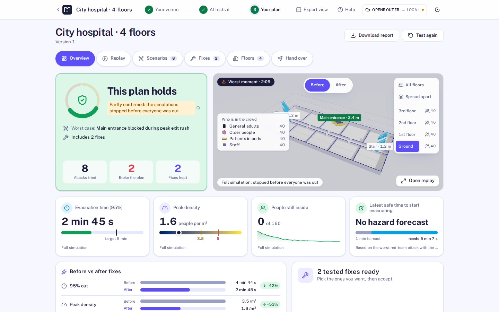
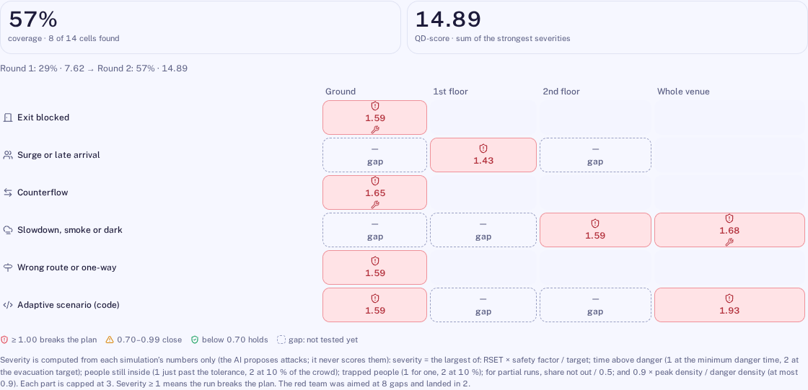
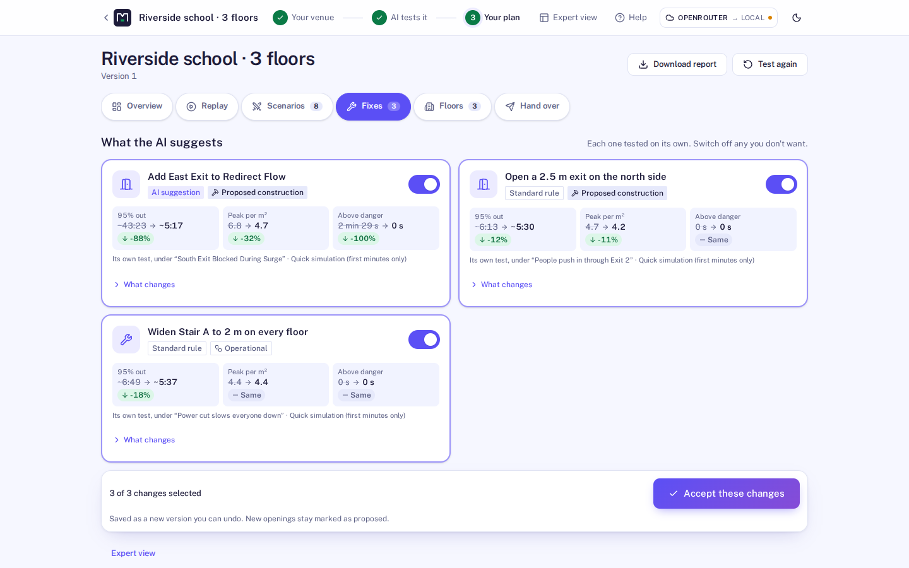
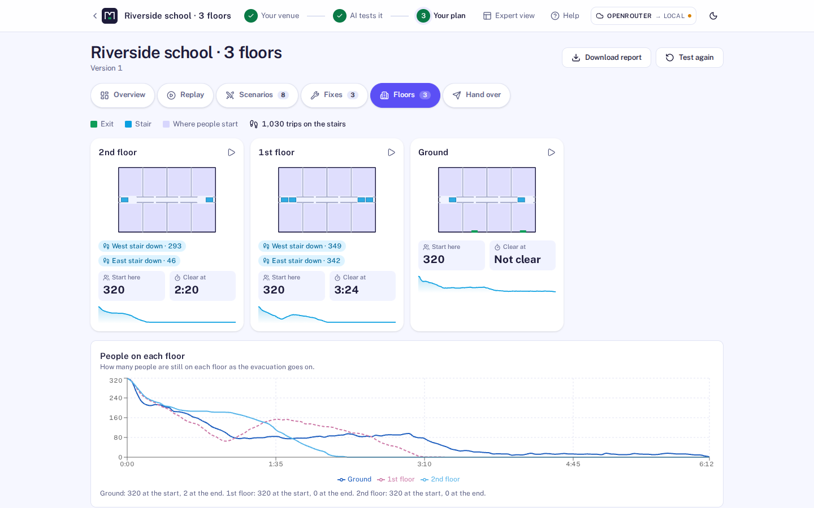
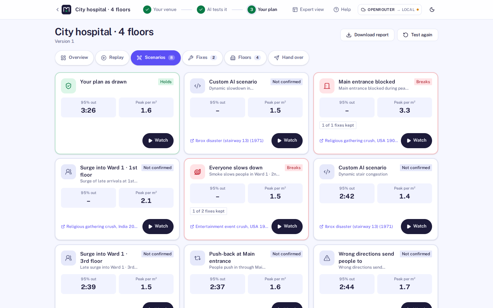
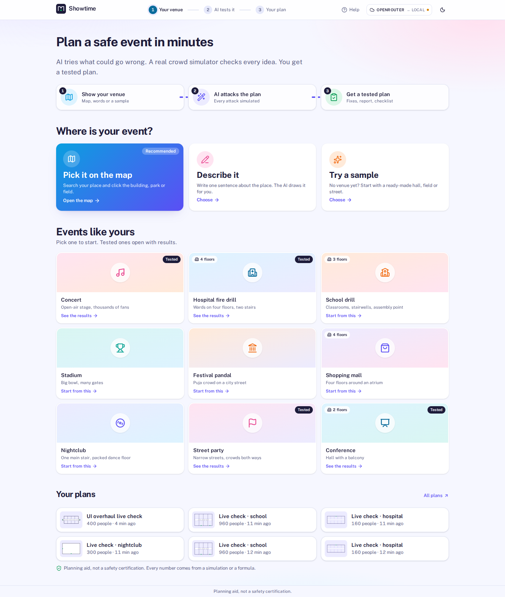
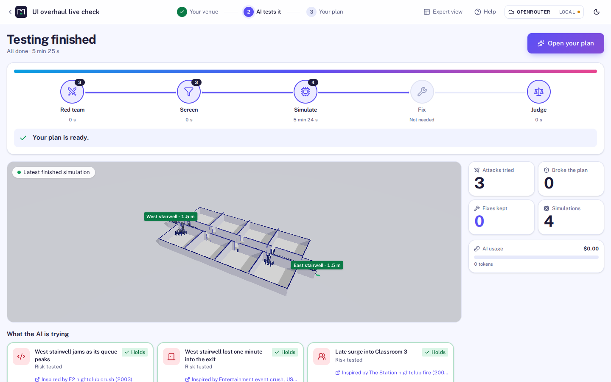

# Showtime: Red Team Night

**Will everyone get out safely? Test your event before the gates open.**

Showtime is a crowd-safety planning studio for event organizers who can't afford a consultant.
Pick your venue on a map, and AI red-team agents (NVIDIA Nemotron) write new crowd-disaster
scenarios as code. Each runs in its own sealed sandbox against a real crowd simulator (JuPedSim).
AI fixes are simulated again, the worst moment can be rewound to test responses from the same
second, and you get a tested plan, a report and a handover checklist. Every number comes from the
simulator, never from the AI. **[Read the pitch, the evidence and the limits](docs/PITCH.md)**
· [Demo script](docs/DEMO.md) · [Simulator validation](docs/VALIDATION.md)

Event safety planning and crowd simulation are slow, expensive and need specialists, so most
events never get stress-tested. Showtime lets AI do that work. NVIDIA Nemotron agents drive
existing, proven simulation software (JuPedSim, PedPy, Pynite, Open-Meteo) and keep costs low:
small models for everyday calls, the largest only for the final judgement, instant estimates
before any simulation, and cached results.

Showtime is an affordable crowd-safety planning studio for event organizers, venue managers and
permit offices. Type what, where, when and how many, for example *“Victory Day concert at Ramna
Park, Dhaka on 16 December at 6 pm for 6,000 people, 5 hours, with a bar”*, and the **Event
Copilot** (NVIDIA Nemotron) pulls the **real site from OpenStreetMap**, lays out the event
(stage, crowd barrier, front-of-house, toilet blocks, bars, crowd zones), estimates **safe
capacity, exits, stewards, first aid, toilets, fencing and budget** from published planning
guides, and starts a **real crowd simulation**. Then **Red Team Night** lets AI attackers break
the plan with scenarios grounded in real crowd incidents and AI defenders fix it, keeping only
measured improvements, down to **the latest safe time to start evacuating**.

> Planning aid, not a safety certification.



| **Failure map**: every way the plan broke, by hazard and floor (Rainbow red teaming) | **Fixes**, each simulated on its own; none may make an outcome worse |
| --- | --- |
|  |  |
| **Floors**: when each storey clears and how many use each stair | **Scenarios** the AI and the rules tried, with the incident that inspired each |
|  |  |
| **Start from your event**: map, one sentence, or a use case | **AI at work**: the red team, the simulator and the judge, live |
|  |  |
| **The real site in 3D**, laid out for the event | **Event Copilot**: one sentence to a tested plan |
|  |  |

## Why

Crowd crushes happen about once a month worldwide (Feliciani et al., *Safety Science* 2023).
Itaewon (2022): 159 deaths in a 3.2 m alley where two flows met. Indiana State Fair (2011): a
stage roof collapsed in a 59 mph gust; nobody had checked its ballast against the forecast.
Professional crowd modelling is expensive and needs specialists, so most events never get
stress-tested. Showtime makes "what happens if…?" a two-minute question for any organizer.

## What it does

- **Event Copilot (a LangGraph agent graph)**: one sentence → Brief agent → the real site
  (OpenStreetMap) or the Designer agent → layout solver → planning ratios → project → full
  simulation in a sandbox → **scenario sweep** (what-ifs from an 18-scenario library, each
  branched into its own sandbox)
  → **Safety officer** agent with prioritised, number-checked actions. The graph is drawn live
  as nodes run.
- **Planning score** (A–F) with an explained breakdown, and a **what-if lab** (crowd size,
  rain or smoke walking speed, closed gates) that recomputes score, evacuation time and capacity
  instantly.
- **Showtime lights** (event-night scene with sweeping stage spotlights and an LED wall) and a
  **narrated cinematic tour** of the plan.
- **Never stuck on a quota**: if the hosted model fails (quota, outage, timeout) the same request
  is answered by local Nemotron and the badge shows the fallback.
- **Three ways to start a venue**: a **real place** (search, then click a building for an indoor
  event or a park, square or campus for an open-air one, on a MapLibre 3D map), **describe it**
  (the Designer agent writes sizes, walls and regions; a solver places every wall, exit, stair
  and zone and the checks run), or a **template**.
- **Plan for the day**: safe capacity (floor space × planning density; exits by the Green Guide
  width × flow × time method; stairs), exit width needed, stewards, first aiders, toilets (Purple
  Guide table by duration and alcohol), fencing, barrier and a budget. Every ratio is cited.
- **3D venue** (React Three Fiber): section-cut walls, exits with direction arrows, stage truss
  and roof, zones, stairs, two floors. Edit by **typing** ("add a 3 m exit on the east wall";
  the Venue agent turns it into a validated patch) or by **dragging**. Every save is a version
  with undo/redo.
- **Instant estimate** (milliseconds): geodesic walking distances, min-cost-flow exit
  assignment and queues. Powers **Break it yourself**: click an exit to block it and see the
  effect immediately.
- **Confirmed by simulation**: every person simulated with **JuPedSim** in a sandbox with no
  network; density on a 1 m grid, hotspots, evacuation time (95%), exit flows; replayed in 3D
  with a colour-blind-safe heatmap and an outlined danger contour (5 people per m²).
- **Red Team Night**: red team attacks (cited from 388 real accidents, 1900–2024), branches
  simulated, blue team fixes simulated, kept only when they remove the break or measurably
  improve; rounds escalate on the improved plan; final before/after confirmation; a judge whose
  every number is checked against the results. Live branch tree, scoreboard, agent activity
  and cost meter. Time travel ("apply the fix from 1:30") and split-screen compare.
- **Wind hazard**: Open-Meteo gust forecast versus the stage's wind limit from a **Pynite**
  structural frame model (uplift, sliding, overturning) → *start evacuating by 10:56* in the
  Wellington sample.
- **Ask the venue**: click a hotspot, ask "why is this red?"; the answer quotes only numbers
  from the run.
- **Report**: printable HTML/PDF with verdict, countdown, evacuation map (SVG with exit
  arrows), attacks with sources, fixes, assumptions with sources, calibration.

Honest by design: **the language model never produces a number shown as a measurement.**
Densities, times, forces and wind limits come from the simulator, formulas or cited data; the
UI always says whether you are looking at an *instant estimate* or a result *confirmed by
simulation*.

## Engineering novelty (and the papers behind it)

| Idea | What Showtime does | Measured here |
| --- | --- | --- |
| **Rainbow red teaming with a physics judge** (Samvelyan et al., *Rainbow Teaming*, NeurIPS 2024; *RainbowPlus*, 2025) | The red team fills a **failure map**: a MAP-Elites archive of hazard kind × place (floor, exit or side), keeping the two worst attacks per cell. Nemotron is asked to fill the empty cells. The fitness is a severity score from **simulated metrics only**, so the search cannot flatter its judge, the failure mode Rainbow Teaming reports for LLM judges. | Matched two-round sessions with Nemotron (mock simulator, same budget): the school wing's map went from 29 % to 57 % coverage and from 4 to 6 of 6 hazard kinds. Live with JuPedSim, a 3-storey school filled 8 of 14 cells, every one a confirmed break. [docs/RAINBOW.md](docs/RAINBOW.md) |
| **Crowd pressure, the turbulence warning** (Helbing, Johansson & Al-Abideen, *Phys. Rev. E* 75, 046109, 2007) | Every simulation computes crowd pressure P = ρ·Var(v) per cell and time, the measure that rose before the 2006 Mina crush, with their 0.02/s² threshold. It shows as a **Turbulence** layer in the replay, together with Fruin level-of-service shares (A–F). | A 0.8 m bottleneck: 28 s of turbulence, against none for a 6 m exit. A 3-storey school with 960 children: 40 s of turbulence on its stairs. |
| **Describe → solve → check → repair for whole buildings** (in the spirit of Text2BIM, *J. Comput. Civ. Eng.* 2026) | One sentence becomes a multi-storey building: storeys and basements, people per floor, wards or classrooms off a corridor, atriums, stair cores. Nemotron writes only the structure; a solver builds the geometry and the checks send errors back once. | Live with Nemotron 3 Super: 12 of 12 test descriptions built correctly (a 5-storey office, a 4-floor hospital, a 3-level mall, a basement nightclub, a 10-storey hotel, a metro platform, …). Before this, every multi-storey description collapsed to one floor. |
| **Who is in the crowd** | Older people, children, wheelchair users and patients in beds walk at cited speeds and take their real width, down the stairs too. The replay draws each kind with its own shape. | The 4-floor hospital takes 207 s to get 95 % out with its patients and staff, against 109 s if everyone moved like a healthy adult. |
| **Scenarios for buildings** | 18 named what-ifs with targets picked from the venue: a stairwell lost to smoke, firefighters climbing the stairs, phased evacuation, a power cut, a gate closed, a late surge… | 3-storey office, 300 people: losing one stairwell raises the time to get 95 % out from 104 s to 174 s (+68 %). |

## How NVIDIA and Nebius technology is used

| Technology | Role in Showtime |
| --- | --- |
| **NVIDIA Nemotron** (Nano 9B v2 locally; Nemotron 3 Nano / Super / Ultra on Token Factory) | Seven agents: **Brief** (one sentence → event brief for the Copilot), **Designer** (description → layout spec that a solver builds and the checks verify), **Venue** (text → validated edit ops; 12/12 on our scripted edits with the local model), **Red team** (attacks grounded in incidents), **Blue team** (fixes), **Judge** (final plan text, number-checked), **Explainer** ("Ask the venue"). Roles map to models: `fast` for drafting, `main` for edits and fixes, `judge` for the final reasoning. JSON is schema-constrained, validated with Pydantic and repaired once. |
| **Nebius Token Factory** | OpenAI-compatible endpoint behind `LLM_PROVIDER=nebius`; per-role model ids and prices in `.env`; tokens and cost are metered per agent call and shown live. |
| **Nebius Sandboxes** (contree-sdk) | `SANDBOX_PROVIDER=nebius`: every scenario is a child snapshot of the venue image (attack → fix branches; the Copilot's six-scenario sweep branches from the plan's run), run in parallel. Locally the same interface runs Docker containers with `--network=none`, one at a time. |
| **LangGraph** | The Event Copilot is a compiled `StateGraph` with conditional routes, checkpointing and custom streaming; `GET /api/v1/copilot/graph` serves its structure, which the UI draws live. |
| **Tavily** | Search adapter built (cached, per-session cap) and shown in health. It is not yet wired into the agents; live evidence for attack cards, cited event research inputs (attendance, capacity, gates), local rules and fix guidance is planned (see `../plan.md`, N02/N03/N18/N19). Today the red team cites the incident dataset. |
| **JuPedSim, PedPy, Pynite, Open-Meteo** | Crowd simulation, crowd metrics, stage frame model, gust forecasts. |
| **OpenStreetMap, OpenFreeMap, MapLibre** | Real sites: place search (Nominatim), buildings, water, paths and entrances (Overpass, with OpenFreeMap vector tiles as fallback), the 3D picking map and the street-map ground in the 3D view. |

See [docs/NEBIUS_SWITCH.md](docs/NEBIUS_SWITCH.md) for what was verified and how to switch.

## Local M1 test setup (OpenRouter, Docker)

Install Docker Desktop for Apple Silicon and use the host's `python3`:

```bash
cd nebius
make m1-test-init
# Add OPENAI_COMPAT_API_KEY to the generated .env using your editor.
make m1-test-up
make m1-test-smoke
```

Open <http://localhost:5173>. The API and web UI run on ARM; the JuPedSim container runs
with `linux/amd64` emulation. The launcher builds dependencies in Docker, starts Docker
Desktop if needed, and waits for the services. No host Python packages, CUDA server,
model weights, Nebius key, or Tavily key are needed. Existing `.env` settings are preserved.

Templates, saved examples, editing, and local simulations work without an OpenRouter key.
AI conversation and agent features require the key and available model quota.
`make m1-test-smoke` checks the UI, API proxy, and an actual 20-person simulation without AI calls.

Use `make m1-test-status`, `make m1-test-logs`, and `make m1-test-down` for status, logs, and shutdown.
Restart built images with `make m1-test-start`, including after updating `.env`.
Use `make m1-test-up` to rebuild after source or dependency changes.
The profile files and commands are explicitly named for M1 testing. The recorded startup
verification was performed on an M1; this is a local development profile.
See [the M1 test setup guide](docs/M1_TEST_SETUP.md) for configuration and troubleshooting.

### Scene inspection API (P2-01)

`GET /api/v1/projects/{id}/scene` returns the full versioned venue with units and provenance.
`GET /api/v1/projects/{id}/scene-facts` computes areas, connected components, reachable exits,
point clearances, and bounded geometric routes without AI or simulation calls.
See [the interface and prepared test procedure](docs/SCENE_INSPECTION.md).

### Organizer plan API (P2-02)

Save organizer constraints and timed operational actions alongside the venue through
`GET/PUT /api/v1/projects/{id}/plan`. Preview and apply complete bundles with version
checks, locks, approvals, dependency checks, and staff/equipment allocation validation.
Runs use saved actions and expose evidence applicability against the current plan.
See [the backend contract](docs/PLAN_CONSTRAINTS.md) and [M1 tests](docs/P2_02_TESTING.md).

## Quickstart (Linux, NVIDIA GPU, Docker)

```bash
cp .env.example .env
make setup        # uv, Python 3.12, web deps, sim image, llama.cpp, Nemotron GGUF, data — all inside this folder
make llm-up       # Nemotron Nano 9B v2 on the GPU (≈ 6.4 GB VRAM, ≈ 0.9 GB RAM)
make up           # Docker Compose → http://localhost:5173
```

Three sample projects (Itaewon-style alley, two-floor hall, Wellington festival in a storm)
install automatically with their finished red-team sessions, so you can explore immediately.
A guided tour for organizers is in [docs/TESTING_GUIDE.md](docs/TESTING_GUIDE.md); a short
presenter script is in [docs/DEMO.md](docs/DEMO.md).

Lighter, without Docker for the app: `make dev` (API + Vite natively). Other targets:
`make test`, `make smoke`, `make calibrate`, `make plugins`, `make mem`, `make help`.

**Switch to Nebius:** set `LLM_PROVIDER=nebius`, `SANDBOX_PROVIDER=nebius`, `NEBIUS_API_KEY`
and the `MODEL_*` ids in `.env`, then `make smoke-nebius`.

## Architecture

A modular monolith with 12 plugin extension points (edit ops, scenario events, hazards, rules,
incident sources, exporters, importers, engines, agents, tools, providers, hooks); built-in
features are plugins too. FastAPI + SQLite (Alembic) + SSE; React 19 + R3F + React Flow +
TanStack Query; JuPedSim in a sandbox image. Details: [docs/ARCHITECTURE.md](docs/ARCHITECTURE.md),
[docs/EXTENDING.md](docs/EXTENDING.md), decisions in [docs/adr/](docs/adr/).

## Numbers you can trust (and their limits)

Every default (walking speed, body size, flows, thresholds, wind coefficients) is listed with
its source in [docs/ASSUMPTIONS.md](docs/ASSUMPTIONS.md) and printed in each report. The engine
was calibrated against published flows (door flow 1.1–1.5 people per metre per second) and its
known artefacts were measured and fixed (doorway plugs, corner deadlocks), see
[docs/PROGRESS.md](docs/PROGRESS.md). Instant estimates are compared with simulations per
template (`make calibrate`) and the ratio is printed in reports.

## Docs

[Demo script](docs/DEMO.md) · [Testing guide](docs/TESTING_GUIDE.md) · [User guide](docs/USER_GUIDE.md) ·
[Architecture](docs/ARCHITECTURE.md) · [Extending](docs/EXTENDING.md) ·
[Assumptions](docs/ASSUMPTIONS.md) · [Nebius switch](docs/NEBIUS_SWITCH.md) ·
[Progress log](docs/PROGRESS.md) · [Handoff](docs/HANDOFF.md) · [Security](SECURITY.md) ·
[Licences](docs/LICENSES.md) · [Feedback on Nebius & NVIDIA tools](docs/FEEDBACK.md)

## License

Apache-2.0 (see [LICENSE](LICENSE)). Third-party licences: [docs/LICENSES.md](docs/LICENSES.md).
