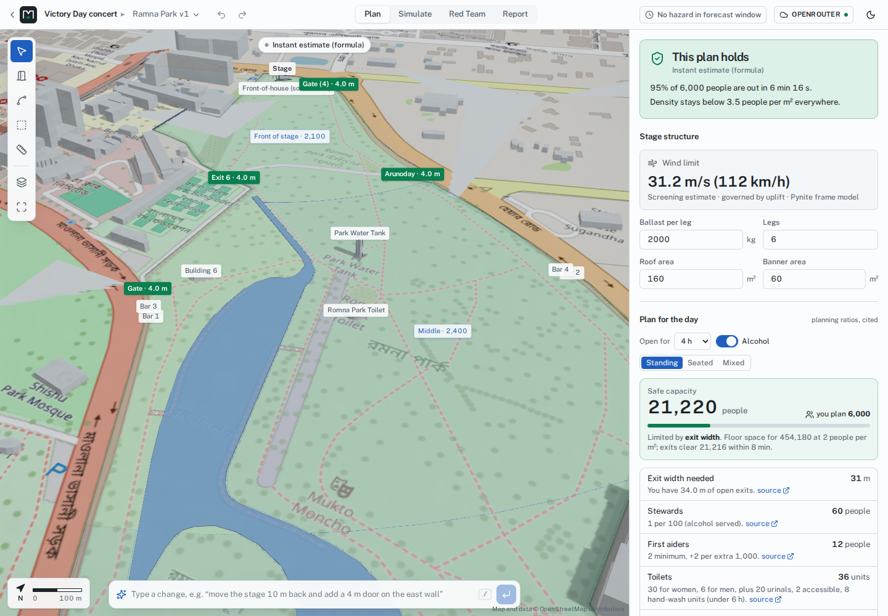
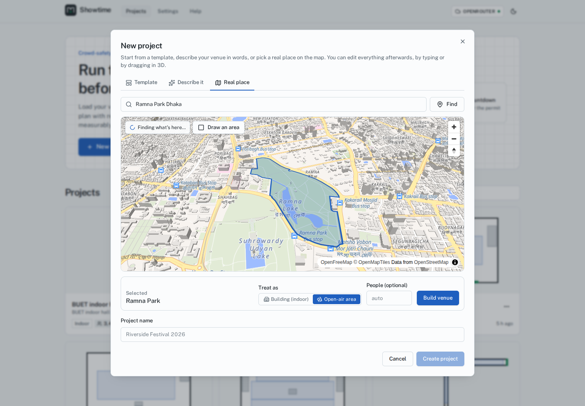
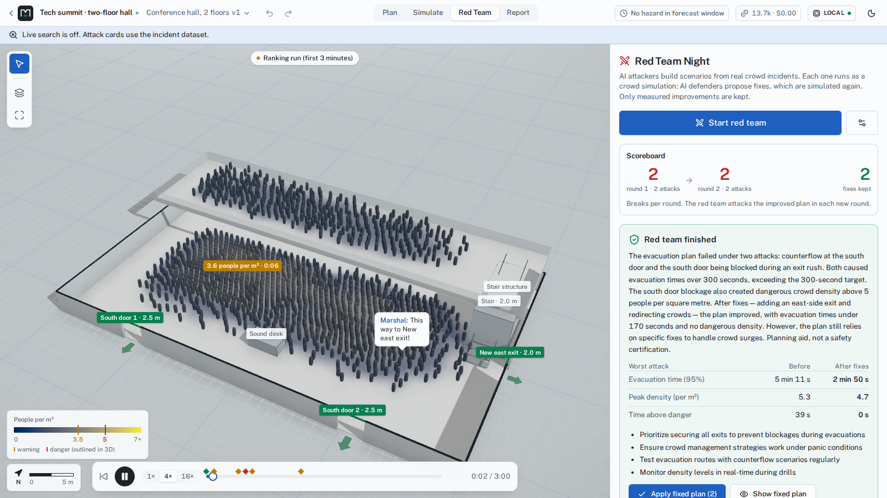
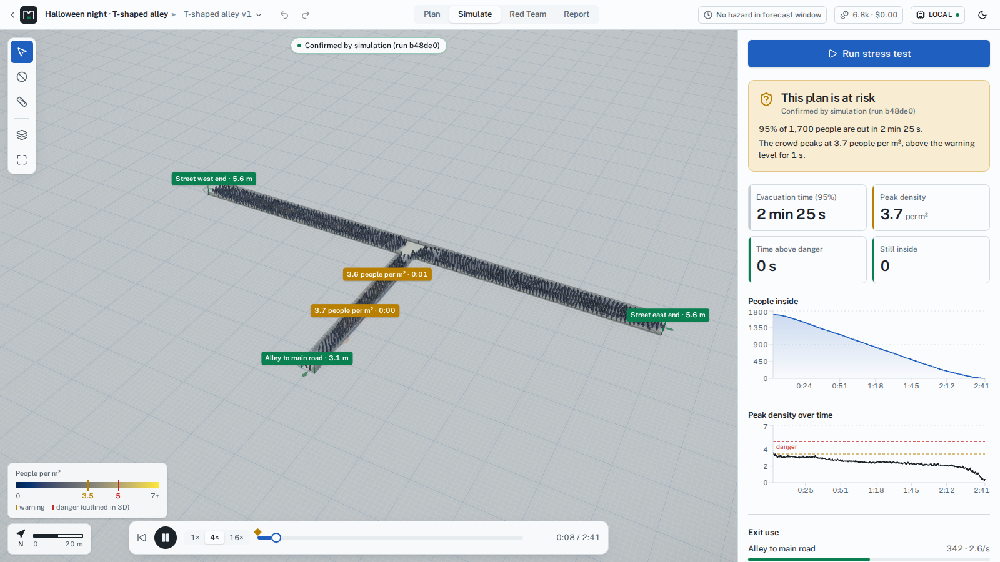

# Showtime: Red Team Night

**From one sentence to a crowd-safety plan you can defend.**

Showtime is an affordable crowd-safety planning studio for event organizers, venue managers and
permit offices. Type what, where, when and how many, for example *“Victory Day concert at Ramna
Park, Dhaka on 16 December at 6 pm for 6,000 people, 5 hours, with a bar”*, and the **Event
Copilot** (NVIDIA Nemotron) pulls the **real site from OpenStreetMap**, lays out the event
(stage, crowd barrier, front-of-house, toilet blocks, bars, crowd zones), estimates **safe
capacity, exits, stewards, first aid, toilets, fencing and budget** from published planning
guides, and starts a **real crowd simulation**. Then **Red Team Night** lets AI attackers break
the plan with scenarios grounded in real crowd incidents and AI defenders fix it, keeping only
measured improvements, down to **the latest safe time to start evacuating**.

> Planning aid, not a safety certification.


| The real site in 3D, laid out for the event | Pick any building or park on a 3D map |
| --- | --- |
|  |  |
| **Red Team Night** | **Crowd replay with density heatmap** |
|  |  |

## Why

Crowd crushes happen about once a month worldwide (Feliciani et al., *Safety Science* 2023).
Itaewon (2022): 159 deaths in a 3.2 m alley where two flows met. Indiana State Fair (2011): a
stage roof collapsed in a 59 mph gust; nobody had checked its ballast against the forecast.
Professional crowd modelling is expensive and needs specialists, so most events never get
stress-tested. Showtime makes "what happens if…?" a two-minute question for any organizer.

## What it does

- **Event Copilot (a LangGraph agent graph)**: one sentence → Brief agent → the real site
  (OpenStreetMap) or the Designer agent → layout solver → planning ratios → project → full
  simulation in a sandbox → **scenario sweep** (six what-ifs, each branched into its own sandbox)
  → **Safety officer** agent with prioritised, number-checked actions. The graph is drawn live
  as nodes run.
- **Planning score** (A–F) with an explained breakdown, and a **what-if lab** (crowd size,
  rain or smoke walking speed, closed gates) that recomputes score, evacuation time and capacity
  instantly.
- **Showtime lights** (event-night scene with sweeping stage spotlights and an LED wall) and a
  **narrated cinematic tour** of the plan.
- **Never stuck on a quota**: if the hosted model fails (quota, outage, timeout) the same request
  is answered by local Nemotron and the badge shows the fallback.
- **Three ways to start a venue**: a **real place** (search, then click a building for an indoor
  event or a park, square or campus for an open-air one, on a MapLibre 3D map), **describe it**
  (the Designer agent writes sizes, walls and regions; a solver places every wall, exit, stair
  and zone and the checks run), or a **template**.
- **Plan for the day**: safe capacity (floor space × planning density; exits by the Green Guide
  width × flow × time method; stairs), exit width needed, stewards, first aiders, toilets (Purple
  Guide table by duration and alcohol), fencing, barrier and a budget. Every ratio is cited.
- **3D venue** (React Three Fiber): (React Three Fiber): section-cut walls, exits with direction arrows, stage truss
  and roof, zones, stairs, two floors. Edit by **typing** ("add a 3 m exit on the east wall";
  the Venue agent turns it into a validated patch) or by **dragging**. Every save is a version
  with undo/redo.
- **Instant estimate** (milliseconds): geodesic walking distances, min-cost-flow exit
  assignment and queues. Powers **Break it yourself**: click an exit to block it and see the
  effect immediately.
- **Confirmed by simulation**: every person simulated with **JuPedSim** in a sandbox with no
  network; density on a 1 m grid, hotspots, evacuation time (95%), exit flows; replayed in 3D
  with a colour-blind-safe heatmap and an outlined danger contour (5 people per m²).
- **Red Team Night**: red team attacks (cited from 388 real accidents, 1900–2024), branches
  simulated, blue team fixes simulated, kept only when they remove the break or measurably
  improve; rounds escalate on the improved plan; final before/after confirmation; a judge whose
  every number is checked against the results. Live branch tree, scoreboard, agent activity
  and cost meter. Time travel ("apply the fix from 1:30") and split-screen compare.
- **Wind hazard**: Open-Meteo gust forecast versus the stage's wind limit from a **Pynite**
  structural frame model (uplift, sliding, overturning) → *start evacuating by 10:56* in the
  Wellington sample.
- **Ask the venue**: click a hotspot, ask "why is this red?"; the answer quotes only numbers
  from the run.
- **Report**: printable HTML/PDF with verdict, countdown, evacuation map (SVG with exit
  arrows), attacks with sources, fixes, assumptions with sources, calibration.

Honest by design: **the language model never produces a number shown as a measurement.**
Densities, times, forces and wind limits come from the simulator, formulas or cited data; the
UI always says whether you are looking at an *instant estimate* or a result *confirmed by
simulation*.

## How NVIDIA and Nebius technology is used

| Technology | Role in Showtime |
| --- | --- |
| **NVIDIA Nemotron** (Nano 9B v2 locally; Nemotron 3 Nano / Super / Ultra on Token Factory) | Seven agents: **Brief** (one sentence → event brief for the Copilot), **Designer** (description → layout spec that a solver builds and the checks verify), **Venue** (text → validated edit ops; 12/12 on our scripted edits with the local model), **Red team** (attacks grounded in incidents), **Blue team** (fixes), **Judge** (final plan text, number-checked), **Explainer** ("Ask the venue"). Roles map to models: `fast` for drafting, `main` for edits and fixes, `judge` for the final reasoning. JSON is schema-constrained, validated with Pydantic and repaired once. |
| **Nebius Token Factory** | OpenAI-compatible endpoint behind `LLM_PROVIDER=nebius`; per-role model ids and prices in `.env`; tokens and cost are metered per agent call and shown live. |
| **Nebius Sandboxes** (contree-sdk) | `SANDBOX_PROVIDER=nebius`: every scenario is a child snapshot of the venue image (attack → fix branches; the Copilot's six-scenario sweep branches from the plan's run), run in parallel. Locally the same interface runs Docker containers with `--network=none`, one at a time. |
| **LangGraph** | The Event Copilot is a compiled `StateGraph` with conditional routes, checkpointing and custom streaming; `GET /api/v1/copilot/graph` serves its structure, which the UI draws live. |
| **Tavily** | Optional live web evidence for attack cards and rules (cached, per-session cap). Without a key the red team cites the incident dataset ("Live search is off"). |
| **JuPedSim, PedPy, Pynite, Open-Meteo** | Crowd simulation, crowd metrics, stage frame model, gust forecasts. |
| **OpenStreetMap, OpenFreeMap, MapLibre** | Real sites: place search (Nominatim), buildings, water, paths and entrances (Overpass, with OpenFreeMap vector tiles as fallback), the 3D picking map and the street-map ground in the 3D view. |

See [docs/NEBIUS_SWITCH.md](docs/NEBIUS_SWITCH.md) for what was verified and how to switch.

## Quickstart (Linux, NVIDIA GPU, Docker)

```bash
cp .env.example .env
make setup        # uv, Python 3.12, web deps, sim image, llama.cpp, Nemotron GGUF, data — all inside this folder
make llm-up       # Nemotron Nano 9B v2 on the GPU (≈ 6.4 GB VRAM, ≈ 0.9 GB RAM)
make up           # Docker Compose → http://localhost:5173
```

Three sample projects (Itaewon-style alley, two-floor hall, Wellington festival in a storm)
install automatically with their finished red-team sessions, so you can explore immediately.
A guided tour for organizers is in [docs/TESTING_GUIDE.md](docs/TESTING_GUIDE.md).

Lighter, without Docker for the app: `make dev` (API + Vite natively). Other targets:
`make test`, `make smoke`, `make calibrate`, `make plugins`, `make mem`, `make help`.

**Switch to Nebius:** set `LLM_PROVIDER=nebius`, `SANDBOX_PROVIDER=nebius`, `NEBIUS_API_KEY`
and the `MODEL_*` ids in `.env`, then `make smoke-nebius`.

## Architecture

A modular monolith with 12 plugin extension points (edit ops, scenario events, hazards, rules,
incident sources, exporters, importers, engines, agents, tools, providers, hooks); built-in
features are plugins too. FastAPI + SQLite (Alembic) + SSE; React 19 + R3F + React Flow +
TanStack Query; JuPedSim in a sandbox image. Details: [docs/ARCHITECTURE.md](docs/ARCHITECTURE.md),
[docs/EXTENDING.md](docs/EXTENDING.md), decisions in [docs/adr/](docs/adr/).

## Numbers you can trust (and their limits)

Every default (walking speed, body size, flows, thresholds, wind coefficients) is listed with
its source in [docs/ASSUMPTIONS.md](docs/ASSUMPTIONS.md) and printed in each report. The engine
was calibrated against published flows (door flow 1.1–1.5 people per metre per second) and its
known artefacts were measured and fixed (doorway plugs, corner deadlocks), see
[docs/PROGRESS.md](docs/PROGRESS.md). Instant estimates are compared with simulations per
template (`make calibrate`) and the ratio is printed in reports.

## Docs

[Testing guide](docs/TESTING_GUIDE.md) · [User guide](docs/USER_GUIDE.md) ·
[Architecture](docs/ARCHITECTURE.md) · [Extending](docs/EXTENDING.md) ·
[Assumptions](docs/ASSUMPTIONS.md) · [Nebius switch](docs/NEBIUS_SWITCH.md) ·
[Progress log](docs/PROGRESS.md) · [Handoff](docs/HANDOFF.md) · [Security](SECURITY.md) ·
[Licences](docs/LICENSES.md) · [Feedback on Nebius & NVIDIA tools](docs/FEEDBACK.md)

## License

Apache-2.0 (see [LICENSE](LICENSE)). Third-party licences: [docs/LICENSES.md](docs/LICENSES.md).
