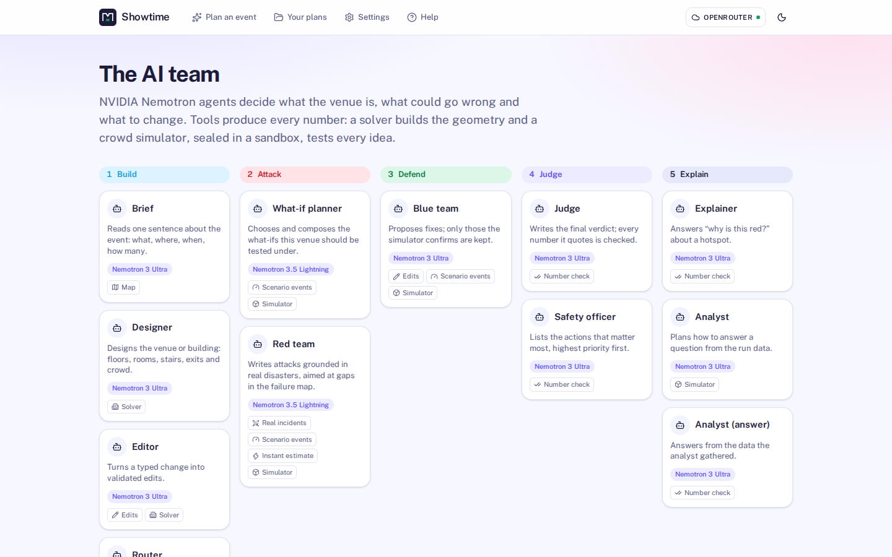
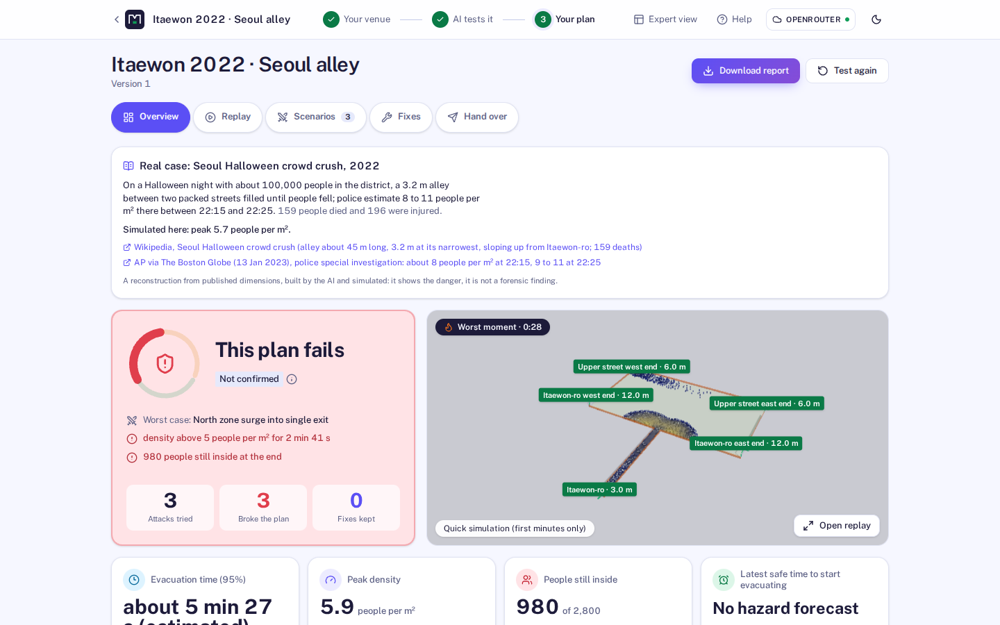
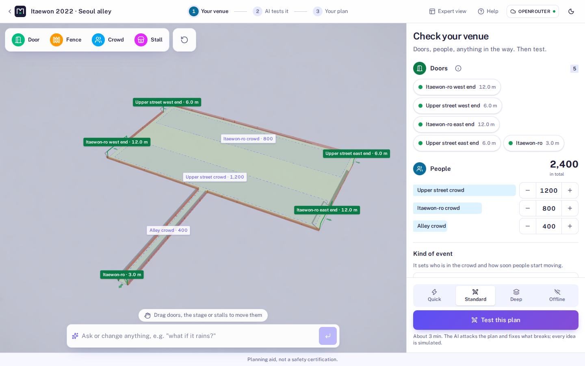

# Showtime: Red Team Night

[](LICENSE)

**AI agents try to break your event plan. Every attack is code the AI wrote, and it only ever
runs inside a sealed sandbox. A physics simulator, not the AI, decides what breaks. Then the AI
fixes the plan and the sandbox proves the fix.**

- **Agents that act:** twelve NVIDIA Nemotron agents. They build the venue from one sentence,
  write attacks as code, look up real incidents, propose fixes and write their own analysis code.
- **Sandboxes at the core:** every simulation and every AI-written script runs in a throwaway
  container. It has no network, a read-only system, memory, CPU and process limits, and no keys.
  [14 attacks on it, and what stopped each](docs/SANDBOX_PROOF.md).
- **Evidence:** attacks cite real crowd accidents (395 in the incident dataset). Every number
  comes from the simulator, which is within about 6 % of a real bottleneck experiment
  ([validation](docs/VALIDATION.md)).


**Run it:** [quickstart](#quickstart) · **Status:** it runs now on local Docker sandboxes and on
NVIDIA Nemotron through OpenRouter. Nebius Token Factory, Nebius Sandboxes and Tavily web search
are built as plug-ins, but **not run live** (no keys yet: [live status](docs/LIVE_STATUS.md)).

> Planning aid, not a safety certification.

## Why

Crowd crushes happen about once a month worldwide (Feliciani et al., *Safety Science* 2023).
Itaewon (2022): 159 deaths in a 3.2 m alley where two flows met. Indiana State Fair (2011): a
stage roof collapsed in a 59 mph gust; nobody had checked its ballast against the forecast.
Professional crowd modelling is expensive and needs specialists, so most events never get
stress-tested. Showtime makes "what happens if…?" a two-minute question for any organizer.

## What you see


| **Failure map**: every way the plan broke, by hazard and floor (Rainbow red teaming) | **Fixes**, each simulated on its own; none may make an outcome worse |
| --- | --- |
|  |  |
| **Floors**: when each storey clears and how many use each stair | **Scenarios** the AI and the rules tried, with the incident that inspired each |
|  |  |
| **Start from your event**: map, one sentence, or a use case | **AI at work**: the red team, the simulator and the judge, live |
|  |  |
| **The AI team**: twelve Nemotron agents, the model each runs on, the tools each may use | **Real cases** rebuilt by the AI from published reports and simulated |
|  |  |
| **Test modes**: Quick, Standard, Deep or Offline | |
|  | |
| **The real site in 3D**, laid out for the event | **Event Copilot**: one sentence to a tested plan |
|  |  |

## What it does

The core loop, in the order you meet it:

- **Failure map** (Red Team Night): the red team attacks the plan, each attack runs as a crowd
  simulation in its own sandbox, and the map shows every way the plan broke, by hazard and by
  floor, exit or side. Attacks cite real accidents (395 in the incident dataset, 1900–2024).
- **Rainbow search**: how the red team fills the failure map. It is asked for the empty cells,
  and a cell is kept only on simulated metrics, so the search cannot flatter its judge (after
  Rainbow Teaming, NeurIPS 2024: [docs/RAINBOW.md](docs/RAINBOW.md)).
- **AI-written scenarios**: the red team writes new failures as small Python programs ("close
  the stairwell when its queue passes 40 people"). **Show the code** displays one. A static
  check refuses unsafe code before it runs, and the sandbox stops what slips past.
- **Fixes the sandbox proves**: the blue team proposes fixes, each fix is simulated again, and
  only measured improvements are kept. The judge's every number is checked against the results.
- **Rewind the worst moment**: the crowd is saved at its most dangerous second. "Do nothing" and
  each response then run from that same second, side by side.
- **Stress test at scale**: every attack against your plan, and each kept fix against several
  random crowds, fanned out over sandboxes with live counters.
- **Evidence panel**: what each attack is grounded in, with its origin (incident dataset or live
  web), and the agents' tool calls in AI at work. Web search switches on with a Tavily key.
- **Real cases**: Love Parade, Hillsborough and Itaewon, rebuilt by the same designer from their
  sourced descriptions, then simulated ([docs/REAL_CASES.md](docs/REAL_CASES.md)).

Around it:

- **Three ways to start a venue**: a **real place** (search, then click a building for an indoor
  event or a park, square or campus for an open-air one, on a MapLibre 3D map), **describe it**
  (the Designer agent writes sizes, levels, zones and routes; a solver places every wall, exit,
  stair and zone and the checks run), or a **template**.
- **Event Copilot** (a LangGraph agent graph): one sentence → brief → the real site or the
  Designer → layout solver → planning ratios → project → simulation → a **scenario sweep** (what-ifs
  from an 18-scenario library, each in its own sandbox) → a **Safety officer** agent with
  prioritised, number-checked actions. The graph is drawn live as nodes run.
- **Plan for the day**: safe capacity (floor space × planning density; exits by the Green Guide
  width × flow × time method; stairs), exit width needed, stewards, first aiders, toilets (Purple
  Guide table by duration and alcohol), fencing, barrier and a budget. Every ratio is cited.
  A **planning score** (A–F) and a **what-if lab** recompute instantly.
- **3D venue** (React Three Fiber): section-cut walls, exits with direction arrows, stage truss
  and roof, zones, stairs, several floors. Edit by **typing** ("add a 3 m exit on the east wall";
  the Venue agent turns it into a validated patch) or by **dragging**. Every save is a version
  with undo/redo.
- **Instant estimate** (milliseconds): geodesic walking distances, min-cost-flow exit
  assignment and queues. Powers **Break it yourself**: click an exit to block it and see the
  effect immediately.
- **Confirmed by simulation**: every person simulated with **JuPedSim**; density on a 1 m grid,
  hotspots, evacuation time (95%), exit flows; replayed in 3D with a colour-blind-safe heatmap
  and an outlined danger contour (5 people per m²).
- **Wind hazard**: Open-Meteo gust forecast versus the stage's wind limit from a **Pynite**
  structural frame model (uplift, sliding, overturning) → *start evacuating by 10:56* in the
  Wellington sample.
- **Ask or change anything**: "why is this red?" quotes only numbers from the run; the analyst
  answers questions by writing code that runs in the sandbox on the simulation data.
- **Report and handover checklist**: printable HTML/PDF with verdict, countdown, evacuation map
  (SVG with exit arrows), attacks with sources, fixes, assumptions with sources; a checklist with
  open conditions, staff actions and a sign-off line.
- **Test modes**: Quick, Standard, Deep, and Offline (no model: rule-based attacks and fixes,
  still simulated).

Honest by design: **the language model never produces a number shown as a measurement.**
Densities, times, forces and wind limits come from the simulator, formulas or cited data; the
UI always says whether you are looking at an *instant estimate* or a result *confirmed by
simulation*.

## How it works: Nemotron agents decide, sandboxed tools measure

Showtime is a multi-agent system. Twelve NVIDIA Nemotron agents make every decision, in five
stages: **build** (Brief, Designer, Editor, Router), **attack** (What-if planner, Red team),
**defend** (Blue team), **judge** (Judge, Safety officer) and **explain** (Explainer, Analyst).
Tools produce every number: a layout solver turns a design into exact geometry, an instant
estimate screens ideas in milliseconds, and the JuPedSim crowd simulator tests every scenario
and every fix in its own sealed sandbox (Docker with no network today; a Nebius Sandboxes
runner is built behind the same interface, not run live yet). A number checker rejects any agent text that quotes a number the tools did not
produce. Nothing about a venue is hand-made: a sentence, a map or a real case's sourced
description goes in, and the agents and tools do the rest. The live team, with the model each
agent runs on, is at `/team` in the app and `GET /api/v1/agents`.

**Models.** Roles map to models in `.env`: `MODEL_FAST`, `MODEL_MAIN` and `MODEL_LONG` for the
everyday agents and `MODEL_JUDGE` for the final verdict, as the hackathon suggests (a fast
Nemotron for most calls, Nemotron 3 Ultra for the judgement). `MODEL_FALLBACK` is tried when a
role's model fails at the provider, and `OPENAI_COMPAT_API_KEY_FALLBACK` when a key runs out.
Tested on OpenRouter with Nemotron 3.5 Lightning and Nemotron 3 Ultra (the free Nemotron 3
Super endpoint was unavailable at the provider during the last tests).

**Test modes** (above *Test this plan*): **Quick** (one round, a few attacks), **Standard** (the
AI attacks and fixes; the default), **Deep** (three rounds on the improved plan, findings
confirmed in full) and **Offline** (no model: rule-based attacks and standard fixes, still
simulated).

## Engineering novelty (and the papers behind it)

| Idea | What Showtime does | Measured here |
| --- | --- | --- |
| **Rainbow red teaming with a physics judge** (Samvelyan et al., *Rainbow Teaming*, NeurIPS 2024; *RainbowPlus*, 2025) | The red team fills a **failure map**: a MAP-Elites archive of hazard kind × place (floor, exit or side), keeping the two worst attacks per cell. Nemotron is asked to fill the empty cells. The fitness is a severity score from **simulated metrics only**, so the search cannot flatter its judge, the failure mode Rainbow Teaming reports for LLM judges. | Matched two-round sessions with Nemotron (mock simulator, same budget): the school wing's map went from 29 % to 57 % coverage and from 4 to 6 of 6 hazard kinds. Live with JuPedSim, a 3-storey school filled 8 of 14 cells, every one a confirmed break. [docs/RAINBOW.md](docs/RAINBOW.md) |
| **Crowd pressure, the turbulence warning** (Helbing, Johansson & Al-Abideen, *Phys. Rev. E* 75, 046109, 2007) | Every simulation computes crowd pressure P = ρ·Var(v) per cell and time, the measure that rose before the 2006 Mina crush, with their 0.02/s² threshold. It shows as a **Turbulence** layer in the replay, together with Fruin level-of-service shares (A–F). | A 0.8 m bottleneck: 28 s of turbulence, against none for a 6 m exit. A 3-storey school with 960 children: 40 s of turbulence on its stairs. |
| **Describe → solve → check → repair for whole buildings** (in the spirit of Text2BIM, *J. Comput. Civ. Eng.* 2026) | One sentence becomes a multi-storey building: storeys and basements, people per floor, wards or classrooms off a corridor, atriums, stair cores. Nemotron writes only the structure; a solver builds the geometry and the checks send errors back once. | Live with Nemotron 3 Super: 12 of 12 test descriptions built correctly (a 5-storey office, a 4-floor hospital, a 3-level mall, a basement nightclub, a 10-storey hotel, a metro platform, …). Before this, every multi-storey description collapsed to one floor. |
| **Who is in the crowd** | Older people, children, wheelchair users and patients in beds walk at cited speeds and take their real width, down the stairs too. The replay draws each kind with its own shape. | The 4-floor hospital takes 207 s to get 95 % out with its patients and staff, against 109 s if everyone moved like a healthy adult. |
| **Scenarios for buildings** | 18 named what-ifs with targets picked from the venue: a stairwell lost to smoke, firefighters climbing the stairs, phased evacuation, a power cut, a gate closed, a late surge… | 3-storey office, 300 people: losing one stairwell raises the time to get 95 % out from 104 s to 174 s (+68 %). |

## How NVIDIA and Nebius technology is used

| Technology | Role in Showtime |
| --- | --- |
| **NVIDIA Nemotron** (Nano 9B v2 locally; Nemotron 3.5 Lightning / 3 Super / 3 Ultra hosted) | Twelve agents (see *How it works*), among them: **Brief** (one sentence → event brief for the Copilot), **Designer** (description → layout spec that a solver builds and the checks verify), **Venue** (text → validated edit ops; 12/12 on our scripted edits with the local model), **Red team** (attacks grounded in incidents), **Blue team** (fixes), **Judge** (final plan text, number-checked), **Explainer** ("Ask the venue"). Roles map to models: `fast` for drafting, `main` for edits and fixes, `judge` for the final reasoning. JSON is schema-constrained, validated with Pydantic and repaired once. |
| **Nebius Token Factory** | A provider plug-in (`api/adapters/providers/llm_nebius.py`): `LLM_PROVIDER=nebius` plus the key selects it and its Nemotron preset; `make verify-nebius-llm` makes one real call. Built and tested with fake clients; **not run live** (no key yet). Today the same OpenAI-compatible adapter runs Nemotron on OpenRouter. |
| **Nebius Sandboxes** (contree-sdk) | A sandbox plug-in (`SANDBOX_PROVIDER=nebius`): every scenario as a child snapshot of the venue image (attack → fix branches), run in parallel. Built against the SDK and tested with a fake client; **not run live** (no access yet; `make verify-nebius-sandbox`). Today every run is a local Docker container with `--network=none`, a read-only system, memory, CPU and process limits ([docs/SANDBOX_PROOF.md](docs/SANDBOX_PROOF.md)). |
| **LangGraph** | The Event Copilot is a compiled `StateGraph` with conditional routes, checkpointing and custom streaming; `GET /api/v1/copilot/graph` serves its structure, which the UI draws live. |
| **Tavily** | A search plug-in the agents use: the red team searches for incidents like the venue's and may cite only URLs that came back; the evidence desk looks up capacity and guidance for the brief. Cached, capped per session (`SEARCH_QUERIES_PER_SESSION`), every source labelled with its origin. Tested with a fake client; **not run live** (no key yet; `make verify-tavily`). Without a key the app says web search is off and the red team cites the incident dataset. |
| **JuPedSim, PedPy, Pynite, Open-Meteo** | Crowd simulation, crowd metrics, stage frame model, gust forecasts. |
| **OpenStreetMap, OpenFreeMap, MapLibre** | Real sites: place search (Nominatim), buildings, water, paths and entrances (Overpass, with OpenFreeMap vector tiles as fallback), the 3D picking map and the street-map ground in the 3D view. |

See [docs/NEBIUS_SWITCH.md](docs/NEBIUS_SWITCH.md) for what was verified and how to switch.

## Quickstart

Linux with Docker. Hosted NVIDIA Nemotron on OpenRouter (a free key from openrouter.ai):

```bash
cp .env.example .env
# in .env, set these three lines (the OpenRouter Nemotron model ids fill in on their own):
#   LLM_PROVIDER=openai
#   OPENAI_COMPAT_BASE_URL=https://openrouter.ai/api/v1
#   OPENAI_COMPAT_API_KEY=<your key>
make setup            # uv, Python 3.12, web deps, the sandbox image, the incident dataset (all inside this folder)
make up               # Docker Compose → http://localhost:5173
make verify-live      # optional: one real call per service, written to docs/LIVE_STATUS.md
```

No key at all: choose **Offline** above *Test this plan*; rule-based attacks and fixes still run
in the sandbox. The local model instead: keep `LLM_PROVIDER=local`, and `make setup` also fetches
llama.cpp and Nemotron Nano 9B v2 (≈ 6 GB); start it with `make llm-up` (≈ 6.4 GB VRAM).
Nebius and Tavily keys: [docs/WHEN_YOU_GET_THE_KEYS.md](docs/WHEN_YOU_GET_THE_KEYS.md).

Three sample projects (Itaewon-style alley, two-floor hall, Wellington festival in a storm)
install automatically with their finished red-team sessions, so you can explore immediately.
A guided tour for organizers is in [docs/TESTING_GUIDE.md](docs/TESTING_GUIDE.md); a short
presenter script is in [docs/DEMO.md](docs/DEMO.md).

Lighter, without Docker for the app: `make dev` (API + Vite natively). Other targets:
`make test`, `make smoke`, `make calibrate`, `make plugins`, `make mem`, `make help`.

**Switch to Nebius:** in `.env`, set `LLM_PROVIDER=nebius` and `NEBIUS_API_KEY`; for the
sandboxes, also set `SANDBOX_PROVIDER=nebius` and `NEBIUS_PROJECT_ID`. Then run
`make verify-nebius-llm` and `make up` ([docs/WHEN_YOU_GET_THE_KEYS.md](docs/WHEN_YOU_GET_THE_KEYS.md)).
Leftover model ids from another provider switch to the Nebius preset on their own.

## Local M1 test setup (OpenRouter, Docker)

Install Docker Desktop for Apple Silicon and use the host's `python3`:

```bash
cd nebius
make m1-test-init
# Add OPENAI_COMPAT_API_KEY to the generated .env using your editor.
make m1-test-up
make m1-test-smoke
```

Open <http://localhost:5173>. The API and web UI run on ARM; the JuPedSim container runs
with `linux/amd64` emulation. The launcher builds dependencies in Docker, starts Docker
Desktop if needed, and waits for the services. No host Python packages, CUDA server,
model weights, Nebius key, or Tavily key are needed. Existing `.env` settings are preserved.

Templates, saved examples, editing, and local simulations work without an OpenRouter key.
AI conversation and agent features require the key and available model quota.
`make m1-test-smoke` checks the UI, API proxy, and an actual 20-person simulation without AI calls.

Use `make m1-test-status`, `make m1-test-logs`, and `make m1-test-down` for status, logs, and shutdown.
Restart built images with `make m1-test-start`, including after updating `.env`.
Use `make m1-test-up` to rebuild after source or dependency changes.
The profile files and commands are explicitly named for M1 testing. The recorded startup
verification was performed on an M1; this is a local development profile.
See [the M1 test setup guide](docs/M1_TEST_SETUP.md) for configuration and troubleshooting.

### Scene inspection API (P2-01)

`GET /api/v1/projects/{id}/scene` returns the full versioned venue with units and provenance.
`GET /api/v1/projects/{id}/scene-facts` computes areas, connected components, reachable exits,
point clearances, and bounded geometric routes without AI or simulation calls.
See [the interface and prepared test procedure](docs/SCENE_INSPECTION.md).

### Organizer plan API (P2-02)

Save organizer constraints and timed operational actions alongside the venue through
`GET/PUT /api/v1/projects/{id}/plan`. Preview and apply complete bundles with version
checks, locks, approvals, dependency checks, and staff/equipment allocation validation.
Runs use saved actions and expose evidence applicability against the current plan.
See [the backend contract](docs/PLAN_CONSTRAINTS.md) and [M1 tests](docs/P2_02_TESTING.md).

## Architecture

A modular monolith with 12 plugin extension points (edit ops, scenario events, hazards, rules,
incident sources, exporters, importers, engines, agents, tools, providers, hooks); built-in
features are plugins too. FastAPI + SQLite (Alembic) + SSE; React 19 + R3F + React Flow +
TanStack Query; JuPedSim in a sandbox image. Details: [docs/ARCHITECTURE.md](docs/ARCHITECTURE.md),
[docs/EXTENDING.md](docs/EXTENDING.md), decisions in [docs/adr/](docs/adr/).

## Numbers you can trust (and their limits)

Every default (walking speed, body size, flows, thresholds, wind coefficients) is listed with
its source in [docs/ASSUMPTIONS.md](docs/ASSUMPTIONS.md) and printed in each report. The engine
was calibrated against published flows (door flow 1.1–1.5 people per metre per second) and its
known artefacts were measured and fixed (doorway plugs, corner deadlocks), see
[docs/PROGRESS.md](docs/PROGRESS.md). Instant estimates are compared with simulations per
template (`make calibrate`) and the ratio is printed in reports.

## Docs

[Demo script](docs/DEMO.md) · [Testing guide](docs/TESTING_GUIDE.md) · [User guide](docs/USER_GUIDE.md) ·
[Architecture](docs/ARCHITECTURE.md) · [Extending](docs/EXTENDING.md) ·
[Assumptions](docs/ASSUMPTIONS.md) · [Nebius switch](docs/NEBIUS_SWITCH.md) ·
[Progress log](docs/PROGRESS.md) · [Handoff](docs/HANDOFF.md) · [Security](SECURITY.md) ·
[Licences](docs/LICENSES.md) · [Feedback on Nebius & NVIDIA tools](docs/FEEDBACK.md)

## License

Apache-2.0 (see [LICENSE](LICENSE)). Third-party licences: [docs/LICENSES.md](docs/LICENSES.md).
