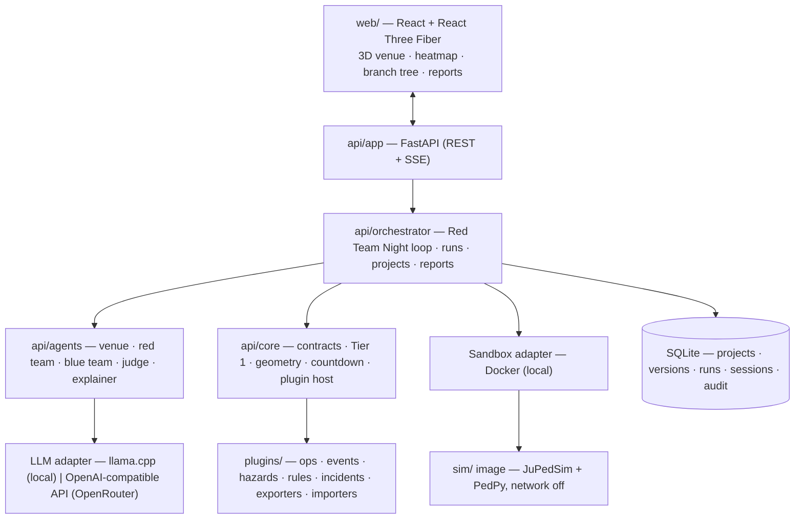

# Architecture

## Request flow: designing a venue from words
1. **Designer** (Nemotron, `api/agents/venue_designer.py`) writes a layout spec (sizes, walls,
   storeys, stairs, exits, headcounts; never coordinates). A solver (`api/core/venue_builder.py`,
   `building_gen.py`, fit-outs from `api/data/fitouts.json`) turns it into exact geometry.
2. **Site** (`api/orchestrator/site.py`): a named place is looked up on OpenStreetMap; the real
   building's size goes back to the designer when the drawing strays from it.
3. **Plan checker** (`api/core/design_review.py`): ways out, walking distance, crowding, fit-out
   and an instant evacuation estimate. Code limits are recorded as notes, never "fixed".
4. **Plan critic** (`api/agents/plan_critic.py`, a model that reads images): looks at the drawn
   plans; an issue counts only if it quotes the description.
5. **Revise** up to `DESIGN_ROUNDS`; the round that best matches the description is kept, and all
   rounds are stored on the venue (`extensions.generated.design_rounds`).
   `api/orchestrator/designing.py` wires these together for descriptions, real cases and Autopilot.

## Request flow: one Red Team Night
1. **Baseline** (Tier 3) in the sandbox; result cached by request hash.
2. **Red team** (Nemotron) reads computed venue facts and 8 similar real incidents and returns
   attacks as JSON (asked for in the prompt, validated with Pydantic, repaired once; at most one
   attack per round may be a scenario script written as code, the rest are menu attacks). Ids are validated; the citation URL is copied from the
   incident record, never from the model. It is aimed at gaps of the **failure map**, a
   quality-diversity archive over hazard kind × where (see [RAINBOW.md](RAINBOW.md)); rule-based
   attacks fill the gaps it misses.
3. **Screening** with the Tier 1 flow model (milliseconds) picks which candidates are simulated:
   aimed gaps first, then other gaps, then attacks that would beat a cell's elites.
4. **Branches**: every picked attack runs as a Tier 2 simulation (a child of the baseline). Its
   severity, computed from the simulated metrics only, decides whether it enters the map.
5. **Blue team** proposes layout edits and operational measures; standard engineering responses
   (one-way flow, new exit) compete. Each fix is simulated as a child of its attack and is kept
   only if it removes the break or improves severity by `FIX_MIN_GAIN` without hurting the
   baseline.
6. Kept fixes form the plan for the next round; the red team must find new weaknesses.
7. **Confirmation**: Tier 3 of the worst attack before and after the fixes.
8. **Judge** writes the summary; every number must match a computed value or the template text
   is used. **Countdown** from the wind hazard (forecast vs stage limit) or a user-set time.
9. Everything streams to the UI as `SessionEvent`s (SSE, replayable) and lands in the audit log.
10. **Let the AI fix it** (`api/orchestrator/improve.py`): the kept fixes become a new version and
    the same test runs on it, until no attack breaks the plan, no fix holds, or `IMPROVE_ROUNDS`.

## Key modules
| Path | Responsibility |
| --- | --- |
| `api/core/extensions/` | Plugin SDK: 12 protocols, registry, hooks, geometry helpers |
| `api/core/tier1.py` | Instant estimate: geodesic grid, min-cost-flow exit plan, fluid queues |
| `api/core/geometry.py`, `venue_ops.py` | Validation and atomic, undoable patches |
| `api/adapters/` | The only provider-aware code (LLM, sandbox, search, weather) |
| `api/orchestrator/session.py` | Red Team Night loop, budgets, events, judge, countdown |
| `api/orchestrator/archive.py` | Failure map: MAP-Elites archive, physics severity score, target cells |
| `sim/plugins/engine_jupedsim.py` | Per-floor JuPedSim runs, stair chaining, events, squeeze/sidestep |
| `sim/metrics.py` | Density grid, hotspots, RSET, binary artifacts |
| `web/src/scene/` | R3F scene: section-cut walls, instanced people, shader heatmap |
| `web/src/panels/` | Inspector, Simulate, Red Team (cards, failure map, tree), Report |

## Data on disk
`state/showtime.sqlite` (projects, versions, runs, sessions, events, audit) · `runs/<run_id>/`
(request, venue, result, `traj.bin`, `density.bin`) · `cache/` (LLM record/replay, weather,
Tavily, demo packs) · `data/` (incident dataset) · `models/` (GGUF weights).

One API process owns `state/` at a time (either `make up` or `make dev`). SQLite runs in WAL
mode, whose shared-memory file is not coherent across the Docker Desktop file share, so host
scripts that need a database (`precompute_demos.py`, `calibrate_tier1.py`) use scratch files
in `cache/tmp/`. Demo packs store trajectories delta-coded at 6 cm (`api/core/trajpack.py`)
and are restored to the normal `traj.bin` layout on import.
